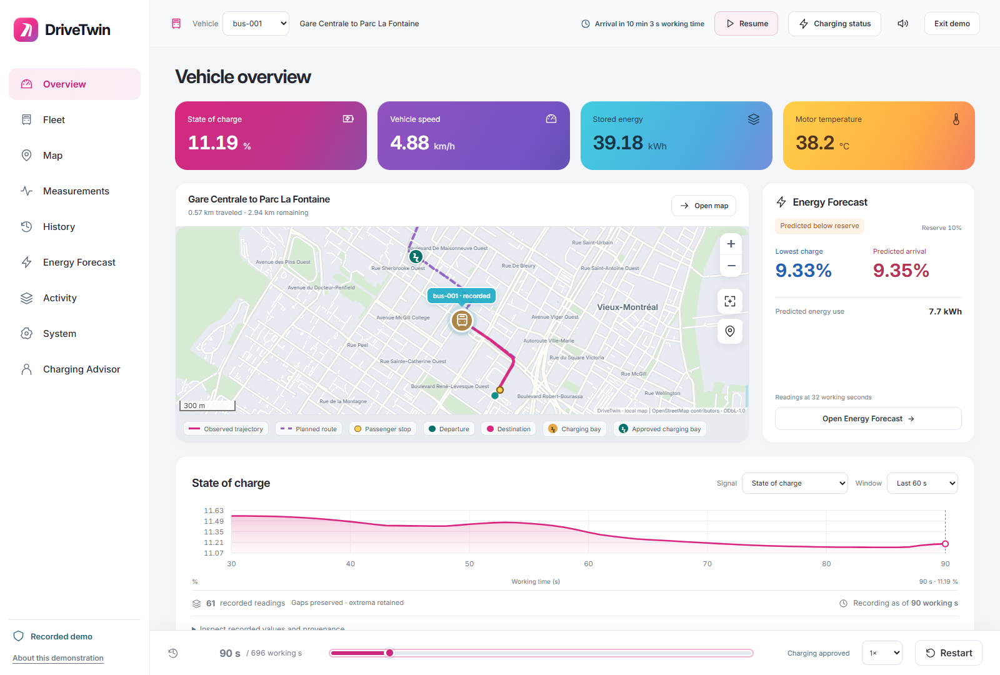
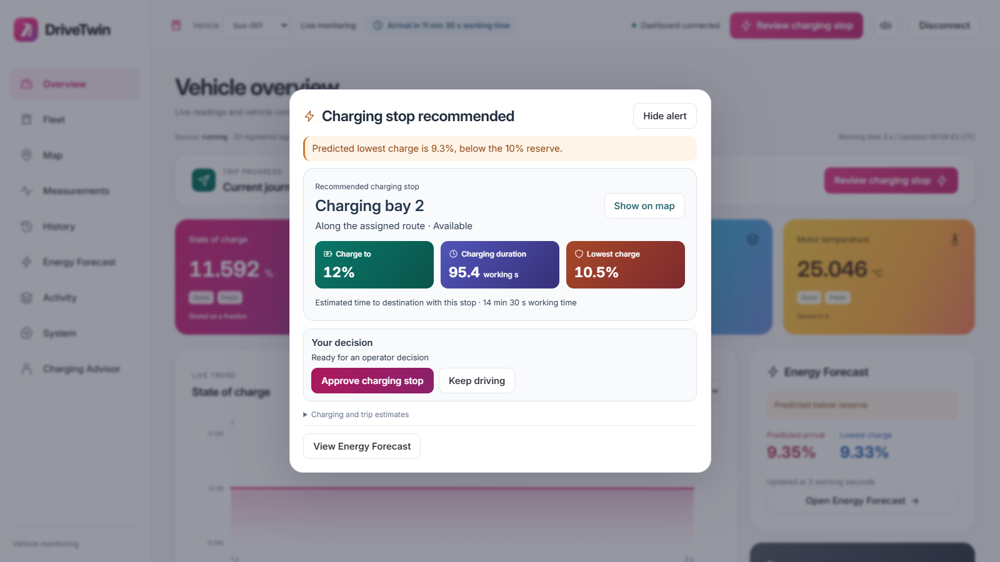
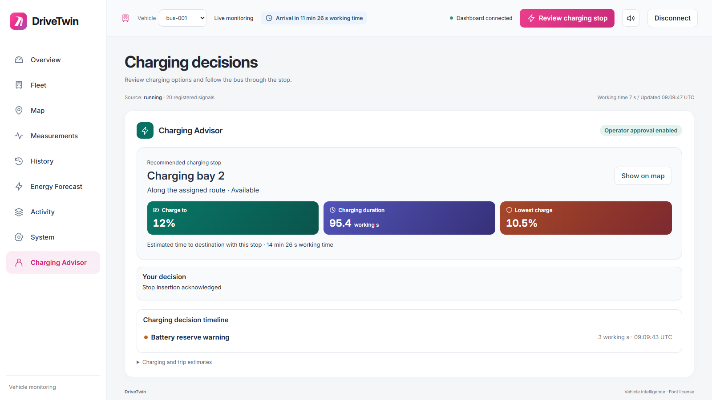
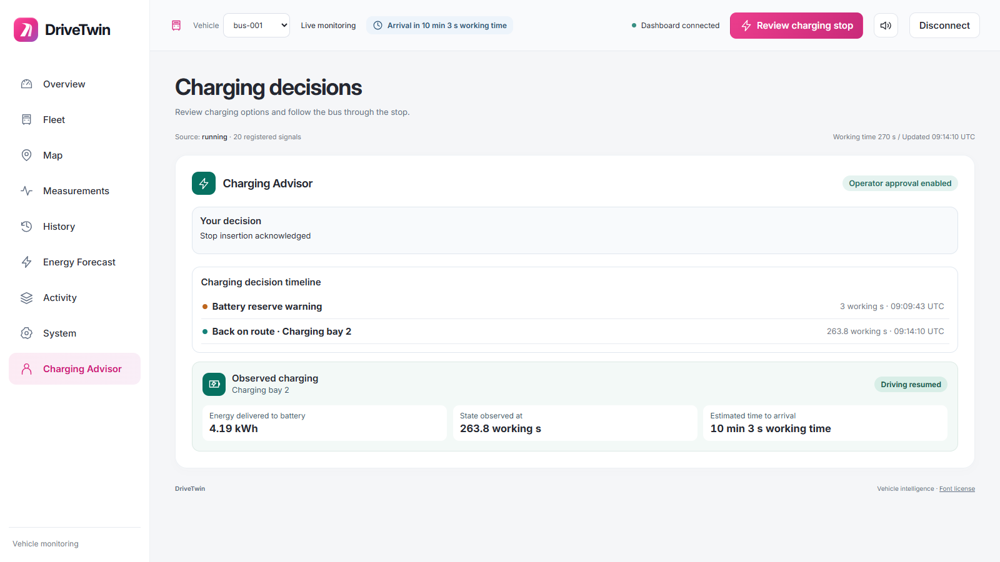
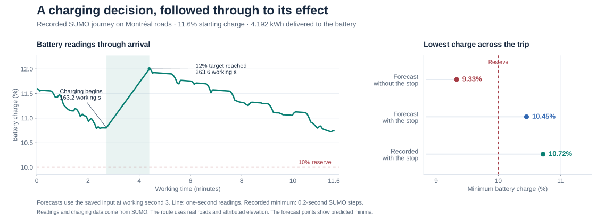
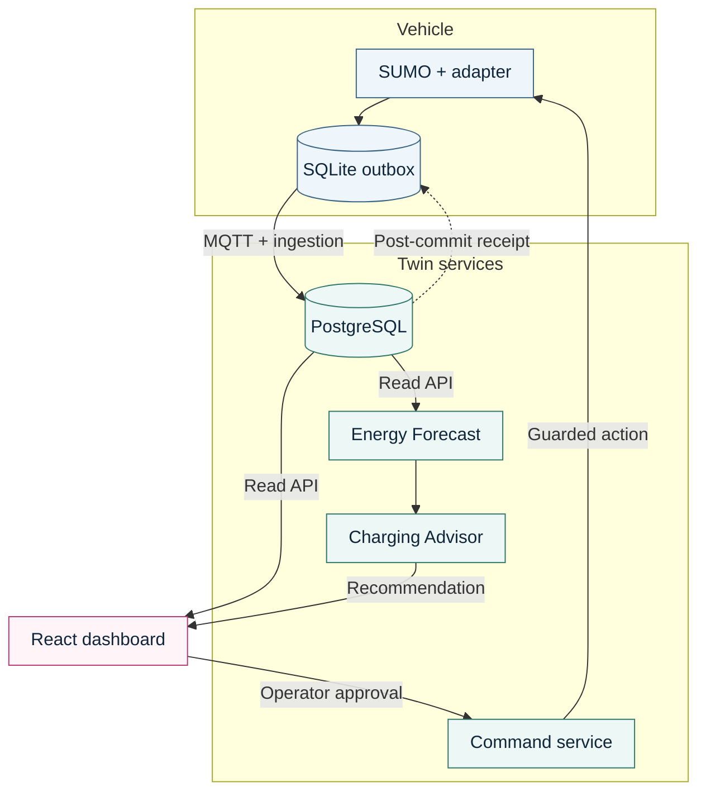

# DriveTwin — A digital twin for electric vehicle telemetry, energy forecasting, and charging control

DriveTwin connects an on-road electric bus to a live monitoring and control system. It forecasts battery use over the remaining route, recommends charging stops, and follows an operator's approval through to measured charging and resumed driving.

The system runs on SUMO with real OpenStreetMap roads and elevation data. It includes the vehicle adapter, data pipeline, prediction services, command handling, and a browser dashboard.

[Architecture](docs/architecture.md) · [Run locally](#run-locally)

The demo runs in your browser and pauses after 30 seconds for your decision.

*Recorded dashboard: route progress, battery state, and the forecast behind a charging decision. [Image details](docs/media/dashboard/README.md).*

## Features

- **Live monitoring.** Track 20 vehicle signals and follow the bus on an interactive route map.
- **Energy forecasting.** Estimate remaining energy use, arrival charge, and where the battery may dip below reserve.
- **Charging decisions.** Review a recommended stop, approve it from the dashboard, and follow the bus through charging and back onto the route.
- **Reliable telemetry.** Buffer readings during a disconnect and deliver them when the connection returns.
- **History and replay.** Compare signals on a shared timeline, replay saved trips, and export readings as CSV or JSON. [Dashboard guide](docs/setup/dashboard.md)

## A charging decision, from forecast to measured result

On the Gare Centrale–Parc La Fontaine route in Montréal, the bus starts at **11.6% charge**. Without a charging stop, its charge is forecast to drop to **9.33%**, below the predetermined **10% reserve**. The advisor recommends a charging bay and a **12% departure target** so the bus can reach its destination above reserve.

| Forecast and recommendation | Operator approval | Measured charging |
|---|---|---|
|  |  |  |

The approved stop delivered **4.192 kWh**. The bus completed the trip in **11 min 36 s**, with a measured minimum charge of **10.72%**.

Screenshots show recorded dashboard states. [Case results](docs/verification/moving-bus-charging.md#connected-montréal-case) · [Capture and chart provenance](docs/media/charging-story/README.md)

## Engineering decisions

- **A reading stays on the vehicle until storage confirms it.** Original telemetry enters a SQLite queue before MQTT delivery. Ingestion returns a receipt only after PostgreSQL commits the observation. If a receipt gets lost and the vehicle resends a reading, ingestion confirms the original without saving a second copy. [Delivery and recovery](docs/engineering/engineering-walkthrough.md#durable-delivery-through-an-outage)
- **Roads and operating conditions are model inputs.** The physics-based predictor accounts for elevation, stops, acceleration, rolling resistance, aerodynamic drag, and equipment demand. The same model serves different routes without map-specific training. [Model design](docs/models/route-aware-energy.md)
- **A recommendation carries no command authority.** After an operator approves a charging stop, the command service checks that the approval covers the requested action, the vehicle data is current, the approval has not expired, and the charging station still meets the command’s requirements. Only then does it save the command for handoff to the vehicle. A saved reservation prevents the same command from being claimed again after an interruption. The system records the vehicle’s acknowledgment separately from the energy actually delivered. [Command-to-effect trace](docs/engineering/engineering-walkthrough.md#charging-approval-through-observed-effect)

## System architecture

[Service topology and permissions](docs/engineering/runtime-topology.md) · [Data flow and failure handling](docs/engineering/engineering-walkthrough.md)

## Technologies used

| Area | Tools |
|---|---|
| Backend and forecasting |  |
| Dashboard and maps |  |
| Storage and messaging |  via Mosquitto |
| Vehicle integration |  with TraCI |
| Packaging and testing |  |

[Full toolchain and dependencies](docs/engineering/toolkit.md)

## Run locally

The guides cover [environment setup](docs/setup/windows-wsl.md) and [how to prepare and run the Montréal example](docs/release/demo.md#prepare-the-local-images).

For the geographic launcher, install the separately supplied scenario bundle, then run **DriveTwin.cmd** to select a route, services, starting charge, and run speed. [Trip and service selection](docs/setup/launch-app.md#trip-and-service-selection)

[Launcher guide](docs/setup/launch-app.md) · [New-map preparation](docs/setup/geographic-energy.md) · [Engineering checks](docs/setup/engineering-checks.md) · [Documentation index](docs/README.md)

## License and data

Original code and documentation use the [MIT license](LICENSE). OpenStreetMap inputs retain ODbL 1.0 attribution, and elevation inputs retain their source terms. [Data sources](docs/data-sources.md) · [Third-party notices](docs/rights/README.md)
