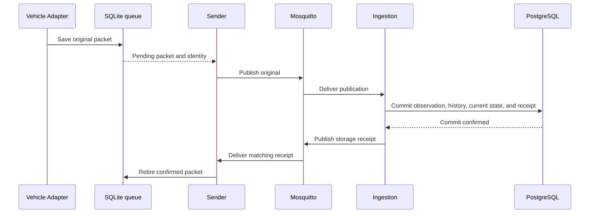
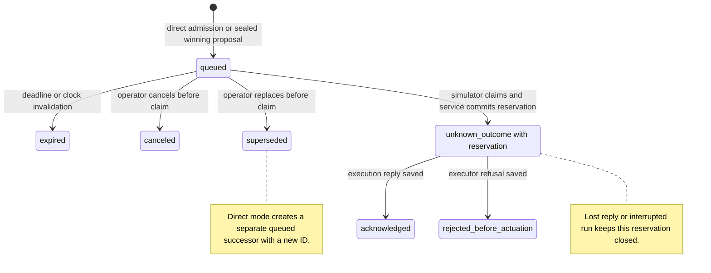
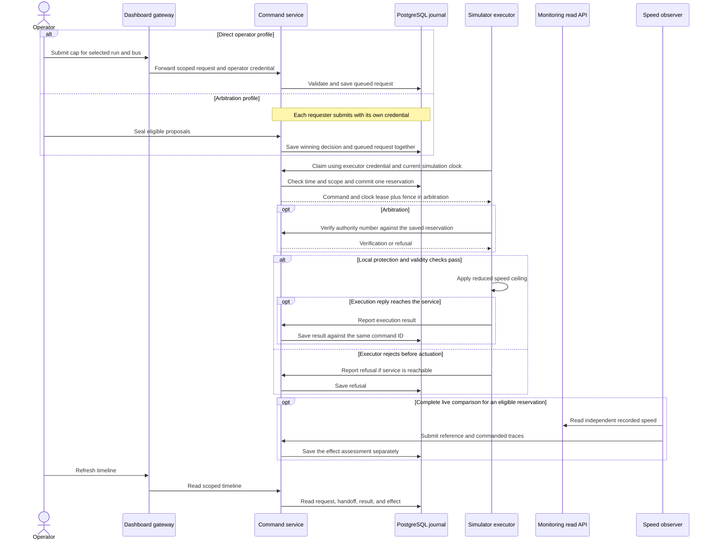

# System architecture and ownership

DriveTwin connects a simulated electric bus to durable monitoring, advisory energy calculations, and guarded commands. The local release runs one bus with separately configured geographic forecasting, speed control, charging, and combined charging/cooling studies. The [capability matrix](release/capabilities.md) separates their evidence and supported profiles. The runtime guide identifies each container, port, and credential boundary. [Runtime topology](engineering/runtime-topology.md) · [System diagrams](engineering/diagrams.md) · [Release scope](release/verification.md)

## Components and storage

| Component | Responsibility | Interfaces |
|---|---|---|
| SUMO and Vehicle Adapter | Advance the simulated bus, sample observations, and apply permitted actions | TraCI to SUMO, shared SQLite queue, HTTP source registration |
| Sender | Retry original queued packets and process matching storage receipts | SQLite and MQTT |
| Mosquitto | Route observations and return receipts by topic | MQTT with scoped producer and ingestion credentials |
| Ingestion | Validate identity and contracts, save observations, and send post-commit receipts | MQTT and PostgreSQL |
| Registry | Register source identity, configuration, and clock state | Internal HTTP and PostgreSQL |
| PostgreSQL | Store original observations, current state, history, and enabled forecast and command records | Separate database roles for writers and readers |
| Monitoring API | Serve current readings, history, map context, health, and forecasts | Scoped HTTP reads and Server-Sent Events |
| Replay API | Serve saved observations with a separate playback clock | Scoped HTTP reads and a separate database role |
| Forecast Controller | Select admitted inputs, prepare assumed plans, run workers, and assemble a forecast | Monitoring HTTP, worker process streams, and Forecast Writer input |
| Energy Worker | Compute one energy estimate in an isolated temporary container | Bounded JSON request and response through process streams |
| Forecast Writer | Append the assembled forecast and its input references | Restricted PostgreSQL role |
| Command API | Admit requests, reserve handoffs, record outcomes, and enforce authority | Operator, executor, and observer HTTP interfaces plus PostgreSQL |
| Charging Advisor | Check station eligibility, forecast approach and onward energy, and rank options | The stationary profile calculates inside the Command API. The moving-bus profile uses an isolated worker launched by the Forecast Controller. |
| Dashboard | Display live and historical data and the optional operator timeline | Monitoring, replay, and configured operator HTTP endpoints |

The Charging Fixture hosts SUMO for the charging demonstrations and publishes regular telemetry through the queue in the combined fixture. Thermal model and fault studies also run as separate Python analysis jobs. [Charging integration](setup/registered-charging-and-dynamic-comparison.md) · [Thermal reproduction](setup/thermal-reproduction.md)

## Uplink transaction sequence

The Vehicle Adapter saves each original message to SQLite before delivery. The Sender retries the same bytes and event identity until it receives a matching application receipt. Ingestion commits the original, derived history, current-state update, and receipt together. A duplicate returns the existing outcome. Older backlog readings enter history while current-state ordering retains the latest eligible observation.

The queue has its own storage and identity checks. The optional bounded-storage mechanisms have separate tests and remain disabled in the release configuration. [Monitoring data path](monitoring-architecture-walkthrough.md) · [Queue storage](setup/queue-on-bounded-storage.md)

## Analysis and read boundaries

The Monitoring API authorizes each bus and recording. It provides bounded history queries, raw exports, static map context, and current snapshots. Live display uses Server-Sent Events, an HTTP connection that streams snapshots. The Replay API has separate credentials, read permissions, and playback state.

The Forecast Controller obtains a minimized authenticated energy-input view, checks the reviewed model and route assignment, and prepares jobs. Each Energy Worker runs with fixed resource limits, disabled networking, and process input and output. The Forecast Writer appends the result through its restricted database role. Saved forecasts retain observations, model identity, assumptions, and unavailability reasons. Current reads recheck source freshness and assignment. [Historical forecast implementation](setup/persistent-energy-forecasts.md)

The current geographic profile explicitly enables the route-aware version, which adds registered route/progress context, prepared elevation geometry, and a durable scheduling controller. The controller runs as a trusted Ubuntu process; its Forecast Writer is a set of restricted database operations within that process. Each numerical job uses a temporary container with a 256 MiB ceiling and no network. A PostgreSQL ownership lock and increasing job identifier prevent duplicate active work and stale completions after restart. Existing monitoring services expose the new version through `/v2/energy-input` and `/v2/energy-forecasts`. The Energy page selects this version only for an enabled assignment. [Route-aware walkthrough](engineering/route-aware-energy-details.md) · [Operating guide](setup/route-aware-energy.md) · [Route-aware qualification](verification/energy-route-aware.md)

The stationary charging configuration reads dedicated departure and station observations and uses its qualified approach model and reviewed road graph. In the moving-bus profile, the Forecast Controller schedules candidate driving legs and charging calculations in the existing isolated worker. The Monitoring API publishes provisional advice. The Command API grants an explicitly approved stop after rechecking the offer, and the Vehicle Adapter reports the observed outcome. [Stationary charging policy](charging-policy.md) · [Moving-bus flow](engineering/moving-bus-charging.md)

## Local command lifecycle

The service saves a reservation before returning a command to the simulator. The reservation means the bus may already have acted. The timeline can therefore show `unknown_outcome` even when a later speed comparison confirms the cap. Pending operator changes and simulator claims use the same transaction lock, so only the first can change which request is handed out.

An admission rejection records an audit event without queueing a command. An executor reply of `unknown_outcome` leaves the state unknown and stores the result separately. The observer can add `confirmed`, `not_observed`, or `inconclusive` to an eligible reservation without changing its execution state. Station intents have their own `intent_recorded` status and no handoff. [Catalog and permissions](command-catalog.md)

PostgreSQL preserves the journal across command service or database restart. If the live simulator stops, a fresh run gets a new identity and queue. The old run and any unresolved reservation stay available for review. [Operator runbook](setup/operator-runbook.md) · [Recovery and transport decision](adr/0056-close-local-command-scope.md)

## Time, data and safety

Every observation carries bus, recording, source, session, sequence, simulated time, observation time, and quality. A source clock distinguishes running, paused, and disconnected states. Replay preserves recorded provenance and uses its own viewing clock. Local command expiry checks simulated time and guarded elapsed time.

Display-latency qualification follows event identity from source readiness to a server witness request sent after the browser verifies the displayed values. The recorded upper bound includes the confirmation request. Resource measurements distinguish application containers, Ubuntu, and the Windows host. [Measurement method](setup/observation-measurement.md)

## Recovery and extension

Database migrations preserve earlier files and supported contract formats. A signal extension changes the reviewed catalog, adapter mapping, and scenario inputs. The shared-data-path proof checks the relevant fingerprints before and after its run.

Recovery checks cover independent service restarts, the five-minute delivery outage, command reservation persistence, sealed history restoration, and the current reader. The local release retains host-memory guards and defers fleet endurance and deployment qualification. [Extension](setup/sensor-and-asset-extension.md) · [Recovery evidence](release/verification.md) · [Compatibility](compatibility.md)
