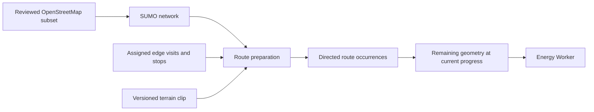

# Route and elevation preparation

The route-aware Energy Forecast uses the assigned roads, their connecting junctions, and elevation along the path. OpenStreetMap supplies the road network. A terrain grid supplies ground height at geographic positions. Preparation produces an immutable route record for the numerical worker.

## Geometry

An occurrence identifies one visit to a road. A loop can visit the same road several times, with different remaining distance and stops. The source's lane-relative position selects the current occurrence and trims its traveled portion. Scheduled stops carry their occurrence, location, and expected dwell. The input must identify completed stops and remaining dwell at a current stop. Passing an uncompleted stop without a plan update makes the forecast unavailable.

Static network preparation retains the internal lanes that connect roads through intersections. It prefers paths with the fewest lane changes. When a route requires a change between adjacent permitted lanes, it constructs a declared smooth path between their centerlines. This is a forward movement assumption. It is recorded as `assumed_lane_change`, including both lane identities. The current implementation supports one adjacent-lane transition on an external occurrence with at least 30 meters of lane length and at most 5 meters of separation. Pinned stop lanes cannot change within that occurrence. Other cases require an explicitly prepared path.

Endpoint gaps up to 2 centimeters can be normalized to remove coordinate rounding; the preparation report counts these changes. Larger gaps fail. Zero-length internal connectors share their neighboring point and add no physical path length. The source's nominal lane length remains separate from the measured shape length, and any proportional position mapping is recorded.

Horizontal length and three-dimensional road length are separate quantities. Grade is signed height change divided by horizontal distance. Preparation preserves intermediate crests and valleys. A trip that returns to its starting height can still include climbing and regenerative braking.

Geographic coordinates determine compass heading. Projected grid axes can be rotated relative to true north. The worker uses geographic bearing between prepared points, or an explicitly declared local east/north frame for synthetic cases. Directional wind cannot silently use an unknown grid orientation.

## Elevation

The first supported public provider is Natural Resources Canada's HRDEM Mosaic terrain product. It uses meters in NAD83(CSRS)/Canada Atlas Lambert, EPSG:3979, with CGVD2013 vertical heights. A coordinate reference system specifies how coordinates correspond to locations; a vertical datum specifies the reference used for height. [NRCan product specification](https://download-telecharger.services.geo.ca/pub/elevation/dem_mne/HRDEMmosaic_mosaiqueMNEHR/HRDEM_Mosaic_Product_Specification.pdf)

The importer obtains a bounded clip, verifies its dimensions and coordinate system, hashes its contents, and caches the bytes and retrieval receipt under ignored `data/downloads/energy-v2/`. The receipt preserves the request, resolution, bounds, rights, and retrieval time. Retrieval time is distinct from the source survey date. A survey date is not inferred from a mosaic catalog timestamp.

Rasterio is the optional Python tool used to read geographic raster files and transform coordinates. It is confined to preprocessing; the Energy Worker uses small numerical route records. Exact Ubuntu CPython 3.12 package versions and wheel hashes are in [the terrain requirements](../../environments/energy-geospatial-requirements.txt), with [dependency notices](../rights/terrain-preparation-dependencies.json).

The maintained tools are:

| Tool | Function |
|---|---|
| `scripts/route_aware_energy/terrain.py` | Request a bounded geographic clip through NRCan's WCS interface, inspect it, and retain its fingerprint and metadata |
| `scripts/route_aware_energy/prepare_route.py` | Read a static SUMO network and assigned mission, expand road connections, transform coordinates, sample terrain, and write route/context provenance |
| `evdt.energy.route_aware.elevation` | Bounded grid interpolation and distance-based geometry sampling |
| `evdt.energy.route_aware.geometry` | Remaining distance, grades, headings, stops, and unavailable reasons |

WCS is a geographic service that returns a requested data region. NRCan plans to phase out this access method and recommends its catalog and cloud-optimized files for longer-term access. The model consumes the prepared record independently of the download method. [Provider access guide](https://download-telecharger.services.geo.ca/pub/elevation/dem_mne/HRDEMmosaic_mosaiqueMNEHR/HRDEM_Mosaic_WCS-WMS_instructions_EN.pdf)

Sampling retains every original road vertex and adds points at a declared spacing. Bilinear interpolation combines the four neighboring terrain cells. Missing coverage remains missing. Ground height cannot establish a bridge deck or tunnel roadway height; flagged structures require a separately verified profile. The original terrain adapter preserves raw samples. The geographic preparer additionally records a 5-meter resampling and a local linear grade fit with a 15-meter radius; raw and processed profiles are retained for inspection. It does not replace terrain with a constant-height profile.

The download limit is 256 MiB, and the decoded grid limit is one million cells. The initial Montréal clip was approximately 1 MB at roughly 10-meter spacing. The prepared route contains 203 road/junction occurrences, 724 vertices, and three assumed lane changes. Its 5.150 km three-dimensional path includes approximately 40.64 meters of ascent and 40.55 meters of descent. These describe prepared geometry, not measured bus energy. The original flat SUMO scenario is unchanged.

## Boundaries

The numerical worker rejects missing elevation, disconnected geometry, ambiguous progress, unsupported direction frames, or grades outside its declared domain. Terrain coverage and roadway accuracy are separate checks. The clip establishes provider access and successful road-coordinate sampling; it does not establish surveyed road grades or forecast accuracy.

NRCan data is provided under the [Open Government Licence–Canada](https://open.canada.ca/en/open-government-licence-canada). Raw terrain and generated route records remain outside the reviewed source distribution. OpenStreetMap road attribution and the existing source receipt remain applicable.

## Geographic road preparation

The [geographic workflow](../setup/geographic-energy.md) combines OSM roads with NRCan ground and surface elevation, or a supplied attributable raster catalog. A two-pass SUMO import simplifies ordinary roads while retaining bridge/tunnel boundaries and their original OSM identities. Straight roads retain the original OSM centerline for surface sampling. Streaming XML processing bounds memory on regional imports.

Ground is the default layer. Bridges use surface data; steep or conflicting returns trigger a recorded comparison of measured ground and surface profiles. Short bridge approaches can interpolate between adjoining measured roadway portals, with a 100-meter limit and an explicit quality label. Connected endpoints that remain more than 2 meters apart are rejected. This processing is a geographic approximation whose trace is retained; it is not a surveyed road-grade claim.

A bridge entrance can contain canopy returns in the surface raster and a ground dip below the deck. The layer selector compares the measured ground and surface samples for continuity. A bridge-end correction is limited to the final 10 meters and requires a stable, measured ground approach plus an interior bridge-surface sample. Its gradient remains bounded; the rest of the deck is unchanged. Raw samples, selected layers, endpoint corrections, and grade fitting have separate receipts. Tests cover both a valid portal correction and rejection of an unstable approach.

The source fingerprint is captured before preparation and checked again before the completion receipt is written. Each numerical request binds the resulting geometry bundle. The same preprocessing rules apply across all journeys.
