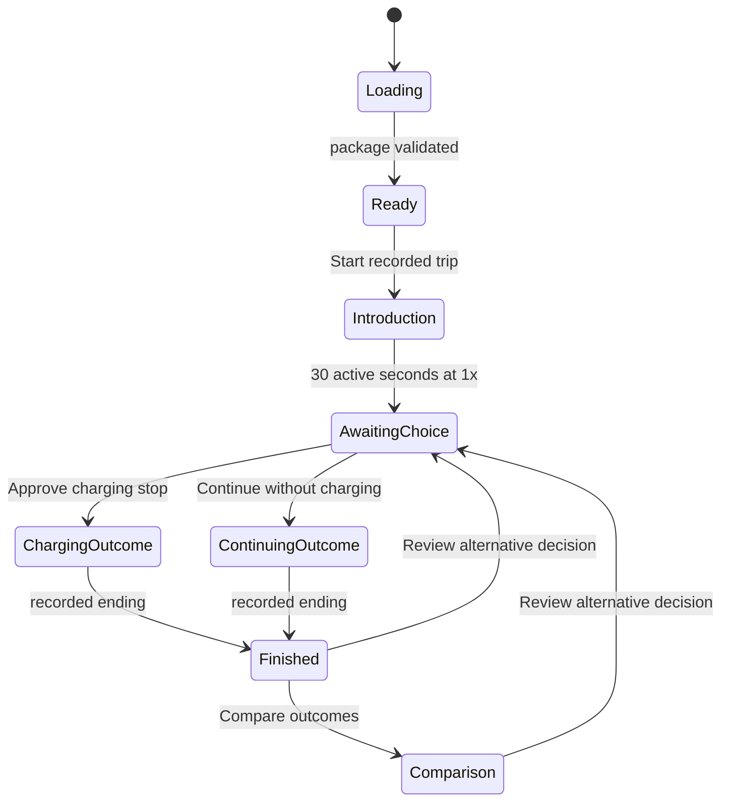

# Browser demonstration with one charging decision

**Status: Public demonstration verified.** Both November 17 matched recordings and their dependent export, actual-case browser checks, privacy review, and static packaging passed. The [Cloudflare demo](https://drivetwin-demo.pages.dev/) subsequently passed anonymous HTTPS verification on November 18, 2026 (UTC). [Current verification](../verification/browser-demo.md) · [Operating guide](../setup/browser-demo.md). The visitor experience below is implemented: one prepared Montréal trip, one decision point, and two recorded outcomes, with no account, installed simulator, database, or command credentials in the visitor's browser.

## Visitor experience and timing

1. Open the link to a short trip introduction. Load and validate the complete case, map, and both outcomes before enabling **Start recorded trip**. The case identifies its route, fixed starting charge, recorded services, and simulation basis.
2. **Start recorded trip** opens the dashboard and starts a 30-second introduction at **1×**. Thirty working seconds therefore take approximately thirty real-life seconds of active playback. Loading, a paused player, and time in a hidden tab do not consume the introduction. A small countdown announces the approaching decision. Navigation and inspection remain available; playback speed and seeking ahead unlock after the decision.
3. At **working second 30**, clamp the playhead and pause automatically. Open the charging decision over whichever tab is visible. Show the predicted reserve risk, recommended bay, charge target, and recorded estimates. Gate reserve/charging pop-ups and their sounds until this point; inline readings and forecasts remain accurate during the introduction.
4. Offer exactly two actions: **Approve charging stop** and **Continue without charging**. There is no default action, expiry countdown, or decision deadline. Show **Playback is paused.** The visitor may hide the window to inspect the dashboard; a persistent **Make charging decision** button reopens it. Playback remains held until a choice is made.
5. Selecting an action selects that recorded outcome and resumes playback. A persistent label identifies the chosen outcome. Choosing to charge first shows the recorded handoff and approach; energy transfer begins only at its recorded time.
6. After the outcome finishes, show its measured result and offer **Compare outcomes**, **Review alternative decision**, and **Restart recording**. Trying the other decision returns to the same checkpoint with the branch-specific state cleared. Restart restores the full introduction.

The 30-second rule is a demonstration playback rule. It does not change the production forecast interval, advisor startup-delay options, station leases, or operator authorization rules. The actual simulation acknowledgment may occur after working second 30 when the executor can safely apply the selected stop.

## Initial scenario and evidence

Use Gare Centrale–Parc La Fontaine with reviewed OSM geometry, attributed elevation, passenger stops, vehicle properties, and a compatible reviewed charging assignment. Start with the existing low-charge example at 11.6%; freeze the exact inputs after confirming that the recommended bay remains reachable at the checkpoint. Select one reviewed bay for this demonstration. An actual off-route stop retains its recorded detour and rejoin geometry.

Prepare a matched pair with the same inputs, SUMO version, seed, numerical model, services, station scenario, and predecision behavior:

| Outcome | Action after the shared checkpoint | Required recorded continuation |
|---|---|---|
| Approve charging stop | A scoped qualification actor submits the reviewed approval through the existing Command API | Guarded handoff, real approach, station transfer, target reached, resumed driving, and trip completion |
| Continue without charging | No charging approval is submitted | Continued driving, any measured reserve crossing, and the actual trip ending |

The earlier [Montréal case](../verification/moving-bus-charging.md#connected-montréal-case) acknowledged charging at working second 7. It cannot supply an unchanged shared prefix for a decision at second 30. Its 4.192 kWh result and arrival time remain historical results; the new demonstration receives its own measured outcomes.

### Verify the shared history

The retained matched recordings supply the current case after the longer prefix is independently verified. For a new case, record two fresh, sequential simulations rather than adding simulator restart or state-restoration behavior. Require equal physical and scenario histories through working second 30: the twenty signal values, units and quality, working timestamps, route and lane progress, passenger-stop state, battery state, station scenario, and relevant declared conditions. Compare original numeric values using a canonical representation. A mismatch requires diagnosis before accepting the pair.

Run IDs, event IDs, sessions, wall-clock timestamps, and controller scheduling metadata naturally differ between runs. Keep these originals private and record the explicit identity mapping. Compare the domain state separately from those identities; never broaden a tolerance to disguise a physical difference. There must be no charging grant or applied stop in either run before the checkpoint.

Export one validated common prefix and the two suffixes. Check position, speed, charge, route occurrence, and stop continuity at each join. The charging decision must be the first causal intervention. Preserve actual handoff, transfer, and departure times; do not retime the old charging recording to make it fit.

The boundary is the recorded state at second 30 before the intervention. An acknowledgment sharing that working timestamp belongs to the chosen suffix, ordered after the decision. The capture protocol must retain that event ordering explicitly; timestamp equality alone cannot place a command in the common prefix.

The intended contrast is charging with reserve versus continuing below reserve. The recordings establish whether that contrast occurs. If a scenario is unsuitable, review its declared starting configuration before freezing another pair. Keep the model fixed, retain unsuccessful attempts, and identify this as demonstration preparation rather than a new reserved accuracy evaluation.

## Dashboard scope

Reuse the dashboard shell, floating ribbon, summary cards, measurement table, fleet vehicle panel, forecast comparison presenter, map renderer, switches, and legend. A static recording adapter supplies past observations and recorded results; it imports no live polling or command hooks. The ribbon includes playback pause/resume, arrival estimate, charging status/review, sound, and Exit demo. About opens a dialog. Overview places four compact readings above the map and forecast, with trip distance in the map heading and the selectable trend below. Playback state and the approaching decision appear in the fixed controls instead of repeated source/coverage cards. During charging, the forecast area presents measured charging. System summarizes the recording and states once that live health instrumentation was not captured. The original 20-second candidate and capture protocol remain historical evidence; the current 30-second prefix is verified from the same original recordings before their first intervention.

| Area | First demonstration behavior |
|---|---|
| Overview and measurements | Twenty recorded signals, quality and recency relative to the playhead, selectable trends, and trip progress |
| Map | Local OSM streets, planned route, past trajectory, departure, destination, passenger stops, charging bay, and actual detour where applicable |
| History | Searchable grouped signal selection without a five-chart cap, recorded intervals, shared cursor, and CSV/JSON export of the visible interval |
| Energy Forecast | Recorded estimates and their assumptions, input cutoffs, model references, reserve warnings, and forecast history |
| Charging Advisor | The single two-option decision, followed by recorded approval, approach, transfer, and resumption states |
| Activity | Events available by the playhead, bound to the current outcome |
| Fleet and System | One recorded vehicle, compact recording coverage, expandable architecture reference, and an explicit explanation of uncaptured instrumentation |

Keep **Recorded demo** visible on every tab. Playback pause is distinct from a recorded source pause or connection failure. Browser recency must not imply a current vehicle connection. Use a single optional alert chime following the Start gesture and provide mute; the decision remains understandable without sound.

The Overview preview opens near the planned departure at zoom 15 and follows the first valid observed positions. Fitting the route or dragging the map suspends following; the Follow vehicle control restores it. The full Map tab retains its route overview by default. The local Montréal backdrop places names using measured text bounds in screen coordinates, gives place names priority, hides minor street labels at lower zoom levels, and recalculates on pan, zoom, resize, or font readiness. Labels avoid one another and map controls.

After the choice, provide pause/resume, 0.5×, 1×, 2×, 5×, 10×, and 20× playback, seeking, and event navigation. Before the first choice, seeking cannot bypass the introduction or enter a suffix. Seeking backward after a choice retains that selected outcome until **Review alternative decision** or **Restart recording** is used.

Starting charge, trip inputs, and recorded service configuration are fixed for this case. Backend restarts, arbitrary route/speed commands, new model calculations, and separate thermal studies are outside this browser demonstration. Explain unavailable operations where useful rather than displaying controls that imply live execution.

## Package and application design

Use a separate `demo.html` entry and `vite.demo.config.mjs`, with an independent `dist-demo` build. Share presentational components and pure replay utilities where their contracts fit. Preserve the existing live dashboard, authenticated replay API, and their defaults.

Implement a recording adapter with a small explicit interface for catalog, frame, history, map, forecasts, events, and local choice selection. Presentational views receive these values directly. Live fetch hooks, command-service polling, and operator credentials must not enter the demo dependency graph. A visitor choice changes local playback state only; it is never sent to a command endpoint. Do not ship the HTTP interception technique used for private screenshot preparation.

The existing [replay model](../../apps/dashboard/src/features/replay/replayModel.ts) supplies useful clock, projection, history, and trajectory behavior. Its authenticated package preserves original packet bytes and private identities. Introduce a separate versioned public demonstration contract instead of weakening `verifySession`, relabeling sanitized data as original packets, or changing the telemetry contracts. [Replay boundary](../adr/0015-isolated-recording-replay.md)

### Public case contract

The proposed `branched-trip-demo/1.1.0` manifest contains:

- Case identity, package version, source/model versions, simulation label, fixed configuration, and attribution.
- A signal catalog, map geometry, initial presentation state, and one common timeline through second 30.
- One decision definition with exactly the `charge` and `continue` outcomes and a recommended station reference.
- Separate suffixes containing readings, route progress, forecasts, advisory states, command-stage observations, and measured effects.
- Input cutoff and presentation-availability time for each forecast or advisory record, so a result cannot appear before it was available.
- Actual end conditions and measured summaries for each outcome, plus content fingerprints and resource bounds.

Keep city names, route geometry, signal data, station names, outcome length, and result values in the package. Avoid route-specific component logic. Later cities can add qualified case packages without introducing a generic decision-tree engine now.

Use an explicit export allowlist and stable public identifiers. Preserve values, units, quality, working-time order, and model/input relationships. Original packets, runtime IDs, credentials, machine paths, raw diagnostic fields, and complete job requests stay private. Public fingerprints check the exported bundle's consistency; private provenance binds it to the original artifacts. Rewritten data must not claim an original packet fingerprint.

Initial bounds are 10,000 combined observation frames and 16 MiB of serialized case data across the common prefix and both outcomes. Measure actual bundle size and browser loading during preparation. Local route-corridor geometry and bundled notices avoid a dependency on external map tiles. Validate all case files before Start, and make loading failures retryable without advancing the clock.

## Playback and decision state

Use monotonic browser elapsed time, pausing on a hidden tab or a long scheduling interruption. Clamp advancement at the checkpoint and at recorded endings. A held decision has unlimited real-life thinking time while working time stays fixed. A double-click or delayed callback can commit only one choice. Branch changes cancel obsolete loads, advance the presentation generation, and clear branch-specific caches, event rows, forecasts, alerts, and history.

Observed movement, history, delivered energy, and events are filtered by the selected outcome and playhead. Known planned roads and stops may be visible ahead. Forecasts remain predictions and retain their input and availability times. Outcome comparisons become available after a selected outcome finishes and the visitor chooses **Compare outcomes**. A static package is downloadable by its visitor; chronological presentation is a UI rule, not confidential-data access control.

## Acceptance checks

| Concern | Required result |
|---|---|
| Timing | Loading consumes no introduction time. At 1× the decision opens once at second 30, including when a browser frame crosses the boundary. Pause, hidden tabs, and sleep cannot skip it. |
| Decision stability | Either choice is available indefinitely at the held checkpoint. Hiding the window keeps the persistent action. Repeated clicks, refresh callbacks, and keyboard input cannot commit conflicting choices. |
| Evidence continuity | Both suffixes match the validated common state. No approval or charge transfer predates the checkpoint. No fabricated charge, shifted events, future readings, or cross-branch state appears. |
| Selected outcome | Charging shows actual application, approach, transfer, and resumption; continuing shows its actual reserve behavior and ending. Results are calculated from recorded observations rather than copied from the older README case. |
| Replay correctness | Forward and backward seeks, every supported speed, restart, retry, outcome switching, gaps, invalid readings, forecast availability, and event links preserve the chosen branch and time. |
| Interface | All twenty signals are inspectable; History selection remains uncapped within that catalog. Decision controls, tooltips, focus, Escape behavior, map layers, units, and legends work with keyboard and mouse. |
| Isolation and packaging | A clean browser can complete both choices with static assets alone, no sign-in and no operational API traffic. Malformed versions, broken hashes, missing files, oversized data, and invalid choice references fail clearly. |
| Privacy and compatibility | The exported source and static build pass the privacy and secret review. Original recordings and failed attempts remain private. Existing live/replay tests affected by shared components, builds, and permission boundaries still pass. |

The [demo verification record](../verification/browser-demo.md) documents the matched recordings, both playback outcomes, and hosted verification.
