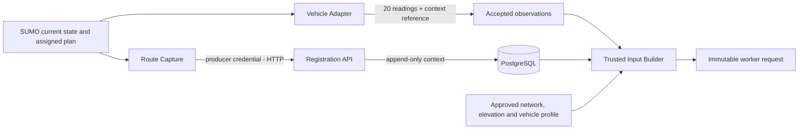

# Route-aware forecast inputs

The source supplies current route progress alongside its twenty scalar measurements. The trusted input builder checks the registered source, current clock, observation reference, approved network, and prepared route before creating a worker request. The worker receives the admitted snapshot and explicit forward assumptions.

## Interfaces

| Interface | Contents and authority |
|---|---|
| `POST /v2/energy/route-contexts` | Producer-only endpoint on the existing private Registration API. Credential scope must match run, asset, and source. Maximum body: 65,536 bytes. |
| `source-route-context/2.0.0` | Source epoch/session, registration fingerprint, working time, observation time, ordered assigned roads, remaining stops, lane progress, and observed charging state. |
| Observation annotation `energy_context` | SHA-256 reference to the canonical registered context. It binds the separate metadata to the accepted observation without adding or renaming a scalar signal. |
| `m_route_contexts` | Immutable contexts with one context per source session and working-time point. Exact duplicate submissions are idempotent. |
| `PreparedPlan` | Approved network geometry and elevation, exact plan revision, external-to-expanded occurrence mapping, and matching stop locations/dwell. |
| `build_request` | Host-only projection of accepted database records. It cannot establish authentication by itself and is not a browser write interface. |

Route Capture is enabled by the Vehicle Adapter's `--route-aware-energy` option. Existing invocations leave it disabled. Registration precedes context publication; a running clock at the same working time precedes each context. Scalar delivery retains its durable queue and normal acknowledgment path.

## Admission

The builder requires the active source epoch/session and a current running clock. Observation and context working time must match. The version 2.1 trusted snapshot also includes the authenticated context at the latest clock step. It selects the newest complete observation/context pair at or before that step. The live geographic profile allows up to 30 working seconds of delivery lag. It requests the first forecast on admission and schedules regular forecasts 120 working seconds apart. Both contexts must retain the same route and remaining-stop revision, source identity, and registration. A new plan or charging state blocks the older pair.

Real-life observation, receipt, both contexts, and heartbeat ages each obey the existing freshness ceiling (5 real-life seconds). The actual source clock remains unchanged in the snapshot and determines forecast working age. A selected reading keeps its original working time and observation identity. Missing current context, pause, finish, disconnection, excessive lag, or stale data makes the input unavailable. Version 2.0 snapshots retain their exact-step requirement because they contain no separate current-plan proof.

This selection accommodates independent delivery of source-clock updates, route metadata, and scalar readings. The live forecast lifetime covers the refresh interval and worker deadline. At 0.5× the real-life lifetime covers the longer wall-clock interval. Fresh source admission and unchanged route identity still govern use of each forecast.

Required readings use their registered units, good quality, and observation provenance. Zero speed is valid. Battery temperature is required when the selected battery curves need it; otherwise it remains optional. No battery capacity is inferred by dividing energy by charge.

Charging or unknown charging state suppresses driving forecasts. Route Capture reads current external charging energy and charging-station presence. SUMO's `NULL` station marker means no station. It does not use hidden battery capacity, future speed, future traffic-light phases, or realized trip energy. [SUMO electric model](https://sumo.dlr.de/docs/Models/Electric.html) · [Vehicle retrieval interface](https://sumo.dlr.de/docs/TraCI/Vehicle_Value_Retrieval.html)

Changed roads or remaining stop plans produce a different plan revision. Old prepared geometry cannot satisfy that revision. Preparation validates bus connectivity, preserves internal junctions, and checks that elevation processing leaves identities, speed limits, and stop assignments intact. A route with an unprepared current lane, missing height, or inconsistent stop remains unavailable.

## Source-adapter limits

The adapter resolves upcoming stops from their order and positions along the assigned roads. A reached stop anchors its location to the source's current lane and route index. The adapter accepts the inferred placement only when both the earliest and latest ordered placements agree. A remaining ambiguity requires an explicitly indexed assignment.

The automatic projection supports duration-based stops. Triggered departure and absolute-until departure rules require an explicit supported departure plan. SUMO reports remaining dwell directly after reaching a stop. The adapter keeps the scheduled dwell in the plan while that countdown advances. A change in expected release time can update the plan. Unsupported context makes that observation unavailable for forecasting. [SUMO 1.28 stop data](https://github.com/eclipse-sumo/sumo/blob/v1_28_0/src/libsumo/Vehicle.cpp#L3260-L3290)

## Verification boundary

Offline cases cover source scope, timestamp and working-time checks, charging, units, quality, context binding, revisions, junctions, stop semantics, producer authorization, request size, and scalar queue/plant compatibility. Database migration/permission checks and a connected source run are part of the product-integration and connected-verification checkpoints. The original telemetry schemas, signal catalog, frozen models, and consumed evaluation records remain unchanged.
