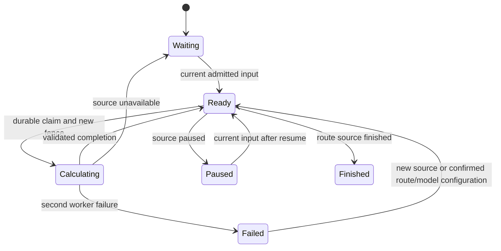

# Forecast update lifecycle

The controller calculates from the first valid snapshot and responds to route or material condition changes. The launcher uses a 120-working-second refresh interval. The original qualification policy uses 30 working seconds. One calculation can run at a time. Waiting work holds the newest snapshot, so an accelerated source does not build a queue of obsolete forecasts.

## Triggers and time

| Event | Behavior |
|---|---|
| First admitted snapshot | Calculate immediately; no fixed 120-working-second wait. |
| Periodic update | Request the latest snapshot after the configured working-time interval from the active or accepted cutoff. Count skipped periods when coalescing. |
| Route or vehicle/policy revision | Invalidate incompatible guidance and prioritize the new configuration. |
| Material condition impact | Require five working seconds above the threshold, with a ten-working-second cooldown. Reset the latch below half the trigger threshold. |
| Reserve classification change | Request immediately. |
| Pause, stale data, charging, or missing required input | Suppress current guidance and pending calculations. Preserve immutable history. |
| Resume or new source epoch | Re-admit state and calculate once from the latest snapshot. |
| Finished source | Stop scheduling driving forecasts. |

The initial impact threshold is the larger of 0.25 kWh and 2% of predicted remaining battery draw, or a charge change of 0.5 percentage points. The impact estimator supplies a screening estimate; it is separate from the full numerical forecast. Confirmed condition changes invalidate results based on the preceding condition set while waiting for a due calculation.

Working time controls cadence, persistence, cooldown, and the forecast's working-time age. Monotonic real-life elapsed time controls the 30-second worker deadline. Monotonic means a clock that measures elapsed time without following corrections to the calendar clock. UTC timestamps support audit and freshness; a calendar-clock rollback cannot make a worker completion current.

Current guidance requires fresh present-state admission, matching source, route, profile, and conditions, and forecast ages within both configured limits. The launcher age limits cover its 120-working-second cadence plus the worker deadline, with a longer real-life allowance at 0.5×. The original qualification policy used 60 working seconds and 90 real-life seconds as age limits. The five-real-life-second sensor deadline applies to the latest source check.

## Durable ownership and recovery

The existing PostgreSQL service stores scheduler snapshots and an append-preserving job history. A session advisory lock permits one controller to own workers globally. The lock remains held across transaction commits and disappears when its database connection closes. Each claim uses a new monotonically increasing database sequence value as its fence and a distinct controller owner identity.

On a normal stop request, the Forecast Controller finishes its current database transaction before shutting down. If a claim was committed but its worker did not start, the controller records the claim as incomplete. An active worker is cleaned up and verified before the claim is released. A hard interruption is reconciled from the durable job and scheduler records at restart.

Claims record the exact immutable input, generation, ownership, and audit lease. In-process deadlines use the monotonic clock. Stored UTC lease timestamps are audit data and do not authorize a second worker while another controller retains the session lock.

A replacement controller first inspects recorded running claims and confirms cleanup of their owned workers. It closes interrupted jobs as incomplete, clears process-local clock state, and waits for fresh admitted input. It never resumes an old monotonic lease. New work receives a new fence. A worker result with an old owner or fence is rejected.

Completed claim identities and outcomes cannot be changed or deleted. Repeating the same terminal write is idempotent. A different outcome under the same claim is rejected. The forecast role can update its lifecycle tables; it receives no additional telemetry, assignment, command, or replay write rights.

One failed worker may be retried after a bounded backoff and a fresh snapshot. A second failure leaves a stable failed state. Ordinary new packets and missed periodic intervals do not reset that budget. A confirmed route/model configuration or new source scope creates a distinct calculation context. Failure of an already superseded worker does not consume the new context's retry budget.

## Verification

Deterministic-clock tests cover first-ready/periodic scheduling, coalescing, pause/resume, restart reconciliation, source epochs, route and condition changes, materiality persistence, hysteresis, timeout, UTC rollback, retry exhaustion, and obsolete completion. The isolated database check verified actual PostgreSQL global ownership, migration idempotency, append-only permissions, restored interrupted-claim fencing, and one restricted worker. The one-bus connected fixture verified first-ready and periodic forecasts, stale display, source recovery, and reassignment. [Current evidence](../verification/energy-route-aware.md)
