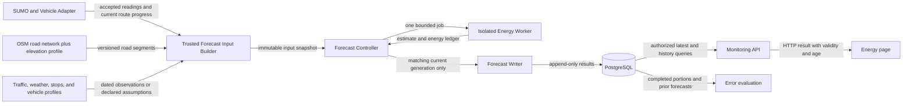

# Route-aware Energy Forecast

This design records the separation of route geometry, observed vehicle state, forward assumptions, and the numerical worker. For current settings and verified behavior, see the [operating guide](../setup/route-aware-energy.md), [model card](../models/route-aware-energy.md), and [qualification record](../verification/energy-route-aware.md).

The Energy Forecast combines the latest accepted observations with the remaining roads, elevation, expected movement, passenger stops, and equipment demand. It reports arrival charge, the lowest predicted charge, energy use by cause, input age, and assumptions. Vehicle parameters are separate from the road network so a new map can use the same model.

## 1. Outcome and scope

### Required outcomes

1. Produce forecasts at valid working-time cutoffs throughout an assigned trip, including before 120 working seconds.
2. Calculate a remaining route from current progress and authoritative route revisions. Retain turns, repeated edges, scheduled stops, and dwell time.
3. Account for acceleration, road grade, rolling resistance, aerodynamic resistance, conversion losses, auxiliary demand, and bounded regenerative braking.
4. Use observations to initialize current state and characterize recent conditions. Use explicit forward assumptions for future segments.
5. Refresh periodically and on meaningful changes without duplicate jobs, unbounded queues, or publication of obsolete-route results.
6. Support independent vehicle profiles and route inputs. Demonstrate transfer to new route families without route-specific fitting.
7. Record input quality, provenance, assumptions, model version, and availability reasons for every result.
8. Preserve permission boundaries, historical forecasts, immutable observations, numerical accounting, and original evaluation claims.
9. Deliver reproducible configuration, operating instructions, tests, a concise introduction, a detailed model guide, and an honest qualification record.

The delivery is a production-oriented local simulation implementation. Real-vehicle accuracy, public deployment, fleet capacity, and autonomous charging qualification require separate evidence. An implementation-complete status does not substitute for a pending integration or accuracy gate.

### Explicit scope decisions

| Item | Decision |
|---|---|
| New evaluation | Create a separate route-aware study, independent inputs, criteria, and consumed-evaluation records. Original reserved outcomes cannot become new holdouts. |
| Vehicle authority | SUMO continues to own movement and battery state. Forecast results never modify either. |
| Charging Advisor and control | Retain their existing qualified models and behavior. Record a future consumer interface for route-aware forecasts. Do not promote the new model into automatic dispatch. |
| Dashboard | Connect the new result lifecycle to the existing Energy view with the minimum necessary version, age, status, and assumption presentation. Preserve all nine tabs and twenty measurements. |
| External data | Use public, attributable, account-free sources. Cache inputs locally. No paid service, new account, or embedded API credential. |
| Host configuration | Keep Windows PowerShell, the current WSL launcher, existing Docker Engine, and host-memory safeguards. No global setting changes, restarts, or application closures. |
| Overnight work | Routine implementation, focused checks, and bounded one-bus qualification are authorized by the current request. Continue independent work if a check requires unavailable resources. Record remaining manual checks together. |
| Publication | Meaningful local commits after privacy checks. No upload, remote configuration, or public-history change. |

## 2. Improvement inventory

Every row below needs implemented behavior, a declared unsupported path, and a focused test. Optional input availability is distinct from implementation status.

### Build into the first route-aware model

| Capability | Implementation | Required evidence |
|---|---|---|
| Remaining route | Ordered directed edge/lane occurrences, position within the current occurrence, connected geometry, distance, speed limits, headings, and stop plan. Resolve repeated edges and junction transitions. | Known-distance routes, loops, partial edges, turns, route revisions, and ambiguous-position rejection. |
| Elevation and grade | Enrich road geometry with a versioned elevation profile. Calculate signed grade in travel direction and preserve vertical datum, resolution, gaps, and structure flags. | Uphill/downhill analytical cases, reverse direction, intermediate hills with equal endpoint elevation, missing heights, bridges, and tunnels. |
| Forward movement | Construct continuous acceleration, cruise, braking, and dwell intervals using road limits, declared comfortable limits, planned stops, and admissible traffic summaries. | Distance closure, continuous speeds, stop placement, bounded acceleration, short edges, and unreachable target-speed handling. |
| Different forecast horizons | Use accepted local conditions near the bus. Use declared road-class/route plans farther away with assumption age and coverage. | A long journey cannot become a repeated copy of the last minute; horizon transitions remain continuous. |
| Energy ledger | Track draw, recovery, rejected recovery, equipment demand, minimum charge, capacity constraints, unserved demand, and arrival state. | Independent analytical tests and numerical convergence with conservation and bounds. |
| Vehicle profile | Separate declared mass, capacity, geometry, resistance, efficiencies, and power limits from route data. Include units, version, source, and supported domain. | Same vehicle on multiple routes; separate vehicles on one route; invalid profile rejection. |
| Live state | Read registered source identity, charge, speed, position/progress, equipment draw, and input quality from trusted views. Use energy and distance history for comparison and recent-use reference. | Valid zero, missing fields, stale data, source restart, mixed identities, and charging transitions. |
| Traffic, detours, and stops | Consume currently available traffic summaries and confirmed plan changes. Update expected movement and dwell. Unknown future incidents remain unknown. | Slowing traffic, sustained queues, changed stops, confirmed detour, and out-of-order route events. |
| Scheduling | First-ready calculation, 30-working-second cadence, material-event refresh, coalescing, one active calculation per bus, deadlines, recovery, and obsolete-result rejection. | Deterministic clocks, overlapping triggers, pauses, jumps, restarts, stale completion, and duplicate writes. |
| Traceable outputs | Store energy by cause, planned distance/duration, arrival and minimum charge, initial state, assumptions, freshness, and validity. | Reproduction from the saved input, stable identity, role checks, and understandable unavailable states. |

### Add next and measure separately

An ablation is a comparison that changes one feature while keeping the other inputs fixed. Use ablations to measure whether each addition improves the appropriate estimate and how much execution cost it adds.

| Factor | Implementation | Qualification boundary |
|---|---|---|
| Directional wind | Normalize wind to an east/north velocity vector, resolve it against each segment heading, and calculate longitudinal drag from relative air velocity. Include source age, height/exposure assumptions, and gust treatment. | Analytical headwind, tailwind, crosswind, zero wind, and route-reversal tests. Independent weather-aware reference required for accuracy claims. |
| Ambient conditions and air density | Accept temperature and pressure with units and provenance. Calculate density when both are credible; otherwise use a declared profile value. | Formula checks, missing/stale values, bounded domain, and separate drag sensitivity. |
| Heating, ventilation, and air conditioning (HVAC) | Prefer observed aggregate auxiliary power for the near horizon. Allow a declared temperature/setpoint and dwell-dependent load model for later segments. Distinguish total auxiliary power from HVAC components. | Stationary consumption, changing ambient conditions, dwell loads, and no double counting. Synthetic coefficients remain labeled assumptions. |
| Passenger/load variation | Support a declared loaded mass or an accepted occupancy/mass feed and scheduled changes at stops. Preserve vehicle mass limits and source confidence. | Kinetic/grade/rolling sensitivity and load changes at the correct route occurrence. No invented passenger count. |
| Battery temperature, usable capacity, and power acceptance | Add bounded profile curves for temperature/state-of-charge-dependent usable capacity and charge/discharge limits when provided. Keep declared aging/capacity separate from measured charge. | Low/high charge, cold constraints, full battery, and temperature-domain checks. No inferred simulator capacity from energy divided by charge. |
| Efficiency and regeneration variation | Support declared operating-region curves for drive efficiency and regenerative conversion/power acceptance, with the constant model as an explicit fallback. | Interpolation/domain tests, energy conservation, and independent component sensitivity. No guessed efficiency map advertised as a manufacturer specification. |
| Recent prediction error | Compare prior forecasts with subsequently observed completed portions of the trip. Report signed error and persistent mismatch. | Causal alignment, charging exclusions, unchanged historical predictions, and no automatic parameter promotion. |

### Add when a scenario or data source supports it

These capabilities receive a typed input path and executable synthetic scenarios now. Real-world provider support is enabled only when coverage, units, and meaning have been verified. An unsupported provider must not cause a fabricated value.

| Factor | Supported treatment | Limit |
|---|---|---|
| Wet road, snow, surface, tires | An explicit rolling-resistance or power-impact profile with applicability and source. Weather can also affect the assumed movement plan. | Rain alone does not establish tire resistance. No universal rain-to-energy multiplier. |
| Construction and temporary closures | Accepted road restrictions, speed limits, detour assignment, and changed stopping plan. | No automatic discovery or rerouting from a descriptive weather label. |
| Door openings, occupancy, solar load | Optional declared equipment-load components and dwell events. | Enable only with a scenario/model that supplies their parameters. Avoid an unvalidated cabin thermal subsystem. |
| Detailed weather forecasts | Time/location-indexed forecasts or recorded scenario series with issue time, validity period, units, and coverage. | Real-world timestamps need an explicit mapping to working time. A fast-forward scenario cannot consume future observations as a forecast. |
| Variable road-class traffic patterns | Configurable typical speed/delay profiles and uncertainty annotations by time and road class; observed traffic overrides only within its supported horizon. | Public speed limits are not measured traffic speed. A stopped ego bus alone does not identify the condition of every road ahead. |
| Additional vehicle profiles | Reviewed parameter files using the same contract and algorithm. | Software extensibility does not establish accuracy for every vehicle type. |

### Deferred features and useful hooks

| Feature | Work now | Deferred work |
|---|---|---|
| Scenario-range redesign | Versioned optional uncertainty object with method, assumptions, coverage domain, and probability-guarantee flag. Preserve legacy ranges with their original results. New results can state `not_established`. | New probabilistic/empirical interval calibration and an accuracy claim for its coverage. |
| Energy page redesign | Supply current/history distinction, version, age, update reason, and energy components in the API. Keep existing layout usable. | New visual layout, additional chart design, and operator interaction changes. |
| Automatic model adaptation | Parameter provenance, residual records, and immutable model-version references. | Online fitting, automatic coefficient changes, and model promotion. |
| Charging integration | Explicit consumer contract including route revision, expiry, reserve interpretation, and unavailable reasons. | New station-arrival qualification and control-policy changes. |
| Advanced physical detail | Document sensitivity results and extension boundaries. | Battery electrochemistry, detailed tire dynamics, computational fluid dynamics, and spatial cabin thermal models. |

## 3. Architecture



The Forecast Controller decides when a calculation is due. The Energy Worker performs the calculation and exits. The Forecast Writer persists an accepted result. These names remain consistent in code documentation and operating guides.

Keep the pure numerical core independent of SUMO, HTTP, databases, clocks, and files. A pure function returns the same result for the same explicit inputs. The worker receives only the projected input it needs. It has no simulator state, future outcomes, credentials, network, host mounts, or Docker socket.

Use a separate `evdt.energy.route_aware` package and versioned contracts for this implementation. Preserve byte-bound legacy numerical, worker, model, and evaluation files. Shared API/adapter changes require affected checks and an explicit compatibility record. Use existing libraries before adding dependencies. A geospatial import dependency, if required, belongs in a bounded preprocessing tool with locked versions, not in the numerical worker.

The controller is a supervised, long-running application process using the established trusted orchestration boundary. Begin with one worker globally and one active job per asset. Persist scheduling claims in a narrowly scoped table. No additional queue framework, broker, or service mesh is required.

## 4. Contracts and input authority

### Versioned records

| Record | Required contents |
|---|---|
| Vehicle profile | Identity/version, declared usable capacity and reserve, mass, rotating mass, frontal area, drag and rolling coefficients, gravity, efficiency/power-limit curves, permitted domains, units, provenance. |
| Route context | Network and route fingerprints, ordered edge occurrences, directed geometry, lengths/headings, road class, speed limits, elevation and structure quality, planned stops and dwell, revision and effective working time. |
| Progress | Run, asset, source, epoch/session, route revision, occurrence index, lane position, observed working/real-life times, wire/event references, and quality. |
| Conditions | Per-segment or validity-bounded traffic, weather, mass, auxiliary, and road-condition inputs. Include observation versus forecast versus declared scenario, availability time, validity, source, and units. |
| Forecast input | Trusted identity/state, current charge/speed, recent admissible observations, complete projected plan/profile references, input generation, reason for refresh, and all selected assumptions. |
| Forecast output | Model and input fingerprints, calculation status, numerical diagnostics, energy components, minimum/arrival state, distance/duration, assumptions, input coverage, and separate qualification scope. |
| Scheduling claim | Asset scope, generation, due/claimed/completed state, lease/fencing token, requested working time, real-life deadline, retry count, and outcome reference. |

A fingerprint is a hash of canonical bytes used to detect changes. It does not authenticate the sender. Route context and progress must enter through the registered source or an authorized assignment path. A browser or forecast worker cannot declare current vehicle state.

Preserve the original telemetry schema and its compatibility corpus. Prefer a separate versioned context record for route and conditions while retaining all twenty standard measurements. If a new envelope/profile is necessary, add it explicitly and run parity checks. No overloaded measurement names or caller-controlled live-source flags.

### Input selection and defaults

- Prefer current trusted observations for current state. Future values come from a documented forecast or declared plan.
- Every default belongs in a profile and carries an assumption label. Unknown elevation is not silently zero. Unknown wind is not a measured calm condition.
- A basic forecast may use declared calm air or constant equipment load when its selected profile explicitly allows that fallback. Report missing-factor coverage.
- Required identity, route, progress, charge, or unit failures yield an unavailable result. Optional factor absence yields the profile's declared fallback or unavailable status, according to its importance.
- Mixed source epochs, future-dated data, invalid floating-point values, impossible masses/capacities, oversized inputs, and unsupported coordinate systems are rejected.
- Charging invalidates net-consumption windows. During a charging session the driving forecast is unavailable unless a distinct supported departure-state model is supplied. Resume after sufficient post-charge input is available; do not treat incoming charge as efficient driving.

## 5. Route and elevation preparation

1. Read the current assigned route, its ordered edge occurrences, current occurrence, lane position, and remaining stops through the trusted adapter. TraCI is SUMO's programmatic interface. It supplies these present-state and plan fields without giving the predictor future motion.
2. Resolve connectivity and legal direction against the versioned network. Include lane/junction geometry where needed for distance and grade. At ambiguous internal-junction transitions, retain a bounded valid previous association or return an explicit unavailable state.
3. Trim the first segment at current progress and keep all later route occurrences. Handle route completion, loops, changed destinations, skipped stops, and detours as explicit cases.
4. Enrich geometry with elevations. Start with an account-free Natural Resources Canada terrain subset if coverage and download size permit. A digital terrain model describes ground height; a surface model also includes buildings and vegetation. Ground data alone does not establish bridge-deck or tunnel height.
5. Record horizontal coordinate system, vertical datum, height units, source license, dataset date, resolution, quality, download fingerprint, and transformations. A vertical datum is the reference surface used to define height.
6. Sample by physical distance, preserve intermediate hills, and derive grade from signed height change divided by horizontal distance. Distinguish horizontal distance from the distance along a sloped road.
7. Set smoothing and sampling from resolution/noise evidence. Preserve total ascent/descent and compare gravitational work before/after processing. Never bridge no-data holes or substitute ground height for unsupported structures silently.
8. Produce compact segment inputs and cache them by network/elevation/processing version. Keep source rasters and unreviewed downloads ignored. Do not download national datasets for a local route.

Initial data-download budget: 256 MiB per task, with bounded timeouts and no credential workflow. If the available product exceeds this budget or coverage cannot be verified, finish the provider interface and synthetic elevation tests, record real-terrain integration as pending, and continue independent work. Do not claim the existing flat Montréal scenario gained real elevation.

Create separately named three-dimensional SUMO evaluation networks for grade checks. Preserve the original flat scenario and its accepted evidence. Check that the simulated reference actually uses the intended elevation. [SUMO elevation](https://sumo.dlr.de/docs/Networks/Elevation.html) · [NRCan elevation products](https://natural-resources.canada.ca/science-data/data-analysis/geospatial-data-tools-services/elevation-data)

## 6. Motion planning and horizon policy

The motion planner predicts a plausible speed sequence along the remaining route. It does not control the bus. Each segment carries a target speed, acceleration/braking constraints, stopping behavior, expected dwell, and the evidence for those choices.

Use a backward pass to enforce braking before stops and lower speed limits, then a forward pass to enforce acceleration from current speed. Split intervals at road, grade, heading, condition, and stop boundaries. Integrate speed over time to reproduce the remaining path distance. If current speed already exceeds a future constraint, represent the initial transient or mark the assumed plan infeasible; do not rewrite the observation.

Initial horizon policy, subject to development tests:

| Region ahead | Assumptions |
|---|---|
| Next 120 working seconds | Accepted recent local traffic where coverage/sample count permit, current source speed, upcoming known stops, and observed equipment demand. |
| Beyond that horizon | Versioned typical/declared speeds by road class, known limits, planned stops and dwell, and dated forward environmental assumptions. |
| Unobserved or uncovered roads | Explicit configured baseline with reduced input coverage. Missing mandatory geometry/direction prevents a forecast. |

These durations are engineering starting points, not scientific constants. Validate them on the development set. Record any adjustment before freezing final evaluation. Do not access future realized speeds, stop times, traffic-light phases, or hidden scenario outcomes. Known schedules and known assigned route are admissible plan inputs.

Recent history serves initialization, a simple comparison baseline, equipment trends, and completed-segment error monitoring. A short observation window is not the whole-trip movement model. The first physics forecast needs a good current snapshot and valid plan, not a mandatory minute of history. A reference estimate may remain unavailable until its own window is sufficient.

## 7. Numerical model and meaningful factors

For forward speed `v`, acceleration `a`, grade angle `theta`, loaded mass `m`, and rotating equivalent mass `m_rot`:

```text
F_acceleration = (m + m_rot) * a
F_grade       = m * g * sin(theta)
F_rolling     = Crr * m * g * cos(theta)
u             = ground_velocity_vector - wind_velocity_vector
F_air         = 0.5 * rho * CdA * length(u) * dot(u, forward_unit_vector)
P_wheel       = (F_acceleration + F_grade + F_rolling + F_air) * v
```

`CdA` combines drag coefficient and frontal area. The vector air model is a declared longitudinal approximation with constant effective area; it does not model a bus's full yaw-dependent aerodynamics. Meteorological wind direction describes where wind comes from, so the input adapter must convert it to the vector's direction of motion. Strong tailwind can yield negative longitudinal air force. Handle its sign consistently and do not square away its direction.

Convert positive wheel power through propulsion efficiency and add equipment power exactly once. Convert negative wheel power through regenerative efficiency and apply battery charge-acceptance, power, and capacity limits. Track unrecovered braking, rejected electrical recovery, and unserved traction separately. Account for heating/cooling as battery-side power and state whether the observed aggregate already includes it.

Evaluate mass, capacity, temperature-dependent limits, and equipment demand at the appropriate interval. A capacity change must not create or destroy stored energy implicitly. Specify whether a profile represents usable energy bounds or a changed charge estimator, retain the conversion assumption, and check consistency before admission.

Report the energy ledger and component contributions. Use compensated or stable summation and bounded-memory accumulation. Keep positive draw and recovery distinct, including a downhill trip with negative net consumption. A temporary reserve breach remains visible even if arrival charge recovers.

Numerical limits: maximum 100,000 integration substeps, 10,000 route segments, and a 4 MiB worker request for the new version. Begin with a 0.2-working-second maximum integration step and a maximum four-working-hour plan. Actual admissibility is the stricter of duration and substep limits. The v1 worker ceilings remain unchanged. Use a streaming accumulator and reject oversized work explicitly. Verify the new worker's limits before claiming runtime compatibility.

## 8. Forecast update lifecycle

### Trigger policy

| Trigger | Design behavior |
|---|---|
| First ready input | Schedule immediately after identity, current state, route, and mandatory assumptions pass admission. |
| Periodic refresh | The geographic launcher uses 120 working seconds from the previous input cutoff. A busy worker retains only the newest pending input, so completion times can vary. |
| Confirmed route/stop revision | Invalidate the current result immediately and prioritize the latest revision. |
| Source restart/epoch change | Invalidate the old scope; cancel obsolete pending work and wait for current admitted state. |
| Material condition change | Trigger after a sustained change whose cheap impact estimate exceeds the configured energy/charge threshold, or may change reserve classification. |
| Pause | Suspend working-time periodic scheduling. Mark the current result paused. Real-life freshness/deadlines still apply. |
| Disconnect/stale required input | Suppress current numeric guidance, retain immutable history, and wait for recovery. |
| Resume/reconnect | Recheck identity, revision, and current inputs. Calculate once from the latest state without replaying missed periodic jobs. |
| Route complete | Save a terminal state; no new driving forecasts. |

Initial materiality target: `max(0.25 kWh, 2% of predicted remaining draw)` or a projected arrival-charge change of 0.5 percentage points. Reserve crossings and route changes bypass the energy threshold. For noisy condition feeds, require 5 working seconds of persistence and 10 working seconds between condition-triggered calculations. Use hysteresis, meaning a lower reset threshold, to prevent repeated toggling around a limit. These values must be evaluated and versioned before final qualification.

Use monotonic real-life elapsed time for worker deadlines and leases. Preserve UTC for audit and input timestamps. A source-clock jump or rollback cannot replay forecasts for an old epoch. Accelerated working time coalesces requests and reports missed cadence; it cannot claim real-time performance.

### Durable scheduling and publication

1. Admit and fingerprint a consistent input snapshot with a route/model/condition generation.
2. Claim work under a durable lease and unique generation key. A fencing token is a monotonically changing claim identifier that lets the writer reject an older controller after recovery.
3. Run one isolated calculation with a 30-real-life-second deadline, 256 MiB memory cap, one CPU, no network/mounts, read-only filesystem, and existing capability restrictions.
4. Validate result schema, input hash, bounds, and numerical accounting.
5. Recheck active source scope, current route/assumption generation, and input freshness before marking the result current. A late result may be retained as historical with its reason; it cannot replace the current route's result.
6. Append through the restricted writer. Duplicate identity/content is idempotent, meaning repeating the same save has no additional effect. Different content under that identity is rejected.
7. Release/complete the claim. On interruption, expire or reconcile the claim safely; do not reuse a lost claim without a new fence.

One transient worker failure may be retried once with a fresh admitted snapshot and bounded backoff. Input rejection waits for corrected inputs. Repeated failure opens a cooldown and exposes a stable unavailable reason. No unbounded background retry loop.

Keep transport freshness separate from forecast age. A short sensor freshness limit governs admission of current observations. Forecast age is tracked separately. Current validity requires fresh present-state checks, an unchanged relevant generation, a bounded working-time forecast age, and the profile's real-life age ceiling. Record all four conditions. Refine the age ceiling for paused/faster/slower source operation without weakening source-heartbeat rules.

## 9. Persistence, APIs, and dashboard compatibility

- Add versioned route-aware assignments, contexts, forecast records, and scheduling state through additive migrations. Use indexed asset/run/time/generation lookups and bounded history queries.
- Keep the legacy forecast table/API and frozen profiles readable. Avoid interpreting v2 results using a v1 120-second domain rule.
- Add explicit v2 API types for input, latest/history/detail, and controller-owned lifecycle operations. Each endpoint keeps the existing asset and role restrictions.
- Input readers cannot save results or send commands. Forecast writers cannot alter observations, assignments, command reservations, or previous forecasts. Scheduling claims receive only their required privileges.
- Replay readers remain read-only and separate from live scheduling. A replay cannot claim a live input generation or trigger a vehicle command.
- The browser selects the configured model version and displays current, pending, unavailable, paused, stale, and historical results accurately. Preserve original assumptions and evaluated range for legacy history.
- For v2, display energy, arrival charge, minimum charge, remaining distance/duration, calculation cutoff, latest update reason, and concise factor coverage. Expose component details through the current details area. Do not display a v1 scenario interval as v2 uncertainty.
- Verify backup/restore includes the new tables and permissions. Restored scheduler records must not silently resume a live job under an old lease.

## 10. Evaluation design

### Evidence separation

Keep four kinds of result distinct:

1. Mathematical verification against analytical cases.
2. Functional integration of trusted inputs, scheduling, isolated execution, storage, permissions, and display.
3. Forecast accuracy against independently generated future outcomes.
4. Input realism and real-terrain/weather provider coverage.

A synthetic wind calculation can pass the first two without establishing the third against SUMO if that SUMO configuration lacks a matching wind mechanism. Never use the predictor itself as its own accuracy reference. SUMO remains the reference for effects its configured plant actually models; use independent analytical references for the others and state the resulting limit. [SUMO electric model](https://sumo.dlr.de/docs/Models/Electric.html)

### New study partitions

Create a new manifest before generating or inspecting evaluation outcomes. Group by complete causal trip family and route family, including reverse/shifted/derived versions. No related windows, reruns, seeds, or geometry variants may cross development and final evaluation.

Use development cases for implementation and any fit; validation cases for choices and thresholds; reserve fresh route families and realizations for final evaluation. The legacy 12/6/6 study remains consumed and unchanged. If a final result is inspected, its claim is consumed even when it fails. A correction requires new independent reserved evidence and a new manifest/version; do not silently rerun the same holdout as a fresh evaluation.

Cover flat urban, rolling hills, a sustained climb/descent, repeated edges, long trips, stop-heavy service, traffic changes, detours, auxiliary changes, head/tail/crosswind, capacity/mass mismatch, low-charge reserve risk, charging-window invalidation, and unavailable data. Use small road networks and one bus per run. A 60-working-minute case may run accelerated without establishing real-life latency.

Evaluate multiple cutoffs per trip while aggregating by trip so adjacent correlated forecasts do not inflate the sample count. Include first-ready, 30, 60, and 120 working seconds and later progress fractions when applicable. Match route revision and forecast horizon to the realized outcome being scored. Report obsolete-route forecasts separately.

### Acceptance criteria

| Area | Gate |
|---|---|
| Accounting | Energy balance tolerance no weaker than `1e-6 J + 1e-10 * max(initial, draw, recovery)`; no hidden discarded or unserved energy. |
| Numerical convergence | Fixed-plan net energy changes by at most 1% with 0.2 versus 0.1 working-second steps, using a declared absolute floor near zero energy. Cases that fail require smaller steps or an explicit domain limit. |
| Route construction | Remaining path distance closes within `max(0.1 m, 0.01% of path length)`; no disconnected/reversed segment or skipped intermediate elevation. |
| Physical constraints | Charge stays within declared bounds; minimum-charge/reserve and unserved-demand flags survive later recovery; no efficiency above one or negative physical limits. |
| Causality and authority | No future observations or hidden plant state enter a forecast. All cross-asset, wrong-role, stale-generation, and replay-to-live attempts are rejected. |
| Scheduling | One active job per bus, bounded pending work, deterministic trigger behavior, no duplicate current result, and obsolete results never become current. |
| Accuracy study | Freeze route/horizon-specific targets before final evaluation. Initial candidate targets: trip-balanced mean absolute net-energy error <= `max(1 kWh, 10% of reference remaining draw)` and worst-case <= `max(2 kWh, 20%)`; report signed error and charge error independently. These are proposed engineering targets, not completed results. |
| Reserve risk | Zero false-safe reserve outcomes in the defined critical validation/evaluation scenarios. Scenario coverage and sample count must be stated; zero observed failures is not a universal guarantee. |
| Baseline comparison | Compare with recent-rate extrapolation only where it is valid; report common-case results and availability separately. State any route/horizon where the new model loses. |
| Factors | Each supported addition has independent arithmetic/domain tests, an ablation result, and a declared reference limitation. |
| Runtime | Worker memory <=256 MiB, one active worker, deadline <=30 real-life seconds. Measure normal completion and controller overhead. Target 95th-percentile calculation below 5 real-life seconds on the recorded host; do not claim this from accelerated/virtual-clock tests. |
| Storage/recovery | Immutable/idempotent records, least-privilege writes, bounded reads, restart fencing, and restore compatibility pass. |
| UI | Existing Energy page shows the correct version and lifecycle without losing legacy history; existing measurement/navigation functionality passes affected checks. |

Relative error uses a declared positive energy floor, and regeneration-dominant cases receive separate absolute/sign-aware checks. Final target JSON must define aggregation and denominators unambiguously. Do not loosen targets after seeing reserved outcomes.

## References

- [SUMO current vehicle and route retrieval](https://sumo.dlr.de/docs/TraCI/Vehicle_Value_Retrieval.html) describes the available present-state and route interfaces.
- [SUMO elevation](https://sumo.dlr.de/docs/Networks/Elevation.html) describes three-dimensional network support.
- [SUMO electric model](https://sumo.dlr.de/docs/Models/Electric.html) defines the configured simulated battery/reference behavior.
- [NRCan elevation data](https://natural-resources.canada.ca/science-data/data-analysis/geospatial-data-tools-services/elevation-data) explains terrain and surface products.
- [NRCan HRDEM catalog](https://open.canada.ca/data/en/dataset/957782bf-847c-4644-a757-e383c0057995) identifies the data product and license.
- [NLR RouteE](https://www.nlr.gov/transportation/route-energy-prediction-model) provides context for route-energy modeling with road, traffic, and grade inputs. It is a research reference, not a newly adopted dependency.
- [NLR vehicle thermal management](https://www.nlr.gov/transportation/vtm) provides context for climate and equipment-energy effects. Its detailed thermal tools are not part of this implementation scope.

## Geographic portability extension

The November 12 extension requires real OSM journeys and attributable elevation, a common numerical model without route-specific fitting, and ten varied demonstrations. The [geographic operating guide](../setup/geographic-energy.md) specifies import and service configuration. The [geographic verification record](../verification/energy-geographic.md) separates development, repeated trips, and unconsumed route families. A region loses its held-out status when its outcomes inform a correction.

The implementation preserves OSM structure boundaries, selects actual mapped passenger stops, rejects unresolved height coverage, and records raw and processed elevation. Forecast requests follow current lane progress and retain future stops and route-bound conditions. Optional power-limited motion uses declared vehicle limits. The same policy and equations apply across journeys.

Complex traffic-light forecasting and signal optimization are deferred by user direction. Ordinary SUMO signals remain active in the plant. A basic optional projection accounts for stops and waits under a declared unchanged fixed-cycle program. It includes no adaptive controller or queue model. Scenario-range changes, physical hardware, and ten-bus endurance remain outside this extension.
