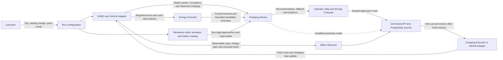

# DriveTwin moving-bus Charging Advisor

The launcher provides advice at 1× and offers operator confirmation for the reviewed Mount Royal, Gare Centrale–Parc La Fontaine, Parliament Hill–Carleton, Stanley Park, and Burnaby Mountain profiles. Confirmation requires matching reviewed inputs, Energy Forecast and Charging Advisor enabled, and 1× pace. Dedicated connected profiles verified automatic charging in Ottawa, scheduled queuing in Burnaby, and charger outage recovery in Montréal. [Verified operating scope](../verification/moving-bus-charging.md#operating-scope)

## 1. Outcome and scope

The Charging Advisor watches the bus’s energy outlook during a trip and answers four questions. Does the bus need charging, how long can it safely keep driving, which charger should it use, and how much energy should it take on? An authorized operator can approve, change, or decline the plan. An explicitly enabled simulation mode can authorize it automatically within independently verified limits. DriveTwin records what the bus actually does after the decision.

The target is one reusable local SUMO service for all ten launcher presets and newly prepared trips. The same upgraded Energy Forecast calculates the baseline trip and all candidate driving legs. New maps, routes, starting charges, and station catalogs are inputs to the model. They require input preparation and compatibility checks. A new route requires no route-specific training.

| Included | Release boundary |
|---|---|
| Launcher controls for initial battery charge and charging mode, alongside existing pace and service controls | One active SUMO bus per session. Verify all ten presets sequentially. Ten-bus tests remain deferred. |
| Driving-time recommendations, future charging stops, fallbacks, partial charging, and replanning | A trip may use more than one stop when needed, with bounded search and fresh confirmation before each diversion. Qualify the one-stop loop first, then qualify multi-stop behavior separately. |
| Advisory, operator-confirmed, and explicitly enabled automatic simulation operation | Advice is the launcher default. Operator confirmation requires a matching input fingerprint and explicit selection for the run. Qualify automatic actuation separately by operating mode and pace. |
| Real OSM roads and attributed elevations, imported station locations where suitable, and simulated charger operation | Physical vehicle operation, real dispatch, paid station access, live provider credentials, and fleet-wide charging optimization are outside this upgrade. |
| Operator, Map, and Energy Forecast changes needed to use and explain the service | Preserve the other dashboard functions and the accepted design language. Reuse the forecast uncertainty status and record any operational margin separately. |

### Starting point

The following paragraph records the starting point before the moving-bus charging work, including its earlier refresh interval.

The upgraded Energy Forecast starts from the observed lane, speed, battery charge, and active route. It reports the lowest predicted charge and arrival charge. The live geographic service refreshes at 60-working-second intervals and on material changes. The ten existing journeys supply useful geographic regression evidence. Charging detours, new charge targets, and moving handoff need new evidence. [Geographic forecast verification](../verification/energy-geographic.md) · [Launcher guide](../setup/launch-app.md)

The current live geographic service requests the first forecast when inputs are valid, with periodic updates due 120 working seconds after the preceding input cutoff. Confirmed plan changes, material input changes, or recovery can request an earlier update. One calculation runs at a time, and the controller keeps the newest pending input; completion need not follow an exact interval. The geographic regression compares real OSM roads and attributed elevation with SUMO battery readings.

The dedicated parked-bus profile has its own station catalog, eligibility and ranking rules, durable command journal, and commissioning evidence. Its station approach model and fixture energy budget stay with that profile. The geographic Vehicle Adapter expects the prepared road and stop sequence. Moving-bus diversion requires a coordinated update of the active route and stop assignment. [Existing charging qualification](../verification/stationary-charging-acceptance.md) · [Prepared journey](../../src/evdt/monitoring/prepared_journey.py)

## 2. Responsibilities and connections

| Boundary | Implementation direction |
|---|---|
| Launcher → run configuration | Send a preset ID, starting charge, supported speed, and charging mode through the existing local launch API. Save the effective run inputs and their fingerprints in the recording and Saved sessions. |
| Vehicle Adapter → Forecast Controller | Keep the existing authenticated monitoring and route-context paths. Supply a trusted live observation for the registered bus, including current lane, speed, battery and route revision. Use stable identifiers for road visits and outstanding passenger stops. |
| Charging Advisor → Forecast Controller | Use typed, versioned candidate requests under the existing worker authority. Isolate candidate results from published current forecasts. Reuse the existing one-worker resource budget and give the live forecast priority. |
| Station source → Charging Advisor | Normalize catalog data and timestamped per-bay status. Keep site configuration, observations, and predicted wait separate. For SUMO, use the simulator for charging power/events and a declared station scenario for occupancy, access windows, and outages. |
| Operator → Command API | Extend the existing scoped dashboard gateway with only the needed read and write operations. Bind approval to the reviewed plan, decision point, target and authority. Keep reader, operator, planner, executor and observer permissions distinct. |
| Command API → Charging Executor → SUMO | Store reservations and one-use grants in PostgreSQL. Use TraCI, the simulator’s control interface, to insert or change a charging stop at a legal step boundary. Record the effect from later independent observations. |

Reuse the launcher, monitoring stack, forecast worker, Command API service boundary, and database. Write new charging logic as an opt-in module inside that design. Settle its process placement in the interface review using ownership, isolation and measured memory. A new container or message broker requires a concrete need that the current topology cannot meet.

## 3. Decision policy

### Reserve and timing

- Keep the nominal reserve at **10% of the configured battery charge scale**. For a 350 kWh model, that is 35 kWh. Forecast the minimum on every leg, including approach and stationary waiting. A later downhill recovery or an arrival above 10% leaves the earlier breach in the decision record.
- Add a separately named planning margin above 10%. Propose it from development error and realistic adverse cases, then lock the policy before independent evaluation. Display the hard reserve, planning margin, and data behind each. The margin carries no statistical coverage claim.
- Use **working time** for the bus’s trip, projected crossing, charging duration and progress toward a turnoff. Use **real-life time** for stale inputs, network and worker deadlines, and command validity. The selected pace changes how much real-life time is available to react.
- Define the **commit point** as the last point where the bus can still use an approved option with enough lead time to change route and reach it. Retain a viable fallback before passing the last safe alternative. Refresh or escalate before that point, using measured worker and handoff time at the selected pace.
- Keep the ordinary forecast cadence. Reevaluate after a material change in energy outlook, station availability, queue, restrictions, route revision, source recovery or progress toward the commit point. Coalesce repeated updates. If a stop becomes infeasible, invalidate it immediately. Require a sustained benefit before switching between feasible options. Derive persistence and cooldown from development runs, with explicit bypass for infeasibility or an urgent deadline.

| Outcome | Meaning and action |
|---|---|
| Continue | The remaining trip clears the reserve and policy margin. Keep monitoring. |
| Evaluate soon | A future crossing or narrowing margin calls for station search. Show what triggered it. |
| Charge later | A future stop is preferred and the bus can still reach it safely. Monitor its status and the last usable fallback. |
| Divert now | The bus is approaching the commitment limit. Obtain authorization and locally revalidate the proposed route update. |
| Below reserve or no feasible plan | Show the limiting constraint and any available fallback. Keep the protective block. Use a safe hold only where a separate, verified behavior is available. |
| Inputs stale, unsupported or calculation late | Mark the plan unavailable or expired. Preserve the last reviewed decision in history and wait for fresh inputs or operator intervention. |

### Routes, energy and scoring

1. Build a current baseline from the same authenticated snapshot that drives the live Energy Forecast. Add a bounded result describing the first reserve crossing and energy/time at selected road or stop checkpoints. Preserve existing result readers and the frozen numerical path. Distinguish the bus already being below reserve from a predicted crossing farther ahead.
2. Search along the remaining route and near accessible detour corridors. A road corridor is the set of connected roads close enough to provide useful diversions. A candidate specifies a legal approach, a reachable bay, the next required passenger stop or rejoin point, and a lawful route to the destination. Tie the route to the current lane, ordered road visit and service-stop order, including repeated roads, one-way streets, junction lanes and local restrictions.
3. Run shortlisted candidate driving legs with the upgraded forecast, using current speed and charge. Include station wait and auxiliary draw before charging. Evaluate the rest of the trip after the projected stop using the projected departure charge and working time. Explicitly model hypothetical state and retain its provenance. The normal live forecast remains tied to measured vehicle state and resumes after the adapter reports that charging ended.
4. Calculate the lowest feasible departure charge from the station, using reserve, margin, the remaining trip, and any next charging stop. Charge duration comes from a declared battery acceptance curve by charge and temperature, station power and sharing, transfer efficiency, and equipment draw. The curve specifies how fast the battery can accept energy. Use a documented simulator profile where manufacturer evidence is unavailable. Verify energy accounting, charge taper and working-time duration against SUMO. Use a bounded search of charge levels and validate the chosen target with a full downstream forecast. Assume monotonic behavior only where it has been demonstrated.
5. Among feasible plans, minimize expected added trip time or service delay. Show driving detour, wait and charging time separately. Credit overlap with a scheduled layover where the bus can actually charge. Use reserve headroom, status quality and a stable station identity to distinguish near-ties. Search multiple stops using a bounded set of reachable station-to-station legs and candidate charge levels. Qualify any search limits against reference cases, and distinguish search budget exhausted from a proven lack of feasible options.
6. Save each decision with the baseline forecast ID, candidate results, model version, route revision, charger/status observations, policy, exclusions, score components, selected target and fallback. Reuse compatible cached geometry and route work. Cache only for matching network, route and relevant input versions. Bound worker time, memory, queue length and candidate count. An old calculation cannot become current after newer route or station evidence invalidates it.

### Station coverage and compatibility

Build regional bundles for Montréal, Ottawa and Metro Vancouver using documented geographic sources. Natural Resources Canada’s station locator can seed public locations after source and redistribution terms are checked. Transit agency data can identify documented depot or terminal chargers. A public location becomes eligible only after its bus access, equipment compatibility, opening or authorization restrictions, and route mapping are verified for the simulated vehicle profile. Model bay clearance, direction of approach, entry and exit, connector or overhead equipment, power, availability, queue capacity and wait. Record which details are attributed, verified in SUMO, assumed for a scenario, or unknown.

Use real road geometry and source-attributed elevations for every approach and return leg. Expand prepared network and terrain coverage where detours fall outside the original route. Simulated transit chargers may be added at plausible, reviewed access points when suitable published sites are sparse. Label them clearly and keep them separate from real-world access claims. Use an OCPI-shaped status boundary where useful. OCPI is a charging-network data exchange specification that distinguishes an available bay from one in use, reserved, out of order or unknown. Store observed time, receipt time, source, and freshness. Current availability is provisional for future arrival. Unknown or stale records cannot release a command.

For every region and trip, report usable sites, reachable options and fallbacks from the relevant decision points, and why others failed. Coverage is measured by the resulting route choices. See the [NRCan locator guide](https://prod-natural-resources.azure.cloud.nrcan-rncan.gc.ca/energy-efficiency/transportation-energy-efficiency/tutorial), [OCPI locations specification](https://github.com/ocpi/ocpi/blob/2.3.0/release/core/mod_locations.asciidoc), and [TransLink’s bus charging example](https://www.translink.ca/news/2023/february/translink%20begins%20battery-electric%20bus%20fleet%20expansion).

## 4. Launcher and operator workflows

- Add **Starting charge (%)** beside vehicle and equipment settings. Use a numeric field paired with a slider, a visible preset default, and a reset action. Proposed first range is **0.1%–100%**, in 0.1 percentage-point increments. Validate unset, invalid, and out-of-range values at the API as well as in the browser. Starts below 10% are explicit degraded scenarios with actuation blocked unless a separately verified protection behavior applies. Cover exactly zero with an offline depletion case.
- Omitted charge in an older profile means the preset’s existing default. Keep the original prepared inputs and their fingerprints immutable. Generate per-run SUMO initial energy, the bus parameter, the run registration, and energy receipts from one normalized value. Compare the requested percentage with the **first measured battery charge**, allowing for rounding and energy used before the first sample under an explicitly tested tolerance.
- Freeze starting charge and mode on launch. Save requested and effective charge, selected mode and pace in the run and Saved sessions, and restore them with **Use these settings**. Expose the actual starting charge and a revised arrival estimate when planning has enough information. Preserve the difference between working trip duration and estimated real-life runtime.
- **Advice only** computes and displays recommendations with no command authority. **Operator confirmed** lets the authorized operator approve the recommendation, pick another still-feasible plan, or veto or cancel a pending change. **Automatic** is opt-in per run and appears enabled only for qualified combinations. Any selected charging mode requires Energy Forecast. Preserve the current monitoring and Energy Forecast entry points when charging is off.
- Show the predicted crossing, plan and fallback on the Map. The Operator tab should show why the plan won, the action deadline, chargers and exclusion reasons, energy and time at arrival, wait, target, and the recorded action state. The Energy Forecast tab should link to the recommendation and distinguish observed charge, predicted driving and projected or measured charging. Use the existing dashboard styling and accessibility patterns.

### Moving handoff and charge lifecycle

An approval can authorize a future plan. When the bus reaches a point where it can apply that plan, the Command API checks the current run, source, lane, route revision, station and expiry again. The executor verifies the real simulator state before applying a change. A newer plan or a veto committed before the final grant invalidates the pending action. Keep plan expiry separate from the short application grant. Commands require eligible conditions regardless of which actor approves them.

Use explicit states for recommended, approved, reserved, applied or uncertain, charging observed, target reached, driving resumed, and complete. An HTTP response and a TraCI acknowledgment each confirm their own step. The effect record requires matching later measurements. If a restart interrupts the grant, or a partial TraCI action has an unknown outcome, reconcile actual route and stop state before any replacement. Preserve passenger stops, stop order, active dwell, restrictions and destination. Verify that a new plan will begin where the bus actually is, with legal entry, enough braking or lane-change distance, and no duplicate charging stop. Recheck power and access before approach commitment and before charging. Follow the approved fallback or hold policy if a charger fails after committing.

During charging, use measured power and energy to display progress and independently check that the configured target and station are reached. Respect limits on power, energy, wait and the maximum permitted stay. Capture completion or interruption, then resume normal live driving predictions from the confirmed measured state. Repeat the authorization path for a later charging stop. Keep operator, automatic policy, and existing command profiles from issuing competing route changes. See the [existing command authority design](../adr/0063-qualify-bounded-automatic-charging.md) and [SUMO route and stop operations](https://sumo.dlr.de/docs/TraCI/Change_Vehicle_State.html).

### Qualification for replacing a committed stop

The current executor stops advancing SUMO if a committed bay loses power. The initial command journal permits one grant for each run and bus. The replacement journal is separate and requires a reconciled record of the original grant.

The Vehicle Adapter now records the held bay, road and lane position, current battery energy, measured station power, and remaining passenger stops before closing the halted run. It verifies the pending charging stop and remaining itinerary against the prepared route. A moving vehicle, contradictory stops, or an advanced simulator clock leaves the snapshot unreconciled.

The Vehicle Adapter submits the held position, charge, equipment demand, battery temperature, and passenger-stop suffix through the producer-only registry. The registry admits one immutable observation per source session and requires a paused clock at the same working time. The Command API's database role can read the receipt. The replacement journal requires that exact observation and a confirmed acknowledgment that the initial stop was applied. A source that has moved or become stale cannot receive a replacement grant.

The opt-in recovery profile keeps SUMO stopped for up to 75 real-life seconds while its working time stays fixed. The equipment uses energy during simulated working time, so the stopped calculation leaves battery charge unchanged while the operator reviews it. A separate forecast job estimates a departure from that exact position at zero speed. It uses the existing road and battery model to compare downstream bays and preserves the authenticated paused state in the ordinary forecast and telemetry views. The same isolated worker slot handles this job. The saved result binds the source receipt, prepared route, and applicable assignment. The result cannot replace the ordinary live forecast.

An operator selects and approves a replacement through the Command API. One durable grant can win per interruption, and a committed veto closes its request. The Vehicle Adapter rechecks its position, remaining stops, battery charge, and the two bay power readings before changing the scheduled stop. It releases the working clock only after the replacement stop and acknowledgment are confirmed. The standard launcher profiles retain the protective stop and partial recording. An unsupported or unreconciled recovery also ends with the bus stopped.

The isolated plant probe uses the same stop insertion checks used by live operator control. It adds the reviewed downstream stop while the bus is still held at the failed bay. It reads back the route and full stop list before releasing the hold, then confirms that only the failed stop was removed. A failed readback ends the probe before another SUMO step. The probe uses a sealed replacement forecast and introduces no command authority.

| Required condition | Evidence for the replacement decision |
|---|---|
| The prior command has a known outcome | Read back SUMO’s current ordered route, pending stops, actual bay, and charge. Match those observations to the prior grant. An ambiguous simulator response or a missing observation keeps the hold active. |
| The bus can reach another bay | Start the forecast from the verified lane position and charge. Include equipment draw during the interruption and any wait at the alternate bay. Check the planning floor through approach, wait, transfer, and the remaining route. |
| The route and stops survive the change | Reconcile the ordered passenger stops and destination before permitting movement. Recheck braking and lane lead distance at the boundary of the actual simulator update. |
| Release is durable and specific to the replacement | Bind the new authority to the reconciled prior outcome, current route revision, source and bay. Serialize veto and release. A timeout, lost reply, duplicated request, or process restart must preserve the hold until the state is known. |

Exercise outages with a reachable replacement, an alternate that becomes unavailable while waiting, and insufficient charge to leave the committed bay. Compare the approved plan and the observed route, battery measurements, and charger records. Use separate inputs with independent outcomes before qualifying any automatic mode.

## 5. Qualification criteria

Verification covers reserve behavior, alternate routes, mandatory stops, station availability, timing, command authority, and recovery. The [verification record](../verification/moving-bus-charging.md) lists the cases run and identifies the profiles that support operator approval.

### Release criteria

| Gate | Required evidence |
|---|---|
| Reserve and route integrity | Zero false-safe plans in the independent matrix. A false-safe plan is one the advisor marked safe even though the independently observed result crossed reserve or violated a required stop. Zero unauthorized or duplicate route changes, lost or reordered passenger stops, wrong-station charge events, or silently discarded failures. Keep the observed outcome of deliberately degraded scenarios visible. |
| Candidate accuracy | Measure error for approach minimum, charger arrival charge, time to target, and post-charge minimum. Establish numerical limits and error units on development cases at CA-01/03, freeze them before held-out runs, and report both worst and typical error. Keep the existing Energy Forecast acceptance criteria for previously covered behavior. |
| Decision timeliness | For every supported actuation pace, demonstrate that a valid decision can complete before the tested real-life time budget for the next commit point. Report estimate, worst observed duration, missed decisions, and worker timeouts. A missed deadline expires the command. Exercise the deadline failure path with a forced delay. |
| Benefits and tradeoffs | On matched routes, report how often the advisor reduces added delay versus nearest-feasible charging, when it chooses to wait, how much extra margin it keeps, and how often it switches. Explain losses and unavailable cases. Use the same available inputs and stopping criteria for each policy. |
| Operation and recovery | Pass the launcher, database restart and restore, normal dashboard shutdown, backup, effect reconciliation, and recording/replay checks. Regulatory or public charging access claims require independent evidence outside this local SUMO release. |

The [moving-bus evaluation criteria](../../qualification/charging/moving-bus-acceptance-1.0.0.json) specify the first independent test limits. The fixed-charge Montréal pilot showed an approach charge error under 0.03 percentage points and a transfer-duration difference of about five working seconds. The independent limit is one percentage point for charge and the greater of 20 working seconds or 25% of the observed transfer time. These are engineering targets for the declared SUMO model, with zero permitted false-safe decisions. The current development margin is zero percentage points above reserve. A qualified operating margin requires further adverse-case evidence.

### Interface decisions

| Interface | Owner and identity | Compatibility rule |
|---|---|---|
| Optional launcher `starting_charge_percent` | Launcher validates a numeric percentage. The runner resolves it against the selected preset, records whether it was supplied, and creates the per-run input files. | An omitted field keeps the original preset inputs. The public catalog remains the source of each preset default. Save the effective value as `initial_charge_percent` for review and retain the override separately for reuse. |
| Prepared SUMO inputs | The runner binds the generated route XML and bus parameters to the source registration. The Vehicle Adapter validates the generated files and measures initial battery energy at insertion. | SUMO’s per-vehicle battery parameter in the prepared XML controls insertion. Update it together with the bus parameters when an override is set. Preserve the sealed fixture XML and the no-override copy path. |
| Candidate and baseline result identities | Forecast Controller binds each request to run, asset, source session, observation, active plan, vehicle profile and model inputs. The advisor additionally binds candidate geometry to its station and station-status revisions. | Candidate forecasts have their own record identity and can never update the current driving forecast or submit a diversion. Admit only results for the still-current candidate inputs. |
| Approval and observed route | The Command API owns authorization and the journal. The Vehicle Adapter owns actual route and stop observations. | A command references an approved plan revision and an ordered road occurrence. Claims and effects stay scoped, durable and separately recorded. Genuine ambiguous application blocks duplicate action until reconciled. |

The stationary charging profile retains its own inputs and qualification scope.

### Development evidence

| Check | Result | Coverage |
|---|---|---|
| Starting-charge preparation | Passed | All ten presets prepared with their original defaults and with a 15.4% override. Default route files remained byte-identical to their reference. The bus parameter and SUMO route file used the same charge. |
| Starting-charge insertion | Passed | Guarded one-bus Montréal preview at 2× recorded 194,040,000 J at 0.2 working seconds for the 350 kWh bus at 15.4%. The run saved its recording and verified cleanup. Evidence ID `live-journey-20261114T063332Z-5cae46`. |
| Starting-charge browser workflow | Passed | Chromium verified the preset default, numeric and slider synchronization, reserve notice, reset, launch request, and restoration of the active and saved settings. The browser intercepted operations that could start or stop a bus. |
| Regional site inventory | Complete for discovery | Retained OpenStreetMap extracts contain 282 Montréal, 71 Ottawa, and 166 Metro Vancouver site records within the selected trip bounds. Bounds can overlap across trips. One site has `bus=designated`, one has `bus=no`. Station points and mapped outlines are leads for review. Keep the normalized catalogs in ignored local storage. |
| Forecast compatibility | Passed | Recomputed all 70 saved geographic forecast requests after adding the optional charging observer. The canonical result bytes matched all 70 retained results. The observer saves the first step below reserve and selected occurrence checkpoints without changing the normal worker request or result. |
| Restricted numerical worker | Passed without vehicle services | The usual worker and the separate charging entry point ran sequentially using the same isolation limits and returned identical baseline forecasts. The charging response binds to its versioned request and the runner confirmed container cleanup. Live scheduling and publication remain unqualified. |
| Live advisory recording | Passed in a bounded development preview | One Montréal bus at 1×, starting at 11.6%, recorded 90 observations and 1,800 readings. The regular controller saved two forecasts and the advisor completed two separate calculations with zero worker failures. Both compared two declared bays and selected the later bay with a 12% target. The first used moving telemetry at working second 2. Backup, source consistency, host checks, and cleanup passed. Evidence ID `live-journey-20261114T072153Z-9b1cea`. |
| Connected Operator tab | Passed in a bounded development preview | Chromium displayed the charging target and fallback, then removed the recommendation on expiry. The API refused a missing reader key and an out-of-scope asset. Three regular forecast jobs and three advisory jobs completed with zero job failures. Backup and cleanup passed. Evidence ID `live-journey-20261114T073744Z-2a62fb`. |
| SUMO on-route charging stop | Passed in isolated development | At working second 2, a bus traveling at 1.8 m/s received a stop at the later declared bay. Measured transfer was 4.192 kWh. The bus reached 12% charge, resumed movement and arrived at working second 695.2 with all four passenger stops served. Minimum observed charge was 10.72%. The energy ledger reconciled 3,475 steps and the container was removed. This probe used a fixed stop request and verified the effect independently of the recommendation. Evidence ID `charging-plant-20261114T075813Z-f90bc4`. |
| Station outage and power recovery | Passed in a bounded development preview | A declared outage at working second 13 triggered a fresh comparison under the prior Energy Forecast. An available earlier stop remained preferred. A second change at working second 38 reopened the later bay at 90 kW and triggered another comparison. The browser observed the post-outage estimate. Six charging jobs and three forecast jobs completed with zero failures, 110 observation events, backup and cleanup. Evidence ID `live-journey-20261114T080526Z-ab4dfb`. |
| Approval journal and restoration | Passed in an owned PostgreSQL fixture | The journal replayed the same approval, preserved a veto, accepted a new approval after the veto, issued one grant, rejected repeated grants, and refused a conflicting acknowledgment. A fresh database restored both monitoring and command records with matching inventories. No bus ran in this case. Evidence ID `worker-database-20261114T081927Z-235b17`. |
| Moving-bus approval and charging display | Passed in a 320-working-second development preview | Chromium confirmed that a monitoring credential cannot call the charging command service. An authorized operator approved a live offer. SUMO inserted the stop at working second 7, began measured transfer at 163.2, reached the 12% target at 263.6, and resumed motion at 263.8. The independent charger export matched the adapter’s 4.192 kWh, minimum charge was 10.788%, and the Map showed the station. All 320 events and 6,400 readings reconciled. Two regular forecasts and one charging calculation completed with zero failures. Backup and cleanup passed. Evidence ID `live-journey-operator-connected-06`. |

The connected development profile inserts one charging stop per run. The calculation preserves passenger stops and forecasts both driving legs separately. It checks the 10% reserve through the wait and models equipment draw and battery charge taper. A complete Montréal run reached its destination at working second 696 with a verified recording and normal shutdown. Recovery following a post-handoff outage and automatic mode remain release gates. [Connected case evidence](../verification/moving-bus-charging.md)

A development comparison used a saved Montréal request at 120 working seconds and 12.93 m/s. With an explicitly declared 11% starting input at that cutoff, the no-charge forecast first fell below reserve at working second 460. Two simulated bay offers on the retained Montréal geometry produced a preferred 12% target and an alternate with the same target. The preferred bay was farther along the route and projected arrival at working second 783. Waiting at the earlier bay moved arrival to working second 1,143. The result is a policy development example with declared station availability and charge. The retained original bus trajectory and forecast evidence are unchanged.

The offline geographic development runner evaluated each of the ten retained departure inputs with its preset charge and a declared reserve challenge. Nine preset cases continued. The Ottawa Parliament Hill–Carleton University preset at 10.5% correctly produced no plan among the two declared offers. The early site would fall below reserve while waiting, and the later site could not be reached above reserve. Each of the ten controlled charge challenges produced a provisional plan using the real road and elevation inputs. These declared sites are development inputs for the calculation. They carry no live charging, availability, or site access qualification. Evidence ID `charging-development-geographic-02`.

Detour input validation uses an explicit branch and rejoin by ordered road occurrence. It checks bus lane connections from the current lane and rejects any replacement that bypasses a mandatory stop. The connected profile requires the approved corridor to contain every alternate road and elevation. The Command API binds approval to the exact detour. The Vehicle Adapter replaces the future route before the branch, checks the route and passenger stops, and inserts the charge stop within the same SUMO step. The connected Montréal case passed through charge and resumed Energy Forecast. Alternate-route actuation with indexed road restrictions requires a verified mapping for those restrictions. [Detour evidence](../verification/moving-bus-charging.md)

A station scenario records nonoverlapping working-time intervals for each bay. Its fingerprint binds the schedule to one run. During occupancy, it can project a release only when the declared schedule has a contiguous available interval. Missing intervals report unknown. Outages remove the offer and a later interval can restore it at a reduced power limit. The real-life observation and receipt times still govern whether status can be used.

The guarded launch runner binds the development station assignment by source fingerprint. The controller schedules the advisory calculation after an accepted risk forecast, in an idle worker slot. It retains decisions under the corresponding forecast fence in a separate job journal and reclassifies late or changed-context completions as historical. Before publishing a result, it confirms that new observations match the modeled station windows, offered power, and station revisions. The original calculation input stays immutable, and the journal stores the renewed display expiration separately. The command path checks the live offer again before granting a stop. Energy Forecast startup accepts a current infeasibility result as evidence that the service is working, while continuing to show the trip as infeasible.

The controller can also schedule another charging comparison under the same accepted forecast when a relevant station changes state or the bus passes an offered bay. Each combination has its own immutable job. The regular forecast keeps priority. A forecast that clears the reserve and planning margin can display **Continue on the assigned route** without starting a charging calculation.

The bounded two-stop search evaluates the first approach, first transfer, inter-station drive, second transfer, and final drive with the same reserve rules. An analytical development case needs both visits because the first bay closes before it can supply enough energy for the full remainder, and the initial battery cannot safely reach the second bay. The deadline and calculation-count cap discard partial decisions. Geographic and command qualification remain separate gates.

To rebuild the discovery inventory, use `scripts/geographic/charging_inventory.py` with the pinned Windows pyosmium dependency, the geographic study recipes, and the corresponding local PBF for each region. Save its output to a fresh ignored file. OpenStreetMap's `access` tag describes who may use a site. Bus suitability also needs a legal approach, a compatible connector, and sufficient clearance. SUMO's station power and efficiency are simulated settings, with transfer during a stop when in-transit charging is disabled. [Geographic prerequisites](../setup/geographic-energy.md) · [OpenStreetMap charging tags](https://wiki.openstreetmap.org/wiki/Tag%3Aamenity%3Dcharging_station) · [SUMO battery and charging model](https://sumo.dlr.de/docs/Models/Electric.html)

The route-planning approach follows published work on varying charging power, partial charging and occupancy-based replanning. Bus research additionally models the impact of charger queues and layovers on service departures. The release applies those ideas to one live simulated bus and evaluates the outcome against observed trip and charging records. [Feasible EV paths with charging stops](https://pubsonline.informs.org/doi/10.1287/trsc.2018.0889) · [Dynamic routing with station occupancy](https://arxiv.org/abs/2305.11773) · [Minimum-delay bus opportunity charging](https://research.chalmers.se/publication/548594)
