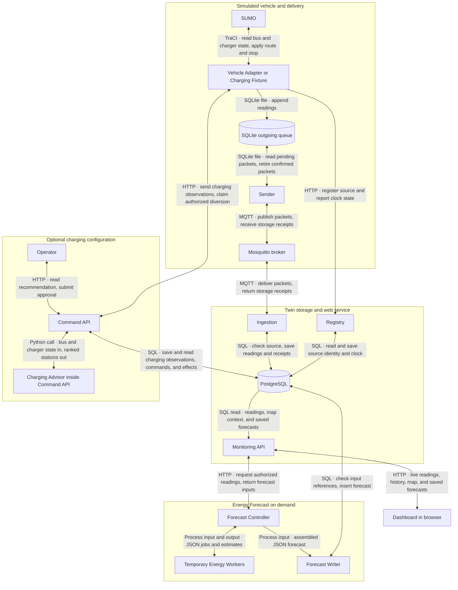
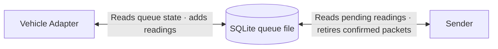
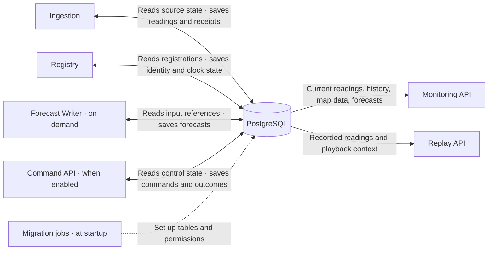

# DriveTwin diagrams

Candidates for the GitHub landing page and final project documentation.

## 1. DriveTwin system map

SUMO, both databases, the Energy Forecast, the Charging Advisor, and the dashboard. Each arrow labels the interface and the data it carries. The map combines the monitoring stack with on-demand forecasting and the optional charging configuration.

## 2. SQLite read and write map

The Vehicle Adapter and Sender share the outgoing queue file. A double arrow means the program reads from and writes to SQLite.

## 3. PostgreSQL read and write map

Arrows into PostgreSQL show writes, arrows out show reads, and double arrows show both. The forecast and command services appear when their configurations are enabled.

