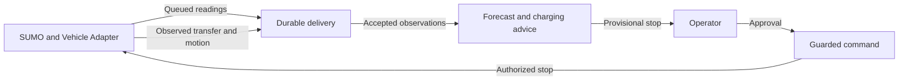

# Engineering traces from readings to observed charging

DriveTwin connects recorded bus readings to energy forecasts, operator decisions, and later observations of what the bus did. Three traces show how the implementation preserves that chain, using separately recorded simulation and database checks. Working time means time inside the simulation; real-life time measures elapsed time on the computer.

1. [Durable delivery through an outage](#durable-delivery-through-an-outage)
2. [Forecast input provenance](#forecast-input-provenance)
3. [Charging approval through observed effect](#charging-approval-through-observed-effect)

## Durable delivery through an outage

The Vehicle Adapter saves each original observation packet in SQLite before the Sender publishes it over MQTT. Ingestion stores the accepted packet, history, current-state changes, and receipt in one PostgreSQL transaction. Only after that transaction commits does it publish the receipt. A broker acknowledgment alone cannot retire the queued original.

The queue checks the receipt's run, bus, source, event identity, and packet hash before retiring that event. A hash is a fingerprint of the packet's bytes. A rejected observation receives an auditable rejection rather than becoming an accepted reading.

**Failure case:** If the database commit succeeds but the receipt is lost, the Sender retries the same bytes. Ingestion recognizes the stored event and returns its existing receipt. The retry does not add a second accepted observation.

**Inspect:** [Transaction and duplicate handling in `store`](../../src/evdt/monitoring/repository.py#L88-L211) and [receipt matching in `Spool.acknowledge`](../../src/evdt/monitoring/spool.py#L214-L247). The [outage verification record](../verification/outage-delivery-compatibility.json) reports 480 originals and 9,600 readings recovered after a delivery outage lasting 300.55 real-life seconds. The queue emptied 19.84 real-life seconds after restoration began, with zero dropped, quarantined, or pending events. Those measurements belong to that one-bus configuration.

## Forecast input provenance

Provenance records where an estimate's inputs came from. The trusted input builder binds an accepted observation to its authenticated source, working-time cutoff, route context, and approved assignment. Road geometry, attributed elevation, vehicle properties, and declared future conditions complete the request. A future equipment-load assumption remains an assumption even when its fingerprint is recorded.

The isolated numerical worker receives that request without database or command credentials. Result validation checks its model version, source, generation, cutoff, and input, route, and vehicle fingerprints. Persistence also checks the exact durably claimed request, assignment, and controller owner before saving an immutable result. The saved estimate can therefore be traced to the state and assumptions used to calculate it.

**Failure case:** A substituted assignment or changed request cannot be saved under the original claim. A route change can also make an earlier forecast unsuitable for current guidance while its historical record remains available.

**Inspect:** [Input binding in `build_request`](../../src/evdt/energy/route_aware/admission.py#L183-L249) and [claim checks in `save_result`](../../src/evdt/monitoring/route_energy_views.py#L207-L282). The [connected lifecycle verification](../verification/energy-geographic.md#connected-lifecycle-compatibility) records assignment-substitution rejection, immutable writes, role restrictions, restoration, and interrupted-job reconciliation. These checks establish traceability; the separate geographic accuracy results compare forecasts with SUMO battery readings on real roads and elevation.

## Charging approval through observed effect

The Charging Advisor uses the route-aware model to compare driving to a bay, waiting, charging, and finishing the trip. Its recommendation carries no permission to change the bus. Operator approval identifies the reviewed candidate and departure target. Before granting authority, the Command API rechecks the current offer, station, route progress, and deadlines, and commits a durable handoff. The executor then checks the actual simulator state before applying the stop.

An applied acknowledgment records SUMO's acceptance of the requested stop. Later battery device and movement observations establish whether charging and resumption occurred. They return through the telemetry path in the diagram.

The [connected Montréal case](../verification/moving-bus-charging.md#connected-montréal-case) started at 11.6% charge and approved a 12% departure target:

| Observation | Working time | Meaning |
|---|---:|---|
| Stop accepted | 7.0 s | SUMO scheduled the stop |
| Charging observed | 163.2 s | The battery device reported transfer at the selected bay |
| Motion resumed | 263.8 s | The target had been reached and the bus moved again |

The independent SUMO station export and adapter each measured **4.192 kWh** delivered. The bus reached its destination at working second 696 with a lowest recorded charge of 10.720%. All 696 telemetry messages reconciled to their committed bytes.

**Failure case:** An expired offer or a veto committed before the grant prevents handoff. Once a grant is committed, a lost response cannot authorize another grant for the same stop. The journal preserves the uncertain outcome rather than repeating an action whose effect may already have occurred.

**Inspect:** [The durable one-use `grant`](../../src/evdt/moving_charge_journal.py#L148-L169) and [later effect observations in `observe`](../../src/evdt/monitoring/moving_charge_executor.py#L476-L521). The [charging verification record](../verification/moving-bus-charging.md) separately records restart fencing, duplicate rejection, veto, and database restoration alongside the connected result.

The [release acceptance](../release/verification.md) and [moving-bus operating scope](../verification/moving-bus-charging.md#operating-scope) define the supported configurations. These simulation results preserve separate evidence for delivery, prediction, authorization, acknowledgment, and observed effect.
