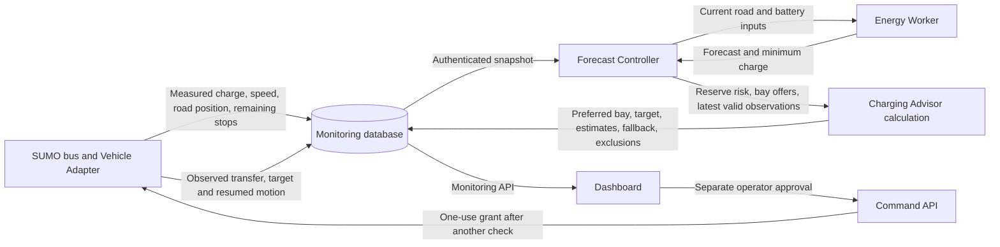
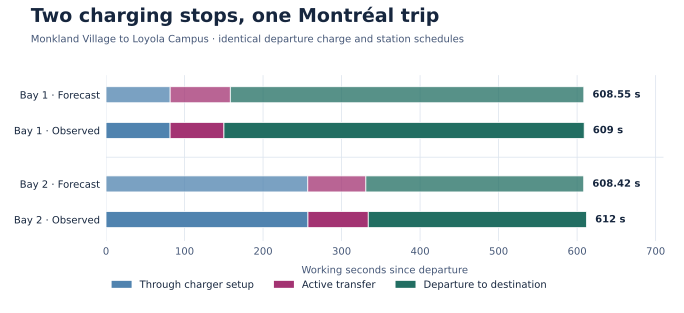

# How DriveTwin advises a moving bus about charging

The Energy Forecast estimates how much battery charge the bus will have along the rest of its trip. The Charging Advisor looks for the lowest predicted charge along that route. A dip below 10% triggers a charger comparison, even if downhill braking would bring the charge back above 10% before arrival. Some qualification profiles use a higher planning floor to leave additional room for prediction error.

On the Mount Royal route, an offline forecast starting at 13.6% predicted a dip to 9.78% and a recovery to 10.21% by arrival. The advisor still proposed a stop because the bus would spend part of the trip below reserve. With 14.0% at the same cutoff, the lowest predicted charge was 10.18% and the advisor recommended continuing. [Mount Royal results](../verification/moving-bus-charging.md#mount-royal-connected-rehearsal)

The advisor evaluates driving to a bay, waiting, charging, and continuing to the destination. Each stage must stay above the reserve. A bay farther ahead can win if it is reachable with reserve and the earlier bay has a long queue. The current development profile compares a defined set of departure targets at each bay. It accounts for equipment draw during a wait and uses a declared charging-power curve.

The Operator tab shows predicted battery charge at the charger and at the destination. It also shows the energy the charger is expected to supply. The battery stores some of that energy. The rest covers charging losses and equipment such as fans or heating while the bus is stopped. A separate measured value shows energy delivered to the battery during the completed transfer.

In the launcher, choose a trip, set the starting charge, and enable Energy Forecast and Charging Advisor at 1×. A live reserve warning in **Energy Forecast** links to the advisor. The **Operator** tab shows the recommendation and a fallback when one is available. **Map** highlights those bays and shows the predicted location of the first dip below reserve if the bus continues without charging. The reviewed Mount Royal, Gare Centrale–Parc La Fontaine, Parliament Hill–Carleton, Stanley Park, and Burnaby Mountain profiles can enable operator confirmation for one eligible, currently available charging stop. Availability depends on matching reviewed inputs and the selected services and pace. [Launcher eligibility](../setup/launch-app.md#charging-advisor)

During an approved stop, **Energy Forecast** shows the observed charging stage and measured energy delivered. As the bus leaves, the tab waits for a forecast based on a newer battery reading. Saved forecasts keep their original inputs and results.

## From reading to recommendation

1. **Observe the bus.** The Vehicle Adapter reads SUMO and sends observations to monitoring. Road, lane position, and remaining stops tell the forecast where to start. The working time is the clock inside the trip. Authentication and processing deadlines use real-life time.
2. **Predict the unmodified trip.** The Forecast Controller requests the first calculation as soon as the inputs are valid. Periodic updates are due 120 working seconds after the preceding forecast's input cutoff; confirmed plan changes, material changes, or recovery can request an earlier update. One worker uses the newest pending input, so completion times can vary. The Energy Worker estimates arrival charge and the lowest charge anywhere along the route. The same route-aware model evaluates the driving segments on either side of a possible charging stop.
3. **Compare charging stops.** When reserve is at risk, an idle calculation worker checks the assigned bays for vehicle compatibility, usable approach geometry, power and availability. It calculates charge through the wait and transfer, then predicts the drive to the destination from the proposed departure charge. The least-delay feasible candidate is preferred. If a search runs out of time, the result reports that limit.
4. **Ask before applying the stop.** In the operator development profile, approval refers to the exact offer visible in the dashboard. The Command API checks the route, bay, latest readings, and expiry before issuing a one-use grant. The Vehicle Adapter checks actual lane, braking distance, and passenger-stop order before inserting the SUMO stop. A veto before the grant prevents actuation.
5. **Verify what happened.** The acknowledgment means SUMO accepted the stop. The battery device supplies independent observations of energy received, target reached, and resumed motion. DriveTwin saves those events separately from the advice. If power fails during the committed stop, the protective check halts simulated progress and preserves the partial result.

## A recorded example

On the Gare Centrale–Parc La Fontaine run, the bus started at 11.6%. The advisor selected the later of two simulated bays because it reduced projected waiting time. The operator approved a 12% departure target. SUMO measured 4.192 kWh delivered at the selected bay, then the bus resumed and completed the trip. Its lowest observed charge was 10.72%.

The 12% target is the battery level the bus should have when it leaves the charger. The bus arrived with less than 11.6% because it had already driven part of the route. The 4.192 kWh is the energy SUMO measured going into the battery during the stop. At the end of the trip, the 10.72% minimum left 0.72 percentage points above the 10% reserve.

| What the operator sees | What to look for |
|---|---|
| **Provisional charging plan** | Compare the earliest projected arrival, the lowest charge with that stop, and the fallback. The **Review window** gives the working-time and UTC limits. |
| **Stop insertion acknowledged** | SUMO accepted the stop on its schedule. The bus can still be driving toward it. |
| **Charging observed** | The battery reports energy from the selected bay. The displayed kWh grows during transfer. |
| **Driving resumed** | The bus reached its departure target and moved again. A fresh Energy Forecast uses the post-charge reading. |

### When the two options are close

On the Monkland Village–Loyola Campus trip, both stops cleared reserve. The advisor forecast the later bay would save 0.13 working seconds. In the matched SUMO runs, the earlier bay finished three working seconds sooner and retained 10.129% at its lowest point, compared with 10.066% for the later bay.

The earlier bay charged about eight working seconds faster than forecast. The drive after charging took longer than forecast and almost canceled that gain. At the later bay, charging took about three working seconds longer than forecast. This comparison shows the resolution of the estimate for these two stops. [Matched-run verification](../verification/moving-bus-charging.md#matched-comparison-against-the-earlier-feasible-bay)

## How the components connect

| Component | Input and output |
|---|---|
| Launcher | Starts one reviewed SUMO profile. The selected starting charge reaches both the battery configuration and the SUMO route file. |
| Vehicle Adapter | Uses TraCI, SUMO’s control interface, to read road position, speed, and battery state. Sends telemetry through the existing sender and broker. |
| Forecast Controller | Uses the accepted telemetry and the current road plan to prepare the driving calculation. When the forecast shows reserve risk, it gives the Charging Advisor an idle worker slot. |
| Energy Worker | Runs in an isolated, short-lived container. Evaluates the baseline and the driving legs for charging candidates with the same model. Returns a calculation with no command authority. |
| PostgreSQL and Monitoring API | Save accepted telemetry, forecasts, and charging comparisons. Serve a scoped browser view over HTTP, the request and response protocol the browser uses. The private Command API uses the same database for its separate grant records. |
| Command API and Vehicle Adapter | The dashboard sends approval through the scoped operator gateway. The Command API verifies the selected offer and commits a one-use grant. The adapter claims the grant over the private container network and checks the actual route and stopping distance before sending a TraCI instruction. |

The launcher supports one approved stop at 1× on Mount Royal and four reviewed profiles with off-route bays. A station change before approval can invalidate advice and trigger a new comparison. A separate recovery profile holds the bus if a charger fails after transfer starts. The Forecast Controller uses the stopped bus’s measured charge and remaining itinerary to calculate a new trip from that location. The operator approves an eligible downstream bay before the Vehicle Adapter releases the bus. If no bay is reachable, the bus stays stopped and the run saves the partial recording. Automatic dispatch and scheduled queuing use dedicated qualification profiles. [Operating scope](../verification/moving-bus-charging.md#operating-scope)

[Run the advisor](../setup/moving-bus-charging.md) · [Measured results](../verification/moving-bus-charging.md) · [Design and interfaces](../design/moving-bus-charging.md)
