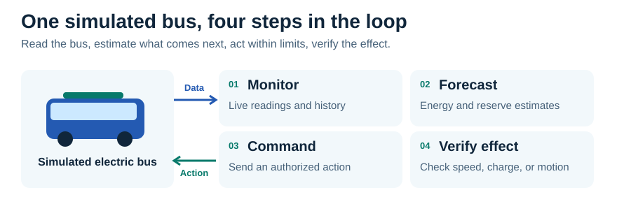

# DriveTwin at a glance

DriveTwin is a digital twin of a simulated electric bus. It shows the bus's readings, estimates energy needed to finish its route, and sends permitted commands through a separate guarded path. Later observations establish whether the command changed the bus's behavior. SUMO supplies the simulated bus, battery and charging environment.

| Capability | What happens in this project |
|---|---|
| Observe | Twenty standard readings pass through a vehicle disk queue to durable storage, live views, History, export and isolated replay. |
| Forecast | A physics-based planner follows the remaining real-OSM roads, elevation, turns and stops with explicit vehicle and future-condition assumptions. It keeps the minimum charge as well as arrival charge. |
| Advise and act | The Charging Advisor compares eligible stops. An approved reviewed offer needs a durable one-use grant before the executor applies it. Acknowledgment and later charging/movement evidence remain separate. |
| Recover | Original messages can be retried after a disconnect. An uncertain command reservation stays unresolved and cannot be claimed again. |
| Evaluate | Model accuracy, permissions, command effects, restoration and host behavior have separately scoped evidence. Bench thermal studies do not establish physical bus control accuracy. |

For example, the recorded Montréal charging case started at 11.6% charge. The saved no-charge forecast warned of a 9.33% minimum, below the 10% reserve. With the approved stop, independent records measured 4.192 kWh delivered; the bus finished with a lowest observed charge of 10.720%. [Explore the recorded decision](../setup/browser-demo.md) · [Charging evidence](../verification/moving-bus-charging.md#connected-montréal-case)

One-bus monitoring and separately configured controls define the local scope. Fleet endurance, physical integration, adaptive promotion, automatic background deletion and production deployment remain outside it. Use the [capability matrix](../release/capabilities.md) for supported profiles and evidence, the [technical walkthrough](technical-walkthrough.md) for implementation, and the [launch guide](../setup/launch-app.md) for local operation.
