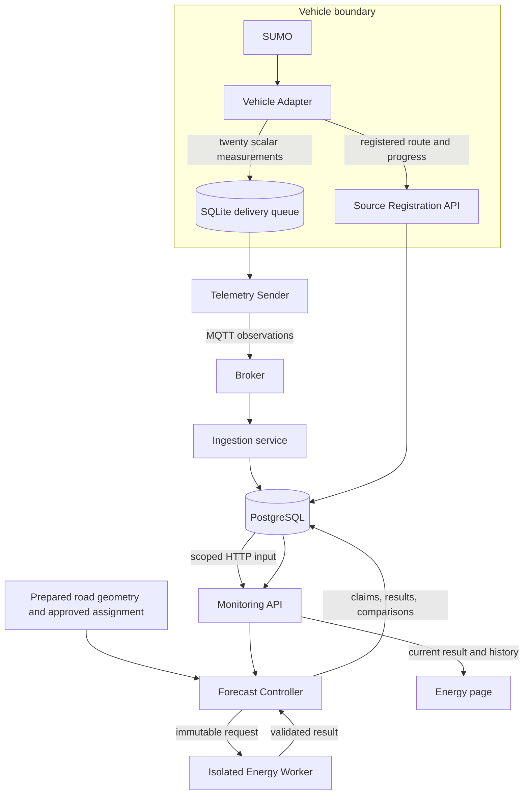
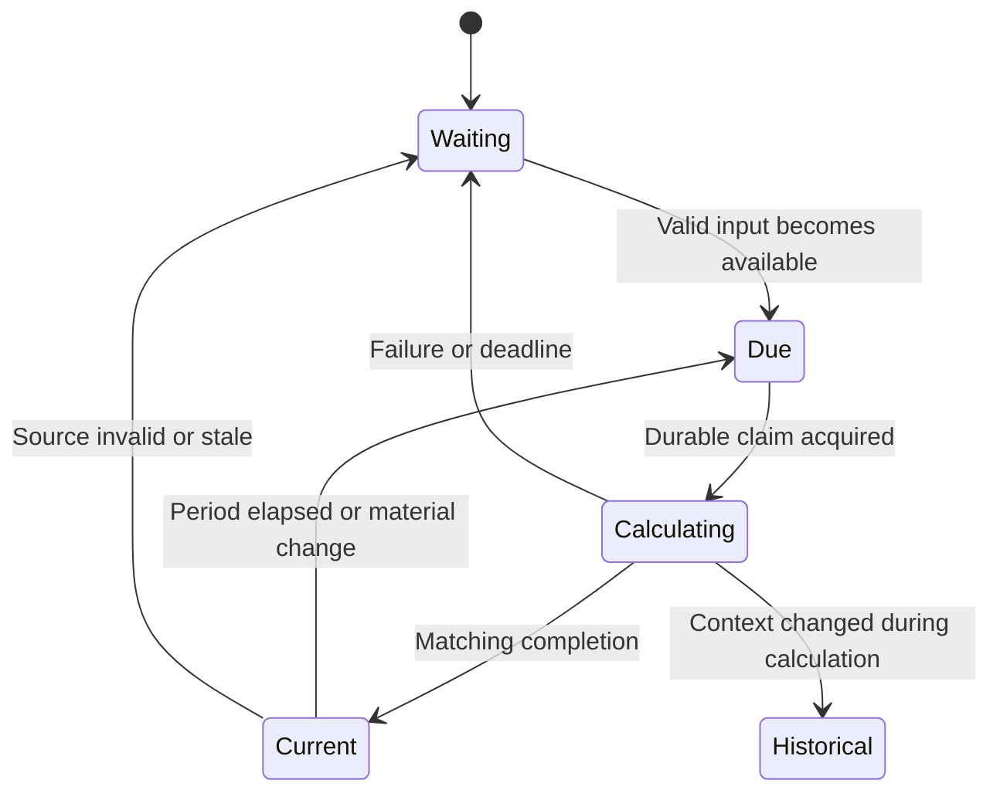

# Route-aware Energy Forecast: implementation walkthrough

Read the [short introduction](route-aware-energy-overview.md) first. This guide follows one input through the implemented service. The [verification record](../verification/energy-route-aware.md) states which behaviors have completed qualification.

## Components and authority



The Forecast Controller is a trusted Ubuntu process. It can read the assigned input endpoint, use the narrowly scoped forecast database role, and launch one calculation container. The Energy Worker is the calculation process inside that container. It receives a bounded JSON request through standard input, returns JSON through standard output, and exits. It has no network, database credentials, simulator access, host mounts, or Docker socket.

| Component | Responsibility |
|---|---|
| Vehicle Adapter | Publishes present route progress and observations from SUMO |
| Source Registration API | Authenticates the producer and binds route context to its registered run and source |
| Trusted Forecast Input Builder | Selects matching, fresh stored readings and route context |
| Forecast Controller | Schedules work, persists ownership, rejects obsolete completions, and saves valid results |
| Isolated Energy Worker | Builds the expected movement plan and integrates battery energy |
| Monitoring API | Serves current validity, immutable history, and completed prediction comparisons |
| Energy page | Displays estimates, age, lifecycle, assumptions, and history |

The separately configured stationary Charging Advisor retains its original qualified model. In the geographic moving-bus profile, the controller schedules route-aware charging comparisons in the same single-worker boundary. Advice does not issue vehicle commands; the separate Command API grants authority after revalidation. [Moving-bus interface](moving-bus-charging.md)

The predictor is a physics-based numerical model. Its movement planner constructs an expected speed profile; its energy integrator applies physical equations over that profile. There are no learned map-specific weights or automatic parameter updates. Differences between predicted and observed consumption are saved for assessment. Vehicle parameters and future-condition profiles remain explicit, versioned inputs.

## 1. Admit a coherent state

The input includes a run, asset, source epoch, and session. An epoch distinguishes a new source execution from the previous one. A cryptographic fingerprint detects changes to the exact bytes of a record; authentication establishes who is allowed to send it.

The input builder requires matching source identity, registered manifest, route-context fingerprint, current working time, valid measurement units, and fresh receipt timestamps. It rejects mixed sessions, unsupported charging states, future timestamps, stale data, and missing required readings. Zero speed and zero charge remain valid numerical readings.

The assignment contains the approved vehicle profile, geometry bundle, conditions, policy, and optional operating scenario. Only the administrative provisioning path changes assignments. A calculation worker or browser cannot declare the bus's current state or approve a new assignment.

## 2. Construct the remaining route

The route is an ordered list of road occurrences. An occurrence identifies one visit to a road. A loop can visit the same road twice without confusing the first and second visits.

Current lane progress trims only the current occurrence. The route keeps intermediate vertices, junction geometry, remaining stops, signed elevation changes, and known lane-change assumptions. Terrain preparation happens outside the numerical worker. Missing heights and unsupported structures remain explicit failures.

The prepared request can omit roads already traveled. The scheduler identifies the original authenticated route and approved geometry, so entering the next road does not reset the periodic forecast timer (120 working seconds in the current live geographic profile). A changed route plan, elevation source, or approved assignment invalidates the old context. Localized road and stop effects retain their original assignment identity while their indices are mapped onto the remaining path.

The geographic input pipeline imports bus-accessible OSM roads and mapped stops, then attaches attributable ground or road-surface elevations. It preserves intermediate hills and valleys and records smoothing and junction corrections. The Energy Worker receives the resulting geometry, not a city name or route-trained coefficient. Power-aware movement uses the same vehicle limits on each map. An optional known fixed-cycle signal plan adds braking, waiting, and departure; adaptive signals and traffic queues are outside that option. [Geographic operating procedure](../setup/geographic-energy.md)

## 3. Predict movement

The movement planner uses current speed, road limits, declared traffic factors, acceleration/deceleration limits, turn constraints, and stop dwell. It works backward to establish where braking is necessary, then forward to establish reachable speeds. The result is a sequence of acceleration, cruise, braking, and stationary intervals.

Future motion follows the remaining route. The model does not repeat a recent speed trace to fill a long journey. Recent observed equipment demand applies near the current bus; forward equipment assumptions cover later intervals. A confirmed route revision replaces the old path. Future incidents remain unknown until an appropriate observation or declared scenario supplies them.

## 4. Account for energy

| Contribution | Main inputs | Meaning |
|---|---|---|
| Acceleration | Vehicle/rotating mass, speed change | Work needed to change motion |
| Grade | Loaded mass, gravity, signed height change | Climbing consumes energy; descent can supply braking energy |
| Rolling resistance | Loaded mass and rolling coefficient | Tire/road losses over distance |
| Aerodynamic resistance | Frontal area, drag coefficient, air density, heading, wind vector | Work against air moving relative to the bus |
| Equipment | Observed or declared auxiliary power and elapsed time | Heating, cooling, electronics, and other electrical loads |
| Conversion and regeneration | Efficiency profiles and battery power/charge limits | Electrical losses and bounded recovered energy |

Wind is represented by eastward and northward air velocity. Each road heading determines the relative air velocity along that segment. Optional temperature and pressure determine air density. The equipment model uses declared heat-transfer, ventilation, door, occupancy, and solar inputs when supplied. It is a steady demand model; it has no detailed cabin thermal dynamics.

The integration step is at most 0.2 working seconds. Integration means adding small energy changes across the movement plan. Stable summation limits rounding loss when large and small contributions are combined. The ledger retains draw, recovery, rejected recovery, conversion loss, unmet demand, and minimum stored energy.

```text
final battery energy = initial battery energy − draw + recovery
net battery energy used = draw − recovery
arrival charge = final battery energy / declared nominal capacity
```

The geographic profile limits planned speed and acceleration to the declared vehicle power before accounting for energy. An inaccessible capacity fraction or remaining unmet power demand can still make that plan infeasible. The result preserves the failed plan and its unmet demand. A later descent cannot remove an earlier reserve breach.

## 5. Decide when to calculate

The controller polls admitted input and uses working time for the configured forecast interval. The live geographic profile requests its first calculation when inputs become valid, with periodic updates due 120 working seconds after the preceding forecast's input cutoff. The original qualification policy uses 30 working seconds. Confirmed plan changes and recovery can request earlier updates. Reserve crossings and changes to the supported input domain can request immediate recalculation. Other material-condition refresh uses an inexpensive impact estimate, five working seconds of persistence, a ten-second cooldown, and separate reset thresholds. These rules suppress repeated jobs caused by noisy values. One calculation runs at a time, and the controller keeps the newest pending input, so completion times can vary. The thresholds are explicit engineering policy and need operational tuning within a separately evaluated deployment domain.



A durable claim survives a controller crash. A fencing token is an increasing job identifier that prevents an old worker from gaining authority after recovery. PostgreSQL permits one active worker globally. A restart first checks and removes any owned interrupted worker, marks its claim incomplete, and then permits new work. The pending queue contains only the latest eligible input.

Real-life deadlines remain active while working time is paused. Each worker has a 256 MiB memory ceiling and a 30-real-life-second deadline. Repeated failure produces an unavailable state instead of an unbounded retry loop.

## 6. Publish and compare

Result persistence is append-only and idempotent: saving the same result twice creates one record; conflicting content is rejected. Current presentation additionally checks source freshness, route/assignment identity, and forecast age. Old records remain available as history.

Each feasible forecast saves a prediction for up to its first 30 working seconds. Once matching subsequent battery readings cover that complete interval, the controller records predicted consumption, observed consumption, and signed error. Charging, route changes, gaps, and mixed identities invalidate the comparison. Pending in-memory observation buffers are lost on controller restart; saved comparison records remain durable. No automatic parameter fitting occurs.

The Energy page examines three nonoverlapping completed windows for the current source, route, and assignment. Errors in the same direction above the configured threshold produce a persistent-mismatch notice. The default threshold is 0.25 kWh per window. This notice describes observed error; it does not establish a calibrated uncertainty range.

Road- and stop-specific scenarios also bind to the exact route revision. A changed route or remaining-stop plan requires a new matching assignment, including the current load. The service returns unavailable until localized effects match the current road occurrences.

## Qualification and interpretation

Analytical cases verify formulas and conservation. Factor checks vary wind, equipment, mass, battery limits, and road scenarios separately. The independent route-family study compares forecasts against SUMO battery outcomes on new road layouts. Development, validation, and reserved families remain separate; correlated cutoffs are aggregated within complete trips.

The reserved evaluation requires a frozen candidate, parameter files, recipes, criteria, and passing development/validation records. Opening that evaluation consumes its claim even if it fails. Failed or incomplete results remain part of the record.

The geographic evaluation uses ten real OSM journeys with public elevation and one unchanged estimator. SUMO supplies the battery reference under the declared vehicle and operating conditions. The [geographic results](../verification/energy-geographic.md) identify repeated trips, new route families, and source compatibility. Earlier synthetic studies retain their own scope.

Real traffic/weather feeds, surveyed road-height accuracy, vehicle-specific parameter validation, calibrated uncertainty, automatic charging adoption, and production deployment require their own evidence.
