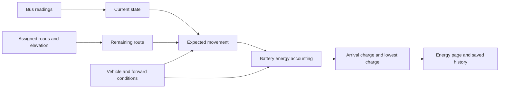

# Route-aware Energy Forecast in brief

The Energy Forecast estimates how much battery energy the bus needs to finish its assigned route. It starts with the bus's current charge, speed, position, and equipment demand. It looks ahead at the remaining roads, elevation, turns, and scheduled stops. The result includes expected arrival charge, the lowest charge along the route, energy use by cause, and the assumptions used.

This is a physics-based numerical model. Equations describe movement, resistance, climbing, equipment use, and braking recovery. Numerical integration adds their energy effects over small intervals along the journey. There is no neural network or learned route-specific weight set. Vehicle properties and future conditions are explicit inputs; the service does not automatically fit them from prediction errors.

The route-aware implementation is a separate model version. Its implementation and qualification status are recorded in the [verification record](../verification/energy-route-aware.md). The original forecast and its saved evaluation remain available under their existing version.

## How a forecast is made

Consider a bus approaching a hill with a scheduled stop at the top. The model predicts acceleration toward the hill, the work needed to climb, braking before the stop, equipment use while waiting, and movement after departure. On the descent, regenerative braking can return some energy. Battery limits determine how much recovery is usable.

The model tracks the lowest charge throughout the trip. A low-charge condition before the hilltop remains visible even if the descent later restores some energy.

## Two clocks

| Clock | Meaning | Use |
|---|---|---|
| Working time | Time within the modeled journey | Route progress, dwell, and the live geographic profile's 120-second forecast interval |
| Real-life time | Time passing on the computer | Reading freshness, calculation deadlines, and connection failures |

A paused source stops advancing working time. Real-life time continues. A bus waiting at a traffic light is different: its working clock continues while its speed is zero. The service distinguishes these states from a source that has stopped communicating.

## When forecasts update

| Event | Behavior |
|---|---|
| Required readings and route first become valid | Calculate the first forecast; no fixed 120-second wait |
| 120 working seconds pass after the preceding forecast's input cutoff | A periodic update is due in the live geographic profile, using the latest admitted state |
| The assigned route, source identity, or approved configuration changes | Invalidate the previous context and calculate for the new one |
| Conditions change enough to matter | Refresh after the configured persistence and cooldown rules |
| A calculation is already running | Keep one latest pending input; avoid a growing queue |
| The source becomes stale, pauses, finishes, or starts charging | Hide the current estimate and retain its historical record |

These are scheduling rules; completion times depend on input admission and the single worker. Recovery can request an earlier update when valid inputs return. Reserve crossings and changes to the supported input domain can request immediate recalculation. Earlier qualification profiles keep their recorded intervals and results. [Live timing and lifecycle](../setup/launch-app.md#trip-and-service-selection)

## What is known and what is assumed

Current readings establish where the bus is and how much charge it reports. The remaining road geometry and scheduled stops come from the assigned plan. Future traffic, wind, equipment load, passenger load, and road conditions need explicit inputs. Each carries its source and applicable interval.

OpenStreetMap supplies road information. An elevation dataset adds heights along those roads. Ground height cannot establish the roadway height of a bridge or tunnel; those require suitable road-height data. Missing required elevation produces an unavailable result.

The weather and scenario interfaces support declared inputs and tested synthetic cases. An installed interface does not imply that a live weather, traffic, or passenger feed is connected.

## Using a different map

The same energy equations process every route. A new route supplies road lengths, slopes, limits, turns, and stops; it does not supply a new set of trained model weights. Vehicle ratings and future operating assumptions remain separate inputs.

The geographic workflow combines real OpenStreetMap roads with public ground and surface elevation. A map import checks bus access and connected roads before it prepares the forecast input. Missing heights, ambiguous structures, or inaccessible roads need input correction. They do not trigger automatic flat-road assumptions or route-specific training. The [new-map guide](../setup/geographic-energy.md) gives the commands and supported elevation inputs. The [geographic evidence](../verification/energy-geographic.md) records the trips checked with the fixed model.

## Reading the result

| Result | Interpretation |
|---|---|
| Available | The stated movement plan is feasible under its declared energy and power limits |
| Infeasible | The plan exceeds available energy or power; the unmet demand is reported |
| Unavailable | Required data or a supported calculation is missing |
| Historical | A saved estimate made with an earlier state or plan |

Completed 30-working-second prediction windows can be compared with subsequent battery readings. These comparisons expose signed error: a positive error means predicted consumption exceeded observed consumption. They do not change the model automatically.

Continue with the [implementation walkthrough](route-aware-energy-details.md), [model card](../models/route-aware-energy.md), and [operating guide](../setup/route-aware-energy.md).
