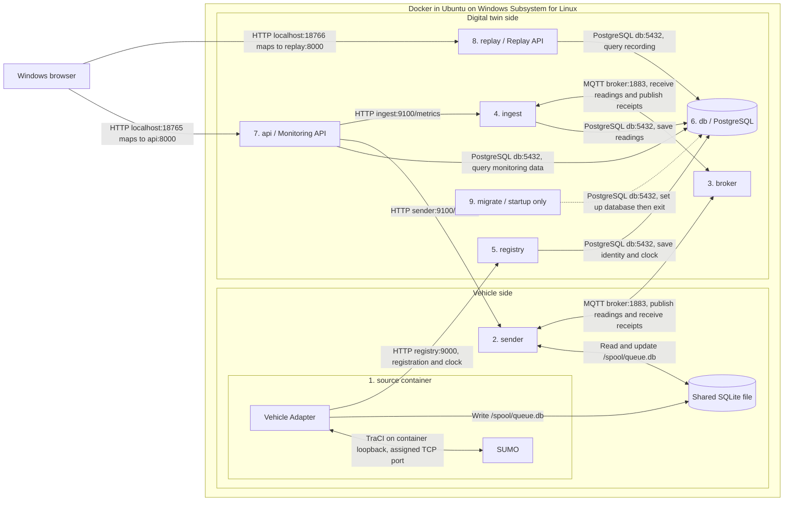

# How the bus and digital twin connect

DriveTwin has a **vehicle side** that produces readings and applies permitted changes, and a **digital twin side** that stores those readings, estimates what may happen, and checks decisions. Simulation of Urban Mobility (SUMO) plays the role of the vehicle and its road and charging environment. Both sides run on one laptop. The vehicle interface defines the observation and control boundary.

The one-bus monitoring demo had **eight running containers** while the bus drove. The browser ran on Windows. The energy and control tests use additional or different components. See the [demo result](../verification/source-reproduction.json) and [demo runner](../../scripts/release/demo_session.py).

## The nine monitoring containers

TraCI means Traffic Control Interface, the connection the Python adapter uses to step SUMO, read its battery and motion, or apply an authorized change. One observation message contains named readings such as speed and battery charge. The adapter saves each original in SQLite, a database kept in a local file. The sender reads that file and publishes the message to Mosquitto. Mosquitto is a broker, meaning a service that forwards messages between publishers and subscribers. MQTT is the messaging protocol they use.

Ingestion checks the message against its registered source and the signal catalog, then commits the original, history, and latest state to PostgreSQL. A **commit** makes a set of database changes take effect together. Only after that transaction does ingestion send the storage receipt that lets the sender retire the original from the queue. A retry can deliver the same message again. The repository uses its stable identity to keep one accepted record. The registry separately records which bus and run produced the readings, its configuration, and whether its simulation clock is running or paused. [Monitoring walkthrough](../monitoring-architecture-walkthrough.md)

The dashboard calls the **API**, or application programming interface, for current values, history, map and trajectory, forecasts, and system health. Its live view uses **Server-Sent Events (SSE)**, an HTTP response that stays open so the server can send fresh snapshots. Replay has its own service, credential, and playback clock. It reads the saved recording from the same PostgreSQL instance through a separate read role. [Map, history, and health](../setup/map-history-and-health.md) · [Replay guide](../setup/monitoring-start-view-stop.md)

## Running containers and their jobs

A Docker image packages a program and its dependencies. A container is one running instance of an image. Docker Compose starts the related instances and gives them service names, networks, and storage. A module is a unit of code and can share a container with other modules. For example, the `api` container serves both the built React dashboard and the read endpoints. The React code runs in the browser once loaded. [Monitoring Compose file](../../ops/compose/compose.monitoring.yaml) · [Dashboard image](../../containers/monitoring.Dockerfile)

| Service | Side | Role and main code |
|---|---|---|
| `source` | Vehicle | Runs the Python adapter and a SUMO child process in the same container. Samples the bus, writes its outgoing queue, and reports source identity and clock. [Adapter](../../src/evdt/monitoring/adapter.py) · [Simulator connection](../../src/evdt/monitoring/source.py) |
| `sender` | Vehicle | Reads the durable queue, delivers originals over MQTT, retries, and processes storage receipts. [Transport](../../src/evdt/monitoring/transport.py) |
| `broker` | Twin intake | Mosquitto routes observations and return receipts by topic, meaning a named message channel. It has its own local persistence. [Monitoring Compose file](../../ops/compose/compose.monitoring.yaml) |
| `ingest` | Twin intake | Validates, stores, and acknowledges observations. [Receiver](../../src/evdt/monitoring/ingest.py) · [Repository](../../src/evdt/monitoring/repository.py) |
| `registry` | Twin identity | Accepts authenticated source registration and clock updates and stores them in PostgreSQL. [Registration API](../../src/evdt/monitoring/registration_api.py) |
| `db` | Twin storage | PostgreSQL holds the original messages, per-signal history, current values, run and clock metadata, and optional forecast and command records. Database roles give each service access to the tables it needs. [Monitoring schema](../../migrations/monitoring) · [Command schema](../../migrations/commands) |
| `api` | Twin read and display | Serves the dashboard and exposes scoped HTTP reads. History, map, health, and forecast read modules run here. [Monitoring API](../../src/evdt/monitoring/api.py) |
| `replay` | Twin playback | Serves the replay page and supplies a scoped, read-only recording to the browser. [Replay API](../../src/evdt/monitoring/replay_api.py) |

`migrate` is a ninth container created during monitoring startup. It sets up the database tables, permissions, and run configuration, then exits. Setup tools and verification probes also run briefly. After the bus finishes, the demo stops delivery and keeps `db`, `api`, and `replay` available for the viewing window. These counts describe a single session. [Demo lifecycle](../../scripts/release/demo_session.py)

## Where analysis, decisions, and control run

For storage, forecast provenance and authority boundaries, see [from a bus reading to a forecast or charging decision](from-readings-to-analysis.md).

The current geographic profile uses the trusted `scripts/route_aware_energy/controller.py` process, a durable PostgreSQL ownership claim, one temporary worker at a time, and direct writes through its restricted forecast role. It serves current/history records through `/v2/energy-forecasts`. The [moving-bus configuration below](#moving-bus-charging-configuration) describes its service set and interfaces.

The following table retains the earlier saved energy product and stationary charging configurations. Their one-off controller, concurrent worker harness and writer container are historical interfaces, not the current geographic scheduler.

A **job** is one piece of work, such as calculating the energy to reach Depot A. A **worker** is the program that does that work. DriveTwin starts one temporary container per **Energy Worker**. A **service** such as the Monitoring API stays running for the session so it can answer many requests. The Energy Worker takes one request, returns one result, and exits. The Forecast Controller then removes that container.

| Name | Meaning, location, and lifetime |
|---|---|
| **Monitoring API** | The web application in `api`. It stays available during the session and serves saved readings, computed read views such as history summaries, and saved forecasts. The dashboard is the browser application that calls it. |
| **Replay API** | The web application in `replay`. It stays available during the session and provides recorded observations for the browser's playback. |
| **Legacy Energy Forecast** | The historical advisory job, from reading inputs to saving a route estimate, range, and any station approach results. A forecast request starts the job. The Monitoring API serves the saved result afterward. |
| **Legacy Forecast Controller** | The historical host Python program `run_monitoring_forecast.py`. In the saved energy test it ran inside Ubuntu, outside Docker. It fetches inputs over HTTP, builds the driving plans, computes scenario ranges in its own process, runs the Energy Workers, and sends the assembled result to the Forecast Writer. It exits after saving. |
| **Legacy Energy Worker** | The calculation program packaged in a temporary container. The saved Energy Forecast used one job for the route estimate, one for the recent-consumption reference, and two for station approaches. The Forecast Controller can run up to four Energy Workers concurrently. |
| **Legacy Forecast Writer** | The `forecast-writer` container. It starts after the calculations finish, receives the assembled result, writes it to PostgreSQL with a restricted database role, and exits. The Monitoring API reads the saved result at `/v1/energy-forecasts`. |
| **Station Approach Forecast** | A calculation of the battery state on the way to a charger. The Energy Forecast includes assumed road approaches as advice. The Charging Advisor uses its own qualified stationary-departure approach calculation for charger selection. |
| **Command API** | The service in `command-api`. The selected configuration determines whether it runs the speed command application or the charging application. It starts for that control session and handles scoped requests and records. |
| **Speed Command** | A request to set a speed limit. The Command API records it. The Speed Executor in `source` claims it and uses TraCI to apply it. Later speed readings let an observer check the effect. |
| **Charging Advisor** | The decision module called by the charging application in the Command API. It calculates station approach energy and ranks eligible chargers when the charging service asks for a recommendation. The result feeds the command authorization path. |
| **Thermal Analysis** | The offline model and advisory studies run as Python jobs when launched. In the combined test, the cooling checks run inside the existing `charging-fixture` process while that test runs. |

Each Energy Worker receives a JSON request on standard input and returns a JSON result on standard output. Those are process data streams. Docker networking is disabled for Energy Workers. They receive a prepared set of inputs with no database connection or service credentials. The Forecast Writer is a separate program with the database access needed to save the assembled record. [Forecast Controller](../../scripts/known_route_energy/run_monitoring_forecast.py) · [Scenario ranges](../../src/evdt/energy/product.py) · [Energy Worker lifecycle](../../scripts/known_route_energy/energy_runtime.py) · [Forecast Writer](../../ops/compose/compose.energy.yaml)

**Decision and command.** The optional `command-api` service is the coordinator. In the speed profile it checks operator requests, saves a command, and lets the authorized executor in `source` claim it over HTTP. Saving a reservation before handoff prevents a duplicate claim. The source uses TraCI to apply the speed limit and sends a result. An observer checks later speed history and sends separate effect evidence. The optional dashboard operator gateway forwards supported actions from `api` to `command-api`, so the browser stays on the monitoring address. [Speed executor](../../src/evdt/live_speed_command.py) · [Command API](../../src/evdt/command_api.py) · [Operator gateway](../../src/evdt/monitoring/operator_routes.py)

**Charging.** The charging overlay uses the same `command-api` service name, running the charging application. The registered `charging-fixture` hosts SUMO and provides bus departure and station observations through distinct role credentials. The advisor runs as a module used by the charging API. It checks eligible routes, forecasts approach energy, and ranks stations. The normal path requires operator authorization. The separately approved automatic profile adds a one-use actuation grant after a final check. The vehicle-side executor uses TraCI to set the route and charger stop. Effect observations verify actual energy delivery and resumed driving. The matched Stationfinder comparison is a separate simulator experiment in a single temporary container. [Charging API](../../src/evdt/charging_api.py) · [Charging overlay](../../ops/compose/compose.charging.yaml) · [Charging comparison](../setup/registered-charging-and-dynamic-comparison.md)

**Thermal analysis.** The baseline adapter derives temperature readings from its simulated vehicle model. The thermal studies run separate analysis scripts. In the combined fault tests, the `charging-fixture` actor also drives the simulated cooling checks and publishes regular telemetry through the shared queue. This profile has no separate always-running thermal API. [Combined charging and thermal fixture](../setup/charging-and-cooling-checks.md)

| Session | Running service set at the main stage | Temporary startup and tool containers |
|---|---|---|
| One-bus release monitoring and replay | **8** from the service table | `migrate` plus setup helpers |
| Two-bus release extension | **10** when both buses run, adding `source2` and `sender2` | `migrate` plus setup and verification helpers |
| Saved energy dashboard integration test | **2** base services, `db` and `api`. The test seeded recorded observations. | `migrate`, setup probes, up to four isolated calculation workers at once, and the one-off writer afterward. A separate temporary database is used for restore checks. |
| Live speed command and restart check | **8** at the main driving stage. This session uses `command-api` in place of starting `replay`. | `migrate`, `command-migrate`, and verification helpers |
| Dedicated registered charging case | **4** during the drive, `db`, `registry`, `command-api`, and `charging-fixture` | Three migration jobs plus verification helpers |
| Combined charging and thermal fixture | **8** during normal delivery, `db`, `registry`, `api`, `broker`, `ingest`, `sender`, `command-api`, and `charging-fixture` | Three migration jobs plus verification helpers. The interruption cases deliberately stop delivery services. |

The saved browser and command restart resource traces recorded their respective eight-container stages. The other rows describe the service sets selected by their runners. A count depends on the session and on when it is sampled. [Extension runner](../../scripts/release/extension_session.py) · [Energy integration runner](../../scripts/known_route_energy/qualify_energy_product.py) · [Restart cases](../../scripts/release/restart_cases.py) · [Registered charging runner](../../scripts/charging/qualify_registered_charging.py) · [Combined runner](../../scripts/combined_faults/qualify_combined_faults.py)

## Moving-bus charging configuration

The geographic launcher starts the seven core monitoring services `db`, `broker`, `registry`, `ingest`, `sender`, `api`, and `source`. Replay adds an eighth service. Operator-confirmed charging with replay adds `command-api` as the ninth. The route-aware Forecast Controller also runs as a Python process in Ubuntu. It starts one temporary worker container at a time for regular forecasts or charging comparisons, and saves the result directly with its restricted PostgreSQL role.

| Connection | Interface and contents |
|---|---|
| Forecast Controller to Monitoring API | `GET /v2/energy-input` on `127.0.0.1:18765` reads the authenticated bus snapshot and active road plan. |
| Forecast Controller to Energy Worker | Process input and output carry the forecast or charging request and its result. The worker has no network access. |
| Dashboard to Monitoring API | `GET /v2/charging-advisory` reads the current comparison with the reader credential. `/v2/operator/{run_id}/{asset_id}/charging` accepts the authorized operator's review, approval, and veto. |
| Monitoring API and Vehicle Adapter to Command API | `command-api:8000` stays on the private network. The gateway forwards operator requests. The adapter separately retrieves a one-use grant and reports whether SUMO acknowledged it. |
| Vehicle Adapter to SUMO | TraCI inserts an approved stop. Later readings report approach, actual battery transfer, target reached, and resumed travel through normal telemetry. |

[Moving-bus data flow](moving-bus-charging.md) · [Operating guide](../setup/moving-bus-charging.md)

## Ports and interfaces

A port is a numbered entry point for a connection. `api:8000` means port 8000 on the Docker service called `api`. Inside the Docker network, programs use service names. On Windows, `127.0.0.1` means the local machine. Publishing `127.0.0.1:18765` to `api:8000` gives the browser a local address for the container. Several containers can each listen on 8000 because each has its own network address.

| Address or interface | Where it exists | Who connects and what passes through it |
|---|---|---|
| `http://127.0.0.1:18765` → `api:8000` | Local host publication for monitoring | Windows browser or local tool. Dashboard assets, `/v1/snapshot`, `/v1/stream`, `/v1/history`, `/v1/map-context`, `/v1/trajectory`, exports, forecasts, health. Optional `/v1/operator/{run_id}/{asset_id}/...` gateway. |
| `http://127.0.0.1:18766` → `replay:8000` | Local host publication for replay | Browser with replay credential. Replay page and recorded session via `/v1/replay/sources` and `/v1/replay/sessions`. |
| `http://127.0.0.1:18831` → `command-api:8000` | Default local host publication when command service is selected | Authorized local operator or test controller. Some runners ask Docker to assign an unused host port instead. |
| `http://api:8000` | Docker `fixture` network | Internal observer or tool. Read scoped telemetry or results, using the same API paths as the monitoring service. |
| `http://registry:9000` | Docker `fixture` network | Producers register their run and asset at `/v1/registrations`. The live adapter posts its clock state to `/v1/clock-events`. Both use the producer credential. |
| `broker:1883` | Docker `fixture` network | `sender` and `ingest` connect over MQTT. Topics are `evdt/simulation/{run}/{asset}/{source}/observations` and the corresponding `/receipts`. Telemetry and storage receipts travel here. |
| `db:5432` | Docker `fixture` and `replay-data` networks | PostgreSQL connections for the server applications, using role-specific passwords. Ingestion writes telemetry, the registry writes metadata, and the read services query authorized data. Optional forecast and command writes use separate roles. |
| `http://sender:9100/metrics`, `http://ingest:9100/metrics` | Docker `fixture` network | Monitoring API pulls authenticated delivery, connection, and queue diagnostics for its System view. A second sender uses `sender2:9100`. |
| `http://command-api:8000` | Docker `fixture` network with command profile selected | The optional operator gateway, executor, and observer. Speed uses `/v1/commands`, `/internal/v1/claim`, `/internal/v1/result`, and `/internal/v1/effect`. The charging overlay adds `/v1/charging/...` for departure, station status, recommendation, diversion, claim, and effect. |
| `127.0.0.1:<assigned TraCI port>` | Loopback inside the simulator's container | Python controls and reads its SUMO process. SUMO steps, motion and battery queries, and permitted speed or route changes. This address belongs to the container's own loopback. |
| `/spool/queue.db` | Shared Docker volume mounted into the vehicle-side containers | Source writes original messages. Sender reads and updates delivery state. SQLite uses a file, so this link has no network port. |
| Standard input and output | Process streams for short-lived energy workers | Controller passes a bounded JSON request and receives the result. The writer takes its own input and connects to PostgreSQL afterward. |

The demo fixes ports `18765` and `18766`. The saved energy dashboard test used `18815` for its monitoring API. The history restore runner defaults to `18785`. The earlier dataflow fixture uses `18760`. Some command and restart tests set the host port to `0`, which asks Docker to pick a free one. The runner then reads the assigned address with `docker compose port`. These are session addresses for the same service interfaces. [Demo runner](../../scripts/release/demo_session.py) · [Energy runner](../../scripts/known_route_energy/qualify_energy_product.py) · [Restore runner](../../scripts/monitoring/qualify_history_restore.py) · [Earlier fixture](../../ops/compose/compose.dataflow.yaml)

The `fixture` network carries the live services. `replay-data` connects the database and replay service through its separate read role. `host-access` and `replay-browser` support the two browser publications. The database, broker, registry, metrics, and TraCI ports stay inside their network boundaries. Local HTTP and MQTT access still check the appropriate credentials. The browser uses an HTTP authorization header, and the command executor and observer have their own credentials. [Monitoring networks and mounts](../../ops/compose/compose.monitoring.yaml) · [Command service](../../ops/compose/compose.commands.yaml)

## What HTTP does

**HTTP**, or Hypertext Transfer Protocol, is a way for a client to request something from a server. An **API** is the set of requests a program offers. The HTTP address locates the server. The **path** names the operation. For example, `GET http://127.0.0.1:18765/v1/snapshot?asset_id=bus-001` asks the Monitoring API for this bus's current readings. `GET` is the request method, `18765` is the host port, `/v1/snapshot` is the path, and `asset_id=bus-001` selects the bus.

The request carries the reader credential in the `Authorization` header. A header is metadata sent alongside the request. A successful response carries status `200` and the data as JSON, a text format for structured values. A status such as `401` asks for a valid credential, and `403` means that credential lacks permission for the requested asset. A `POST` can carry a JSON body to submit a source registration, clock update, command, or effect report. A command response can acknowledge a request or reservation. Later observations establish what the vehicle actually did. [Reader access](../../src/evdt/monitoring/http_readers.py) · [Registry API](../../src/evdt/monitoring/registration_api.py) · [Command API](../../src/evdt/command_api.py)

The live dashboard starts one HTTP request to `/v1/stream` and leaves the response open. The Monitoring API sends repeated snapshots using Server-Sent Events. HTTP also carries diagnostics from the sender and receiver, forecast inputs and saved results, and command requests and claims. MQTT carries the original bus observations and storage receipts between the vehicle and ingestion. PostgreSQL connections, the shared SQLite file, TraCI, and Energy Worker streams have their own interfaces. [Monitoring API](../../src/evdt/monitoring/api.py)
