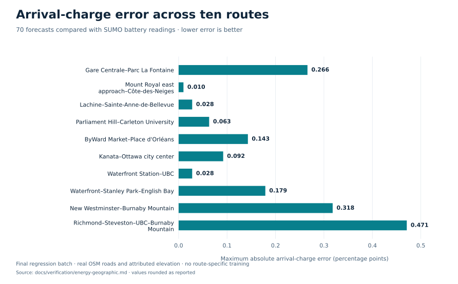

# DriveTwin implementation and verification

DriveTwin connects a SUMO electric bus to durable monitoring, route-aware energy advice and guarded control. SUMO supplies simulated movement and battery state. DriveTwin records the observations, calculates predictions from the information available at each cutoff, and checks later observations for the effect of an authorized action. The [capability matrix](../release/capabilities.md) identifies each supported profile and its evidence.

## Readings and durable delivery

The Vehicle Adapter samples twenty standard signals and saves each original message to a SQLite disk queue. The Sender retries the same bytes through MQTT. Ingestion validates the registered source and commits the original message, per-signal history, current state and receipt in one PostgreSQL transaction. Only a matching post-commit receipt permits the Sender to retire the queued message. Backlog enters history without moving current state backward.

A reading has a value, unit, quality, source identity and observation time. A valid reading can become stale; good numerical quality does not mean recent delivery. Monitoring shows that distinction. History plots and JSON/CSV exports read stored observations. Replay uses a separate clock, credential and read-only database role.

The measured one-bus run reconciled 1,860 messages and 37,200 readings, including warmup. A separate 300.55-second delivery outage reconciled all 480 original messages; its queue cleared 19.84 seconds after restoration began. These results apply to their recorded configurations. [Delivery trace](engineering-walkthrough.md#durable-delivery-through-an-outage) · [Monitoring review](../verification/one-bus-monitoring-review.json) · [Recovery review](../verification/outage-delivery-compatibility.json)

## Energy forecasts and reserve

The current geographic Energy Forecast is a physics-based forward calculation. It starts with admitted charge, speed and route progress, trims the traveled roads, and plans movement over the remaining elevation, turns, road limits and scheduled stops. Vehicle ratings and declared future conditions determine acceleration, resistance, equipment demand and battery constraints. The energy ledger records draw, usable regeneration, rejected recovery and unmet demand.

A kilowatt-hour (kWh) measures energy. Charge percentage expresses a fraction of the declared battery capacity. For a 350 kWh profile, a 10% reserve is 35 kWh. The forecast keeps both arrival charge and the lowest predicted charge along the route: recovery on a later descent cannot erase an earlier reserve breach.

| Result | Meaning |
|---|---|
| Available | The assumed movement can finish within the declared energy and power limits |
| Infeasible | The attempted plan exceeds an energy or power limit; an achievable arrival charge is omitted |
| Unavailable | Required inputs, geometry, identity or a supported bounded calculation are missing |
| Historical | A saved calculation for an earlier input or route; current guidance requires a separate validity check |

The trusted controller authenticates matching observations and route context, persists a scheduling claim and starts one isolated numerical worker. The worker receives bounded JSON, has no network or credentials, and cannot inspect the simulator or future outcomes. The restricted writer saves only a result that matches the claim and input generation. Saved inputs distinguish observed state from declared future traffic, weather, loads and equipment use. A declared absence of charging is an assumption, not a sensed fact.

The first forecast runs when inputs are valid. The live geographic profile schedules periodic updates 120 working seconds after the preceding input cutoff; confirmed plan changes, material changes or recovery can request earlier work. Working time is time inside SUMO and holds during pause. Real-life time still governs freshness and deadlines. One running job and the newest pending input bound the queue.

Ten OSM journeys use one model without route-specific learned weights. In the final 70-forecast regression batch, the largest arrival-charge error was 0.471 percentage points, with no missed reserve breaches in the declared cases. SUMO battery readings are the independent reference; this is simulation evidence, not physical-bus validation. Earlier frozen geographic and synthetic evaluations retain their distinct results and consumed claims. [Model](../models/route-aware-energy.md) · [Input-to-result trace](engineering-walkthrough.md#forecast-input-provenance) · [Geographic evidence](../verification/energy-geographic.md)

Each bar shows the largest reported arrival-charge error for one journey in the final regression batch. The [source table](../verification/energy-geographic.md#ten-journey-accuracy-result) retains the route conditions and evaluation scope. Regenerate this chart from the project root with `uv run --script scripts/build_geographic_result_figure.py`; the script declares its optional Matplotlib dependency separately from application packages.

The earlier known-route predictor used a training speed template and a 12/6/6 mission split. Its 0.285 kWh reserved-trip error and scenario ranges apply to that frozen model. Historical records and stationary charging still need its readers and qualification artifacts. [Legacy study and worked example](legacy-energy-example.md)

## Commands and independently observed effects

The operator, executor and observer have separate authority. The Command API checks the target bus and recording, freshness, expiry and configured protections. It commits a durable reservation before handing an action to the executor. If a reply is lost, the action may already have occurred: the reservation remains and a second claim is rejected.

An acknowledgment records an attempted or accepted action. Later speed, route, charging and battery readings establish its effect. The matched speed-command test reduced peak speed from 7.80 to 4.00 m/s. An uncertain handoff remains unresolved until eligible independent evidence can settle it. [Command lifecycle](../architecture.md#local-command-lifecycle) · [Command closeout](../verification/command-acceptance.md)

## Charging decisions

The moving-bus Charging Advisor uses the route-aware model for candidate driving legs and combines them with station eligibility, availability, waiting and charging assumptions. Advice carries no command authority. An approved reviewed offer passes through a separate durable grant, current-state checks and executor checks before SUMO receives the requested stop.

In the recorded Montréal case, the bus started at 11.6% charge and approved a 12% departure target. SUMO accepted the stop at working second 7. Independent station and adapter records measured 4.192 kWh delivered, motion resumed at 263.8 seconds, and the trip finished at 696 seconds with a lowest observed charge of 10.720%. All 696 original messages reconciled. [Charging trace](engineering-walkthrough.md#charging-approval-through-observed-effect)

Ordinary launcher operator approval is limited to five reviewed profiles at 1× with matching station and service assignments. Automatic charging, scheduled waiting and outage replacement have separate one-bus cases. The older stationary advisor and its matched policy comparison retain their qualified approach model and original scope. [Moving-bus scope](../verification/moving-bus-charging.md#operating-scope) · [Stationary charging](../verification/stationary-charging-acceptance.md)

## Thermal studies and extension

Laboratory motor winding-temperature prediction used independently split bench sessions. Synthetic bus cooling faults and matched intervention are separate studies. The integrated cooling case reduced modeled motor temperature by 2.59 °C after 120 simulated seconds; it does not validate a physical bus thermal controller. [Thermal scope](../verification/thermal-acceptance.md)

A new scalar signal needs a catalog entry, unit, cadence and adapter mapping. The coolant-temperature exercise followed a twenty-first signal through ingestion, storage, History and replay, with separate asset/run permissions. [Extension guide](../setup/sensor-and-asset-extension.md)

Use the [architecture](../architecture.md) for interfaces and ownership, [runtime topology](runtime-topology.md) for processes and ports, and [operating guides](../README.md) for setup and recovery. Fleet endurance, physical integration, adaptive promotion, automatic retention deletion and production deployment remain outside this local release.
