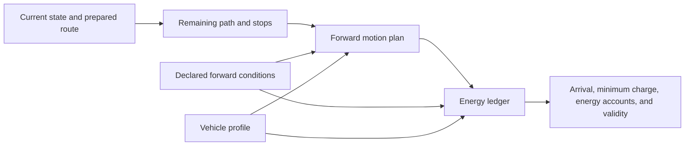

# Route-aware Energy Forecast

**Retention update:** original model artifacts and consumed evaluation identities remain, while completed historical raw recordings and superseded study input copies are retired under [ADR 0075](../adr/0075-minimal-historical-retention.md). Recorded numerical outcomes retain their original scopes; inspection requiring retired payloads is unavailable. See the [issue/fix guide](../setup/known-issues-and-fixes.md).


Status: implemented physics-based predictor used by the explicitly enabled geographic Energy Forecast service, with source admission, continuous scheduling, persistence and an Energy-view interface. [Route-aware qualification](../verification/energy-route-aware.md) and [geographic verification](../verification/energy-geographic.md) record its independent evidence. The legacy known-route forecast retains its original qualification; its evaluation results do not qualify this model.

## Short explanation

The model estimates the energy needed to finish an assigned route. It starts with current battery charge and speed, then follows the remaining roads, hills, turns, and stops. It predicts movement along that path and adds the work needed to accelerate, climb, overcome rolling resistance and air resistance, and run equipment. Braking can return some energy to the battery.

The calculation keeps the lowest predicted charge as well as arrival charge. A later downhill section cannot erase an earlier reserve breach. If the assumed movement requires more energy or power than the battery can supply, the result is infeasible and does not present an achievable arrival charge.

## Implemented numerical path

Model class: deterministic, physics-based forward prediction with constrained movement planning and numerical energy integration. Identical validated inputs produce identical numerical outputs. The implementation has no machine-learning estimator or online parameter training. Vehicle profiles supply physical parameters and optional component curves; study outcomes validate the implementation and its declared operating domain.



The numerical package is `evdt.energy.route_aware`. It has no database, HTTP, SUMO, or terrain-file dependency. The one-request worker reads bounded JSON from standard input and writes a bounded JSON result. A separate caller is responsible for authenticating the inputs and accepting the result for the matching source and generation.

| Component | Responsibility |
|---|---|
| `geometry` | Trim traveled distance, retain road occurrences and stops, calculate grade and compass heading |
| `motion` | Construct continuous acceleration, cruise, braking, and dwell phases whose distances close to the remaining route |
| `power` | Bound planned speed and acceleration using vehicle power, road grade, equipment demand, and declared conditions |
| `signals` | Add stops and waits for an optional declared fixed-cycle signal program |
| `ledger` | Integrate mechanical work and electrical flow while respecting battery limits |
| `forecast` | Combine inputs, resolve time-dependent movement caps, and return available, infeasible, or unavailable status |
| `wire` and `worker` | Validate bounded input/output records and execute one calculation |

## Movement assumptions

The motion planner first works backward from stops and speed restrictions to determine where braking must begin. It then works forward from the observed current speed to enforce the declared acceleration limit. Within each road piece, it creates a triangular or trapezoidal speed profile: accelerate, cruise when distance permits, and brake.

Turn speed uses a declared comfort acceleration of 1 m/s² and curvature estimated from adjacent polyline directions. The default arrival assumption is a stop. If the observed speed exceeds a new traffic or comfort assumption, the plan begins braking toward that assumption and records the transition. It preserves the observed speed and kinetic energy. A state that cannot meet a legal road limit, required stop, or arrival constraint within the declared deceleration remains unavailable. The numerical planner does not control SUMO.

For a source with a documented SUMO Euler position update, the trusted assignment can declare `sumo_euler_step_working_s`. The independent study declares 0.2 working seconds. When the continuous plan cannot brake from the observed state, this policy allows up to ten working seconds of initial braking using end-of-step speed for position. Each step stays within the declared deceleration and the speed limits of the road pieces it travels. The planner returns to continuous movement as soon as it can meet the remaining limits. Forecasts under this policy carry model version `route-aware-energy/2.0.1-dev`. [SUMO integration methods](https://sumo.dlr.de/docs/Simulation/Basic_Definition.html#defining-the-integration-method)

Traffic factors reduce the road speed cap. For conditions that vary with working time, the planner uses the most restrictive factor overlapping each piece's expected traversal and recalculates the plan. It permits eight iterations. Failure to settle returns an unavailable result. Unprovided traffic-light delays remain excluded and recorded as an assumption.

Observed aggregate auxiliary power applies over the initial 120-working-second horizon. Beyond that horizon, a declared forward aggregate is required. Explicit extra loads must exclude equipment already counted in that aggregate. This prevents a short history window from silently becoming the equipment assumption for the whole trip.

## Work and battery accounting

For each integration interval, mechanical work consists of:

| Account | Calculation |
|---|---|
| Acceleration | Change in kinetic energy using loaded mass plus rotating equivalent mass and the speed at each end of the interval |
| Grade | Loaded mass × gravity × signed height change |
| Rolling resistance | Rolling coefficient × road-condition multiplier × loaded mass × gravity × slope cosine × distance |
| Air resistance | Relative air speed and its component along the bus heading, with declared density, drag coefficient, and frontal area |

Wind is a velocity vector pointing toward the direction the air moves. A strong tailwind can assist movement; its sign remains intact. Pressure and temperature, when both supplied, determine dry-air density. Otherwise the declared profile density applies. The drag calculation uses constant effective frontal area and does not model detailed crosswind aerodynamics.

Positive wheel work passes through propulsion efficiency. Negative wheel work supplies potential regenerative energy. Recovered energy can serve equipment and then charge the battery. Battery power acceptance and available capacity limit recovery; rejected energy remains visible. Discharge power and accessible stored energy limit draw. Any unmet electrical demand marks the attempted movement plan infeasible.

The ledger checks three balances:

```text
final stored energy = initial stored energy - battery draw + battery recovery
requested equipment and propulsion energy
  = battery draw + used regeneration - battery recovery + unserved energy
potential regeneration = used regeneration + rejected regeneration
```

Temperature-dependent usable fraction, when configured, sets an inaccessible-energy floor relative to nominal capacity. It does not delete stored energy or silently change the source's charge scale. Changing loaded mass while moving is rejected. Optional component curves require valid inputs within their declared domains.

Stable summation retains small contributions beside large totals. The maximum integration step is 0.2 working seconds; the ceilings are 100,000 integration steps across the full plan and saved comparison window, 10,000 road pieces, and four working hours. The input limit is 4 MiB and the result limit is 256 KiB. An isolated worker/database check verified the 256 MiB restricted container configuration and successful execution. Broader runtime and connected results remain separately scoped in the verification record.

## Result interpretation

| Status | Meaning |
|---|---|
| Available | The declared movement plan has a calculated arrival and no material unserved demand |
| Infeasible | The attempted plan exceeds battery energy or power capability; diagnostic accounts remain, and achievable arrival charge is omitted |
| Unavailable | Required inputs or geometry are missing, inconsistent, outside the supported domain, or cannot produce a bounded plan |

An available calculation describes its explicit assumptions. Forecast accuracy and real-world applicability require independent evidence. The uncertainty method is currently `not_established`; the result makes no probability-coverage claim. Each result carries the source scope, input generation, model version, and fingerprints of its request, route, and vehicle profile.

The analytical and development results are in the [verification record](../verification/energy-route-aware.md). The [route guide](../data/route-elevation.md) explains elevation quality, structures, nominal lane positions, and assumed lane changes. The [implementation specification](../design/energy-forecast-v2.md) defines interfaces and acceptance gates. The [operating guide](../setup/route-aware-energy.md) covers configuration, verification, and shutdown.

## Continuous service and current limits

The explicitly enabled controller requests the first valid forecast immediately. In the live geographic profile, periodic updates are due 120 working seconds after the preceding forecast's input cutoff; confirmed plan changes, material input changes, or recovery can request earlier updates. Working seconds measure time inside SUMO and hold while the trip is paused. One calculation runs at a time, and the controller keeps the newest pending input, so completion times can vary. Earlier qualification profiles retain their recorded intervals. SQL records preserve source identity, input assumptions, worker ownership, history, and completed prediction errors. The Energy Forecast tab distinguishes current guidance, unavailable input, and historical records.

Three separate, nonoverlapping comparison windows with errors in the same direction above the configured energy-change threshold produce a persistent-mismatch notice. The default threshold is 0.25 kWh per window. This is an initial monitoring rule, not a fitted accuracy guarantee. The notice does not change model parameters or authorize a command.

Localized road and stop scenarios bind to a specific route revision. A detour or completed-stop revision requires a new approved localized assignment. The input builder refuses an outdated assignment; it does not transfer an occurrence index onto a different road. Broad conditions without localized effects can continue across route revisions. The current SUMO adapter rejects ambiguous repeated-road stop assignments; explicit occurrence-aware input is supported by the model and study interface.

The one-bus connected check verified the source, controller, and browser path under the default continuous policy. Study 2.0.1 passed all 21 development, 21 validation, and 21 fresh reserved cutoffs using the Euler position policy and corrected reference collector. The reserved evaluation measured 0.280 trip-balanced normalized absolute error against a limit of 1.0. The escarpment trip crossed below the 10% reserve, and all seven forecasts for that trip predicted the breach. Accuracy evidence covers the three declared SUMO route families and their vehicle and equipment assumptions. [Verification record](../verification/energy-route-aware.md)

## Geographic movement profile

The geographic profile selects `route-aware-energy/2.1.1-dev`. It adds a forward speed/acceleration envelope derived from declared discharge limits, grade, mass, resistance, equipment, and wind. It never increases a battery limit to make a plan feasible. If equipment alone exceeds available power or a road cannot be climbed within the supported envelope, the result is unavailable with a specific reason.

The OSM adapter uses the imported turn-speed limits and unopposed minor-junction visibility distance. The worker receives a suffix of the assigned route bound to the observed lane, retaining original route identity and remapped stop/condition occurrences.

Adjacent-lane preparation matches nearby positions along curved carriageways. Equal percentages of two long lane shapes can refer to different longitudinal positions. The alignment keeps the five-meter lateral-separation limit, lane-change permissions, and monotonic progress; it does not bridge disconnected roads or alter the observed lane.

An optional fixed-cycle projection reads the declared signal program for each controlled connection. It projects braking, waiting for green, and acceleration using the bus's estimated arrival time. A bounded forward correction adds waits until each projected crossing falls within its green interval. It can retain a conservative stop when an earlier delay changes a later crossing. Missing, multiple, or actuated programs are reported as unsupported when this option is enabled. Queues, adaptive timings, signal priority, and signal optimization are outside this profile.

The geographic SUMO profile declares signal braking at 3 m/s² and ordinary comfortable braking at 1.5 m/s². The stronger bound applies to a projected signal approach; it does not rewrite an observed speed. These values match the configured plant and SUMO's `tls.yellow.min-decel` behavior, which also applies to red lights. They are source-specific assumptions, not universal bus parameters. [SUMO options](https://sumo.dlr.de/docs/sumo.html) · [SUMO signal braking implementation](https://sumo.dlr.de/daily/doxygen/dd/d1d/_m_s_vehicle_8cpp_source.html)

Imported timing programs are generated SUMO inputs. OSM identifies signal locations but generally does not provide the real controller's timing. Real-world forecasting requires issued timing or an independently justified delay profile. The geographic comparison evaluates the same declared program on both sides; the forecast never reads future vehicle outcomes.

New policy and vehicle fields are optional on the wire; original request fingerprints remain valid when they are absent. New geographic assignments select the [versioned policy](../../qualification/energy/route-aware/geographic-policy.json). [Geographic evidence](../verification/energy-geographic.md) and [new-map operation](../setup/geographic-energy.md) state the tested domain and required inputs.

Ten real OSM journeys of 3.5–59 km produced 70 forecasts, all within the declared energy-error criteria, with a largest arrival-charge error of 0.471 percentage points. The final batch is regression evidence. An earlier candidate first evaluated two of these journeys after its freeze; their outcomes were then inspected. The common equations and vehicle-model coefficients were unchanged across all ten. The geographic record retains the separate runtime failure, its performance correction, and subsequent checks. These are SUMO battery comparisons under declared operating conditions. Geographic transfer requires valid road, elevation, vehicle, and future-condition inputs; a new route does not require training.
