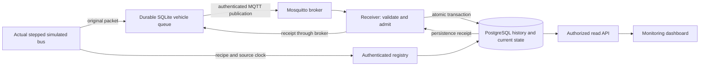
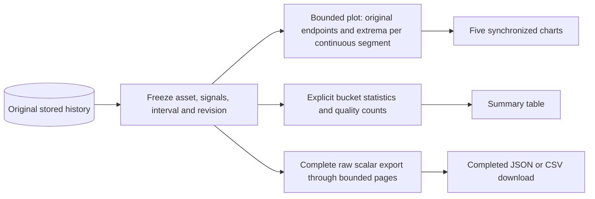

# Understanding the monitoring system

This walkthrough explains the implemented local monitoring architecture. It is not a complete Phase 1 acceptance claim: consult [current status](monitoring-status.md) for measured gates and limitations. Full live workload/resource, storage/retention/startup and final release review remain separate from a working feature. The simulated plant is explicitly assumed, not calibrated to an on-road bus. Operational commands and automatic physical effects belong to later phases.

## Follow one reading

A **signal** is one named measurement, such as `motion.speed`. An **event** is one original packet containing several measurements with shared identity and time. The initial bus emits twenty scalar readings in an event once per simulated second. A scalar is a single numeric value; location uses separately named latitude and longitude signals.

An **asset** identifies the bus. A **run** identifies one recording. The source/session/epoch identify the producer and its timeline. They prevent a restarted model or another bus's data from silently replacing the wrong state. A packet's event identity remains the same when delivery is retried.



Suppose a simulated bus produces a speed reading of 10 m/s. This is an example, not a measured benchmark result. The adapter encodes it with the other nineteen readings, units, quality, timestamps, asset/run/source identities and a recipe fingerprint. It commits the original bytes to its local queue before the sender tries the network.

The sender publishes through MQTT, a messaging protocol that routes messages by topic. Mosquitto is the broker used here. A topic identifies the recording, bus, source and message class. Credentials and access rules restrict which producer can publish or receive a receipt. MQTT quality of service 1 allows retries and duplicates; it does not promise one end-to-end application effect.

A broker acknowledgment means the broker received a publication. The separate application persistence receipt means the server accepted and stored that original packet. The queue retires a packet only after validating its matching persistence receipt. If a receipt is lost, the sender retries the same original packet. **Idempotence** means this retry returns the existing result without creating another durable observation or changing current state.

## Contracts, catalog and recipe

These solve different problems:

| Record | Question it answers | Example |
|---|---|---|
| Schema | Is the packet structurally and numerically valid? | Required identity/time fields; allowed quality states; finite numeric values |
| Signal catalog | What does this signal mean? | Unit, component, physical measurement location, sampling/freshness metadata and provenance |
| Source recipe | What produced this recording? | Simulator/model versions, code/input fingerprints, plant assumptions and actual source identity |
| Trusted run policy | Which source is allowed to produce which signals with which inputs? | The permitted bus/source owner and expected model/cadence/format |
| Source clock | What is the source doing now? | Running, paused or finished, declared simulated time and heartbeat revision |

The registry admits the actual recipe before live observations. A fingerprint is a hash of bytes: changed content produces a different fingerprint. It binds a recording to the exact inputs used for that run. A fingerprint is an integrity check, not proof that an unknown publisher is trustworthy.

The tested held-back sensor extension uses these boundaries. A supported scalar can be added through its adapter/catalog definitions after the documented compatibility preparation, with generic transport/storage/read/display behavior retained. That does not mean every future camera, protocol or physical model can be added without engineering: new data kinds and incompatible semantics need their own design and tests. See [the worked extension](setup/sensor-and-asset-extension.md) and [compatibility](compatibility.md).

## What the database retains

PostgreSQL stores original observation bytes and their hashes, decoded values, registration/clock metadata and persistence receipts. It also maintains individual scalar history rows, current values and dashboard/event indexes. A **projection** is a derived view of stored facts, such as “latest accepted speed for this bus.” Its purpose is efficient reading; it does not replace the original recording.

An atomic transaction commits the original observation, required derived state and receipt together. A crash cannot be treated as successful storage merely because one intermediate operation happened. Duplicate identities and source/time ordering are checked. An older backlog observation can enter history without moving current readings backward.

Rejected originals are retained in quarantine with a reason. Quarantine is an audit area for refused input, not accepted history. Event accounting separates unique generated events from delivery attempts:

```text
generated unique events = accepted + quarantined + explicitly dropped + pending
```

Retries add delivery attempts, not new generated events. Each counted category needs evidence; an uninstrumented or unexplained difference is not silently called zero. See [outage and storage checks](setup/sustained-outage-and-capacity.md).

## The dashboard's view of truth

An API, or application programming interface, exposes authorized read requests. A reader credential is carried in request headers and retained in browser memory. Asset scope applies to catalog, current, history, map and export requests. The existing dashboard is read-only. A map click or history replay does not dispatch a vehicle command.

The selected-vehicle display uses a complete snapshot and a stream of replacement snapshots. The separate [Fleet page](setup/fleet-monitoring.md) uses two bounded polling workers to read independent validated snapshots for every selected authorized bus; its panels preserve each bus's identity, quality, freshness and connection state. A snapshot includes readings plus definitions and explicit quality/freshness/source state. The interface validates identities, formats and revision ordering. Reconnection resynchronizes against a complete snapshot. Browser connection status and sensor freshness are different: a connected dashboard can correctly show an old, missing or finished source.

- **Quality** describes the observation: good, missing, invalid or unknown. Missing/invalid values stay null; a legitimate zero stays zero. Diagnostic raw values/reasons are kept when supplied.
- **Freshness** describes age and source behavior under the registered cadence/deadline. Paused, disconnected, finished and stale states are explicit.
- **Simulated time** describes the model timeline. Observation/receipt wall timestamps describe when software handled the packet. They are not interchangeable latency clocks.

The local map uses the qualified road/context artifacts and observed coordinate pairs. It preserves gaps and labels the last valid location when current coordinates are unavailable. Charging markers are explicitly hypothetical. See [map, history and health](setup/map-history-and-health.md).

## History, plots, summaries and exports



A frozen query fixes the recording, asset, selected signals, interval and database revision. Later arrivals cannot silently change the remaining pages. The plot returns at most 5,000 original points across up to five signals. It retains endpoints/extrema and separates missing/invalid/cadence/epoch gaps. A reduced plot is not a complete export.

Summaries explicitly count good, missing and invalid inputs. Empty buckets have no numeric mean. Raw export pages contain at most 1,000 original scalar rows; the browser validates and assembles the complete result before offering a file. A partial download is not relabeled as complete. At the full W2 first-hour query, five signals contain 18,000 raw readings across eighteen pages, even when the plot is smaller.

The independent history audit reconstructs expected points and statistics from original source packets. Actual JSON/CSV downloads are compared row by row. CSV is a text table whose quoting preserves commas and newlines. These checks protect against plausible-looking charts with wrong values, gaps or incomplete exports. See [bounded history](setup/bounded-history.md) and [query/recovery/download procedures](setup/history-query-and-restore.md).

## Measurement without false precision

The qualification harness follows event identities through source-ready, durable enqueue, publication attempt, broker acknowledgment, receiver, transaction and actual rendered rows. DOM means the browser's displayed element tree. The browser checks every rendered value/unit against the original packet and sends an authenticated post-DOM witness request.

The primary live delay uses a causal upper bound on one qualified Linux clock: source-ready to server receipt of that post-DOM witness. It includes witness-request overhead and does not claim physical screen paint or the instant a person noticed a reading. Separate clock exchanges, process/boot identities and sampling-gap checks expose invalid measurements. Percentiles combine actual event samples; they are not averages of per-bus percentiles.

Resources are measured separately: disjoint application cgroups, whole Linux/WSL overhead, Windows available physical memory, paging and browser process diagnostics. A cgroup is the Linux kernel's accounting boundary for a process group. Cached accounting locations do not replace fresh counters. A correct final reading can coexist with a failed resource test; reports keep those results separate. See [observation measurement](setup/observation-measurement.md) and [full live workloads](setup/full-monitoring-workloads.md).

## Replay and recovery

Replay is retrospective analysis with its own session identity, viewing clock, credentials and read-only backend/network boundaries. Its recording is frozen, original provenance remains available and it cannot reach the operational broker. Seeking backward does not change live bus state. See [recording replay](setup/recording-replay.md).

Recovery has two explicit scopes. The development checkpoint includes its tested pending queues. The history checkpoint includes the source-backed database, original packet/recipe/physical evidence, configuration, inventories and frozen queries; it excludes vehicle queues and physical-plant resumption. Both are private. The history restore requires an independent empty cluster, fresh credentials, complete integrity equality and representative reads. A backup file alone is not a proven restore, and a same-disk copy is not offsite protection.

## Where the tools run

| Component | Role | Location |
|---|---|---|
| Windows PowerShell agent | Source editing and command orchestration | Windows |
| `scripts/linux.py` | Controlled command launcher into the selected Ubuntu environment | Windows to WSL |
| Ubuntu WSL2 | Linux tools and the already authorized native Docker Engine | Lightweight Linux environment alongside Windows |
| Docker Compose | Uniquely owned service/network/volume configurations | Ubuntu |
| SUMO/TraCI and dependent plant | Actual stepped motion and assumed energy/thermal signals | Simulator container |
| Python services / FastAPI | Registration, admission, transport and scoped reads | Separate bounded Linux containers |
| SQLite | Durable per-asset vehicle queue | Owned Linux storage |
| PostgreSQL | Original history, projections, metadata and audit | Owned Linux storage |
| TypeScript / React | Typed interactive monitoring and replay pages | Built into the read service; displayed in Windows browsers |
| Playwright | Automated actual-browser checks and private diagnostics | Windows Edge / pinned Chromium |
| Git and privacy/secret checks | Reviewed local source history and publication boundaries | Canonical project folder |

Docker containers package processes and dependencies; they do not turn assumed plant parameters into validated physical measurements. Compose defines how the processes connect. Credentials, database contents, diagnostics and checkpoints remain ignored/private. The canonical source tree stays `<checkout>`; there is no agent-mode switch or source relocation when changing chats.

The [engineering walkthrough](engineering/engineering-walkthrough.md) follows an observation through durable storage and an approved charging action through its measured effect. The [release evidence](release/verification.md) also covers the implemented command, charging, thermal, and recovery configurations.
