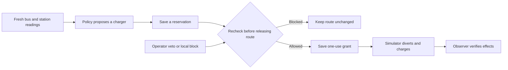

# Reproduce the bounded automatic charging qualification

Automatic dispatch means the policy can request a diversion without a person approving that individual route. For example, a parked synthetic bus reports low energy and a charger reports that power is available. The policy selects an eligible charger. The executor must get two confirmations before it can use the route: a saved reservation and a one-use grant. The operator can block the second step. The run uses the same simulator and frozen energy model as the earlier operator test. [Operating decision](../adr/0063-qualify-bounded-automatic-charging.md)

The reservation is like taking a numbered ticket. It prevents a duplicate but does not tell the executor how to move the bus. The grant is the final permission to use that route. It checks the current observations and protects against a recent charger outage, stale readings, the operator override, and thermal or other local protection. It also checks time twice: simulation time for the modeled vehicle and elapsed time for the running computer. Pausing the simulation cannot extend the real deadline.



## Run the isolated tests

1. Open PowerShell in `<checkout>`. Use the qualified Ubuntu Docker Engine, pinned simulator image, and the Phase 4A network artifact. Choose a new output name.
2. Run:

   ```powershell
   python scripts/linux.py --timeout 600 -- python3 scripts/charging/qualify_registered_charging.py --automatic --output evidence/p4/my-automatic-charging
   ```

   `--automatic` adds the qualification-only profile. Without it the runner exercises only the operator configuration and verifies automatic dispatch is refused. Each case creates a new run and removes its own containers, database volume, and networks. The runner uses no live bus or charger.
3. Expect ten named results, typically within four minutes on a warm Engine. A `True` means the expected outcome occurred, so a refused action should also show `True`. Success requires a top-level `qualification.json` with `passed` and `complete_automatic_matrix` both true. Each case has its own report and cleanup result. For a false result, read that case's private `qualification.json` and `commands.log`. Preserve the failed run. `--case NAME` can diagnose a single case, but it cannot qualify the full matrix.

| Case | Expected bus and service behavior |
|---|---|
| `mission` | One automatic route grant. The bus charges to 87.5 kWh, resumes, and arrives. The independent observer reconciles the trace after the service restarts. |
| `interrupted` | The handoff is discarded after reservation and before grant. Restart leaves it unknown, blocks a new grant, and rejects an ungranted effect report. |
| `lost-grant` | The returned grant is discarded before route actuation. Restart retains the grant and refuses another. There is no observed effect. |
| `override` | An authenticated operator vetoes the reserved command. No grant is released. The veto persists across restart. |
| `thermal`, `local` | A new observation reports a protection limit after reservation. The route remains unchanged and no charge is delivered. |
| `stale` | Stored inputs actually age while the simulation clock is held. No command record is created. |
| `wall-expiry`, `simulation-expiry` | The expired command cannot receive a grant. Both deadline types are checked. |
| `changed-station` | The reserved station loses physical power. The revised station and departure inputs invalidate the old proposal. |

The thermal and local flags are injected test inputs. This qualifies how charging responds to a block. It does not qualify a thermal model or prove the accuracy of a real sensor. A restart is a test of recorded state and safe refusal, not a real vehicle recovery procedure.

## Run the matched-departure comparison

Run the comparison command from the [dynamic comparison guide](registered-charging-and-dynamic-comparison.md) with `--matched-departure` appended and a fresh output directory. The simulator measures charger power at departure in each arm. The custom policies receive that one starting snapshot, without the earlier power history. The native selector reads the same physical station state. All arms use the same road, bus, outage schedule, and reserve cutoff, with rescue disabled. They keep their own search timing and target. Expect six outcome lines and `shared_departure_power_verified: true` in the report.

## Verify the saved reports

Run the operator check once without `--automatic`, and run `python scripts/dev.py check` for the shared engineering checks. The latter prints the directory of its `report.json`. Pass the four report paths into the closeout verifier. For example, replace `SHARED_REPORT_ID` with the directory printed by the shared checks.

```powershell
python scripts/charging/review_stationary_charging.py --automatic evidence/p4/my-automatic-charging/qualification.json --operator evidence/p4/my-operator-charging/qualification.json --matched evidence/p4/my-matched-charging/qualification.json --shared .runtime/dev-checks/SHARED_REPORT_ID/report.json --output evidence/p4/my-phase4-closeout.json
```

The verifier also checks the retained Phase 4A through D2 evidence. It verifies the exact measured source bytes and the results of all required cases. Expect `Phase 4 local evidence verified; Phase 5 entry is ready.` If an earlier private report is missing, restore it from the private evidence copy or report the gap. A successful unit test does not replace a missing mission measurement.
