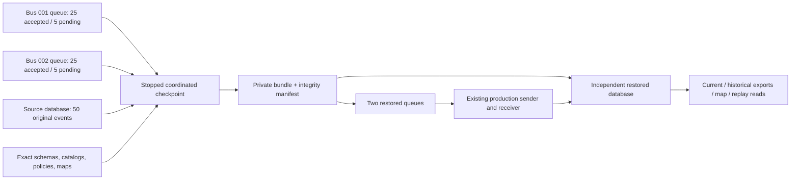

# Development backup and restore: worked recovery exercise

**Historical fixture retirement:** the original completed history/normal-queue backups and recordings described below were retired under [ADR 0075](../adr/0075-minimal-historical-retention.md). Their measured outcomes remain historical summaries. Commands requiring those named originals cannot reproduce the old checks from the reduced tree. Normal new-trip recording and recovery remain implemented; a new qualification needs new authorized evidence.

This guide records the qualified normal-queue recovery exercise. Its original runner is tied to the reviewed historical source fingerprints. The current release separately tracks compatibility with the restored historical recording. Start with the [current reader and restore procedure](history-query-and-restore.md#current-reader-compatibility) and [release evidence](../release/verification.md) when evaluating the current source. The retained normal-queue backup passed a fresh file-integrity check and its required image is still available. [Restoration review](../verification/restoration-review.json)

## What this adds

A backup is a saved recovery point. A restore rebuilds a working system from it. Git protects reviewed source history; it deliberately excludes vehicle recordings, queues and credentials. This exercise protects a development recording separately and proves it can be read and completed after recovery.

The database holds accepted observations, sample/history/current projections, original packet bytes, durable receipts, run recipes, source clocks, maps and access permissions. Each vehicle also has a SQLite queue: a small local database retaining observations until the server confirms durable storage. Saving just the server database would omit generated observations still waiting on a vehicle.

An application programming interface (API) lets another program request application data over HTTP. Here the recovery test uses the same read APIs as the dashboard to verify the restored application's behavior. Docker Compose is the existing tool that starts related containers; a separate Compose project gives this exercise independent services, networks and storage.

The source system is stopped before querying the recovered system. Independent database identity, networks, volumes and new credentials make accidental reads from the original detectable. This is one application built from the canonical source tree; archived JSON/SQL files are recovery artifacts, not another source checkout.

## Terms introduced

| Term | Meaning and use here |
|---|---|
| Coordinated checkpoint | Stop changes across related components before saving them, so database and queues refer to the same recovery point. |
| PostgreSQL cluster identity | A database installation's system identifier; compare it to refuse restoration into the original instance. |
| `pg_dump` / `pg_restore` | PostgreSQL's export and recovery programs. The custom compressed dump contains schema, data, sequence state and object permissions. |
| Schema | Database structure: tables, columns, constraints, functions and related objects. This differs from a telemetry JSON schema, which describes message structure. |
| Sequence | A database counter, used here for generated identifiers. Both its value and whether it has already been used matter. |
| Transaction | A group of database changes that succeeds together or is rolled back together. `--single-transaction` prevents partial archive restoration. |
| SQL | Structured Query Language, the language used to define database objects and read/change records. Migration files contain versioned SQL changes. |
| Access control list (ACL) | Permissions attached to a database object. Preserve them so readers remain read-only and restricted functions stay restricted. |
| Inventory | Counts and deterministic content fingerprints for every application table, plus definitions/permissions/counter state. More informative than a file-copy success message. |
| Manifest / SHA-256 | A list of backup files, lengths and content fingerprints; detects missing, extra or changed bytes. It does not authenticate a maliciously replaced bundle. |
| Recovery point / recovery time | Which generated/accepted work is included, and how long it takes to restore useful service. A small local measurement does not establish a fleet-scale guarantee. |

## Reproduce the original exercise with its qualified source

1. Open Windows PowerShell at the root of the qualified source revision and keep the project launcher configured for Ubuntu. The runner verifies the reviewed source bytes before it creates a fixture. Use the recorded source fingerprints and image identity when selecting that revision.
2. Run `python scripts/dev.py check`. Expected: privacy/secret scans, offline code checks, tests and contract compatibility all pass. The report goes under ignored `.runtime/dev-checks/`.
3. Run `python scripts/linux.py --timeout 2400 -- python3 scripts/monitoring/qualify_recovery.py --evidence-dir evidence/p1/CHOOSE_NEW_RUN_NAME`. Choose a new evidence name; overwriting an earlier run is refused. The launcher requires the normal WSL tool permission, not a global app setting change.
4. Read that directory's `qualification.json`. Require `passed: true`, unchanged source fingerprints, independent cluster identity, identical table/schema/permission inventories and representative API results, denied unsafe targets/old credentials, final event/sample counts and empty queues. Cleanup must list no owned containers or volumes. Raw logs and inventories remain private.
5. The same report identifies a bundle under `.private/backups/`. Keep it private. It contains precise recorded data and locations; it is not included in Git. Test credentials are regenerated under `.runtime/` and excluded from the bundle.

The automated command builds matching locked application/simulator images, generates two independent 30-event vehicle runs, sends exactly 25 original packets each, stops all writers, seals the source database read-only, copies both queues with SQLite's backup API, saves the database and artifacts, validates and finalizes the bundle, creates a fresh deployment, restores without migrations, compares data/permissions/representative reads, then drains five original pending packets from each recovered queue. It removes only the two uniquely named fixture deployments; the private bundle and evidence remain.

`ops/compose/compose.recovery.yaml` mounts archived catalogs/contracts read-only into restored services. The matching image identity is checked before restoration. PostgreSQL passwords are read from secret files, not command arguments. Binary archives use Python binary file handles so Windows text encoding cannot alter them. Failed partial bundles remain clearly labeled `.partial`; they are not valid finalized checkpoints.

The manifest's source commit is the checkout's latest existing commit when the checkpoint is made. Qualification can run before new changes are committed, so that commit alone may not identify the tested code. The recorded source-file fingerprints and exact application image identity identify those tested bytes; keep the matching image available. The final local commit saves the reviewed implementation and verification summary afterward.

The small recovery fixture is currently the supported operator entry point. It does not accept an arbitrary deployed database as a restore target. Reusing the primitives for deployment recovery requires an explicit stopped-system procedure, target ownership/identity review and matching image availability; do not improvise a `--clean` restore into a running environment.

## Scope and next engineering gates

This exercise checks existing observation transport, not restoration of SUMO's physical simulation memory. Source clocks and original timestamps remain unchanged, so readings may correctly appear stale after recovery. It does not restart physical generation or issue vehicle commands.

The original checkpoint verified P1-07 for its small recording. Current Q-10 evidence also covers the sealed history restore, current-reader queries, exports, rotated credentials, and scope restrictions. [Current restore result](../release/verification.md)

See [ADR-0017](../adr/0017-coordinated-development-recovery.md) for the decisions and [Phase 1 status](../monitoring-status.md) for actual results.

## Measured local result

The final November 3, 2026 run passed: 39 payload files / 2,832,765 bytes plus manifest; backup work 16.455 seconds after source preparation. Queries were ready in 39.125 seconds; cumulative recovery through backlog/retry verification took 60.717 seconds. Fifty accepted originals plus ten pending events became 60 unique stored observations / 1,215 scalar readings, with both queues at 30 accepted / zero pending. Full inventories, application reads, permissions, target guards, original bytes and cleanup passed. Final shared checks passed 97 Python and 12 frontend tests. This qualifies the small P1-07 case, not W2/Q-10. [Reviewed result](../verification/coordinated-recording-restore.json).

The qualification command selects the recorded baseline after the additive format and trusted-policy update. The backup requires the matching application image and archived artifacts. [Compatibility records](../compatibility.md) · [Source and policy decision](../adr/0019-sustained-workload-sources-and-measurement.md)

## Current normal-queue compatibility closeout

The November 4 final current-configuration exercise passed: 43 payload files / about 2.87 MB, matching original data/schema/permission inventories, new credentials, denied unsafe targets/old credentials, preserved packet bytes and 60 final messages / 1,215 readings. Queries were ready after 35.446 seconds; recovery through both five-message backlogs took 55.139 seconds. Warm-engine startup took 8.415 seconds. Both queues ended with 30 accepted / zero pending.

The restore fixture creates the stopped second sender through `docker compose create sender2` before any probe mounts its named queue. This creates Compose ownership without starting a writer. The fixture rejects an occupied restore target before entering its cleanup block, verifies exact queue identity/labels, and checks the exact named volume after cleanup as well as project labels. Independent before/after inventory confirms all preexisting storage is preserved. The first leftover-volume attempt and unsupported-option rerun remain failed; the additional corrected attempt was explicitly authorized and passed. See the [full closeout](../verification/monitoring-acceptance.md).

The existing full historical restore remains accepted for its recorded matching image and compatible readers; it was not regenerated or silently promoted to a cross-version deployment recovery claim.
