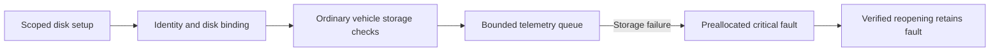

# Opening the correct bounded vehicle storage

Status: actual temporary lifecycle, explicit normal factory selection and authenticated internal metrics passed. The subsequent nominal single-bus source/sender/API outage also passed; fleet, live overflow and new-provider browser/backup/reboot work remain. See [ADR-0035](../adr/0035-bound-vehicle-storage-lifecycle.md).

## A mount and a binding

A **mount** makes a filesystem appear at a folder. In an ordinary vehicle container, `/spool` exposes telemetry storage and `/critical` exposes its separately bounded fault/status storage. If a mount is missing, the folder might still exist in the container image. Writing there would bypass the intended disk boundary.

A **binding** is a small explicit record associating those disks with one recording, bus and source. The provider verifies the actual Linux mount entries, filesystem format/options, kernel device identities, measured capacities and current Ubuntu boot before opening the queue. A different bus or new boot cannot silently reuse the association. Sensor definitions remain in the existing catalogs; they are not embedded in this storage mechanism.



The telemetry image is 64 MiB, with the existing 32-MiB encoded packet limit. Critical storage has another 8-MiB image. Actual usable filesystem capacities remain 58,675,200 and 3,653,632 bytes; filesystem overhead occupies the rest. These are separate bounded filesystems on the same host drive. They protect one storage class from consuming the other's budget and do not protect against failure of that drive.

## Initialize once, then verify without repair

Initialization creates a fresh queue and its two preallocated fault copies, then synchronizes the canonical binding and schema fingerprint in critical storage. A schema fingerprint detects changes to the database's tables/index definitions. The binding does not replace the queue's own immutable wire/catalog/policy metadata.

Normal opening requires existing files, matching binding, two valid fault copies and a read-only SQLite integrity/schema check. It refuses an absent, linked, empty, or incomplete database and preserves the original queue state for recovery. A partial initialization also refuses automatic overwrite. Explicit recovery must inspect the original evidence. The current provider has no automatic repair, fault reset or reboot reattachment operation.

During normal bounded-queue transactions, physical storage errors attempt to latch a fault on the independent critical filesystem. A fault latch remembers the first/latest failure until separately addressed. The failed transaction retains its original exception. If the critical record is also unavailable, that condition cannot become a healthy report. A latched fault can remain visible after telemetry space recovers. Operational command handling remains disabled in Phase 1; this is not a command-result journal.

## What the actual fixture checked

| Check | Observed result |
|---|---|
| Initialization and fresh ordinary-container reopening | Passed with nominal budgets |
| Missing telemetry/critical mount | Explicitly refused |
| Stale boot, changed device or changed binding | Explicitly refused |
| One admitted original reopened | Exact bytes, ID/hash, metadata and counts matched |
| Next insertion with telemetry physically full | Actual SQLite error 13; original and sequence/counters unchanged |
| Fresh reopening while still full | Original retained; both critical fault copies valid |
| Removal of owned filler and fresh reopening | Original retained; sticky fault remained visible |
| Captured source/image checks and owned cleanup | Passed |

Component checks additionally cover malformed/oversized/duplicate-key bindings, identity/format/budget changes, explicit labeling of reduced-capacity tests, initialization refusal, absent or changed/linked binding, incomplete database without healing, degraded fault redundancy and refusal to substitute an ordinary folder for a mount. These component cases do not substitute for the actual mount/full-disk fixture.

## Reproduce from Windows

In PowerShell at `<checkout>` with the qualified Ubuntu Docker Engine running:

```powershell
python scripts/dev.py check
python scripts/monitoring/qualify_vehicle_storage.py --evidence-dir evidence/p1/CHOOSE-A-NEW-VEHICLE-STORAGE-ATTEMPT
```

The controller builds the locked application image, starts the existing scoped administrator provisioner, then performs all application checks as ordinary user ID 10001. Helpers have no network/elevated capabilities, a read-only container root and bounded memory. The private provisioner publishes exact readiness metadata and waits for an owner-bound release. The controller finishes its helpers before release; cleanup checks exact ownership and refuses referenced or changed resources. Its ten-minute fixture lease is a cleanup bound, not a live workload duration.

Require a positive parent `qualification.json`, positive child lifecycle/source/cleanup verification and all recorded ordinary checks. Both captured source sets must still match. Earlier failures/partial reports stay unaccepted. Raw identities, binding records, originals and logs remain ignored. The command changes neither agent environment nor source location.

Live source/sender deployment, API/browser diagnostics, overflow/reconnect, new-provider backup compatibility and deployment/reboot recovery remain separate work. Full W0/W1 still require exactly sixty warmup plus 1,800 measured wall seconds with every original quality/resource requirement unchanged.


## Explicit normal factory selection and current diagnostics

A factory is a function that creates or opens the appropriate object from explicit settings. The normal queue factory now selects this provider when the container configuration defines EVDT_STORAGE_BINDING_FILE. That setting names the read-only binding file; SPOOL_FILE must name /spool/queue.db, CATALOG_VERSION must match the binding, and the run/asset/source settings must match its identity. The deployment controller must mount both verified volumes and the binding before starting either source or sender. Unset selection preserves the legacy queue; an empty or missing selected file returns an error. The fleet controller's bounded-storage integration is outside the release scope.

The actual ordinary-container fixture now calls that same normal factory. It starts the real internal metrics HTTP endpoint, verifies anonymous access returns 401, authenticates using a private token and checks the current recording identity and no-store response. HTTP is the request/response web protocol; an endpoint is one address that answers those requests. The secret token remains in an ignored read-only file and is sent as a header, never returned in measurements or placed in a URL. These checks passed before, during and after telemetry exhaustion, with the original and sticky fault preserved.

Metrics expose confirmed drops separately from unresolved/lifetime evictions, current overflow indication and verified storage/fault status. Unselected legacy queues report loss and overflow as unknown. The API health adapter rejects inconsistent/boolean counts as an instrumented loss report and clears current physical claims when sender measurements are unavailable. The System page has fields for those distinctions; its build passed, while actual new-provider API proxy/browser and broker overflow/reconnect tests remain pending. A counter snapshot is internally consistent; filesystem/fault readings are separate measurements, not a cross-filesystem atomic snapshot.

This follow-up passed 468 Python / 22 frontend tests, seven strict Python modules and unchanged contract outcomes, plus actual factory/authenticated HTTP/full-disk checks with matching source and empty cleanup. See [the separate measured record](../verification/storage-factory-metrics.json). Earlier lifecycle evidence retains its original exact source scope.


The normal-service single-bus outage subsequently passed using verified external volumes, read-only binding and the explicit factory. API health now has actual connected/stopped/reconnected/final acceptance. Live overflow, fleet, browser and new-provider backup/reboot remain open. See [the current outage and flow-control guide](bounded-outage-and-flow-control.md).
