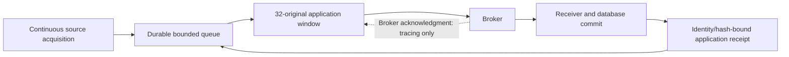

# Recovering a real queued backlog without flooding the receiver

The single-bus bounded-storage source, Sender, and API fixture passed. This optional storage configuration is disabled in the local release. Current monitoring and recovery acceptance is recorded in the [release evidence](../release/verification.md). See [ADR-0036](../adr/0036-bounded-outage-and-receipt-flow-control.md) and [measured results](../verification/bounded-outage.json).

## Two different acknowledgments

The broker is the message relay between the vehicle and digital-side receiver. Its acknowledgment says that it received a publication. The receiver's application receipt is issued after the original is durably stored or explicitly rejected. The sender keeps the original bytes until that identity/hash-matching application receipt is applied to its SQLite queue. Broker acknowledgment alone cannot remove an original.

After a long outage, hundreds of originals may be waiting. Repeatedly resending every pending original on each poll creates duplicate work while the receiver is still committing earlier packets. **Flow control** limits how much work the sender asks the receiver to handle at once; acquisition continues into the local durable queue.

The application window permits 32 distinct originals to await server receipts. It gives a waiting original five seconds before retrying its exact bytes. When a receipt retires an original, another queued original can use that slot. Broker acknowledgments do not free application slots. Eviction can also remove a queued original; its separate durable audit still controls whether its outcome is confirmed or unresolved. The scheduling cache never invents a loss or acceptance.



## Keep network callbacks short

A callback is a function the networking library calls when an event occurs. A lock is a turn-taking guard shared between threads. Two threads can deadlock if each holds a guard the other needs. The previous broker-acknowledgment tracking had such an ordering risk; a controlled test reproduced it.

The callback now places the acknowledgment into a bounded memory queue and returns. The publisher associates it with the exact attempt, including callbacks that arrive before `publish()` returns. It retains the callback's timestamp and records processing separately. A 512-entry bound and explicit anomaly/failure handling protect instrumentation completeness. Packet storage remains in SQLite; this memory queue is only for broker-acknowledgment tracing.

## Selected settings

An environment variable is a named startup setting passed into a container. The default policy is:

| Setting | Default | Valid range | Purpose |
|---|---:|---|---|
| `EVDT_RECEIPT_WINDOW_LIMIT` | 32 | Integer 1–256 | Bound distinct originals awaiting application receipts |
| `EVDT_RECEIPT_RETRY_SECONDS` | 5 | Finite 0.5–30 seconds | Wait before retrying the same unconfirmed original |

Larger windows allow more outstanding work; shorter retries can produce more duplicates. The current test verifies the effective 32/5 settings through authenticated sender/API metrics. Changing these settings requires reevaluating affected workload/recovery behavior. They do not change the 32-MiB encoded queue limit, 64-MiB telemetry and separate 8-MiB critical filesystem budgets, one-Hz source sampling or any quality threshold. The half-second sender polling interval is unchanged.

## Actual qualification

The shared fixture starts normal source, sender, broker, receiver, registration and read services. Its controller prepares the exact owned bounded volumes and read-only binding, then checks the merged configuration before starting consumers. The source records throughout the outage.

This single-bus fixture uses telemetry 3.0.0 and catalog 1.2.0, matching the earlier outage's twenty-signal profile. Fleet catalog 1.4.0 retains its separate workload gate; the provider is not restricted to this fixture's versions.

| Check | Observed result |
|---|---|
| Broker and receiver confirmed down | 300.357 real seconds |
| Recovery limit | 120 seconds, unchanged |
| Measured recovery | 22.987 seconds, while source still running |
| Final original packets / scalar readings | 480 / 9,600 |
| Quarantined / dropped / pending | 0 / 0 / 0 |
| Original bytes, recipe and final current sequence | Matched; sequence 479 |
| Current state across latest-before-older delivery | Never regressed |
| Sampled monitor | 488 samples; largest interval 1.127 seconds |
| Originals after first sampled complete drain | 83 |
| API health at connected/stopped/reconnected/final stages | Passed with actual anonymous/asset-scope denials |
| Source/image and owned service/volume/device cleanup | Passed |

Connected API diagnostics reported verified nominal storage, zero confirmed losses, no overflow and two healthy critical-fault copies. When the sender stopped, loss became unknown and the API removed its current physical-bound claim. After reconnection those verified current measurements returned. This run verified the bounded-storage API diagnostics.

Two earlier attempts remain failed. One did not complete delivery within its recovery wait; the next delivered all originals but measured 122.199 seconds. The latter's available source, queue, critical and monitor state was captured before cleanup. The concurrency test establishes a real lock-order defect, while the first failed process's exact stack was not retained. No numeric requirement was relaxed and no measured duplicate count is claimed.

## Reproduce from Windows PowerShell

From `<checkout>` with the qualified Ubuntu Engine available:

```powershell
python scripts/dev.py check
python scripts/monitoring/qualify_storage_outage.py --evidence-dir evidence/p1/CHOOSE-A-NEW-BOUNDED-OUTAGE-ATTEMPT
```

The source portion takes eight minutes, plus build/setup/verification/cleanup. The controller performs the commands; no agent-mode switch or source relocation is needed. It starts ordinary application containers, reserves temporary storage through the existing scoped administrator helper and releases storage after application cleanup. Root guards refuse referenced or changed resources.

Require positive parent, service and storage lifecycle reports, all four API health stages, exact current source fingerprints and empty owned cleanup. Keep earlier failures and raw artifacts private. Partial capture remains incomplete diagnostic evidence, not a coordinated restore bundle. The current shared checks passed 503 Python / 22 frontend tests, eight strictly checked Python modules and unchanged contract outcomes.

This passes the local single-bus outage. The ten-asset outage/load, full thirty-minute W0/W1, Q-12 host resources, new-provider backup/restore and reboot recovery, browser/visual, retention/startup and final review gates remain separate. Operational commands are still unavailable.
