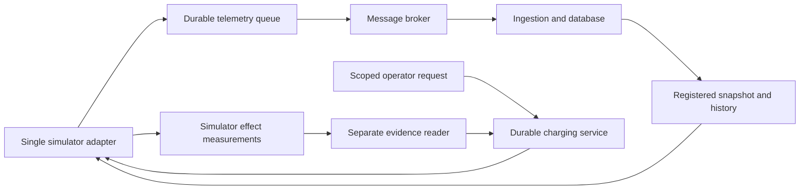

# Charging and cooling integration checks

This test connects monitoring, charging, and cooling for one simulated bus. For example, if a charging request is waiting and a cooling fault triggers local protection, the simulator must withhold the route change. After communication returns, the system must account for the old request and require a fresh eligible request before any action.

## Entry evidence reviewed

| Input | What carries forward | What P6-C1 still needs |
|---|---|---|
| Single-bus monitoring | W0-30 accounted for all 1,860 messages. | Prove fresh, registered readings and correct permissions on the combined fixture. [W0-30 review](../verification/one-bus-monitoring-review.json) |
| Charging | The Phase 4 review names 13 retained reports. All 13 still match their saved file fingerprints. Three focused charging tests passed for authority, evidence, and timing. | Reproduce the relevant behavior with operator-only charging in the combined fixture and one actuator owner. [Phase 4 closeout](../verification/stationary-charging-acceptance.md) |
| Thermal | The read-only verifier confirmed the three frozen studies, including 48 advisory cases and 72 intervention traces. All 16 focused intervention tests passed. | Feed registered current observations into the combined fixture and verify cooling and protection from separate simulated measurements. [Phase 5 closeout](../verification/thermal-acceptance.md) |

An actuator owner is the only component allowed to change the simulated bus. The charging service can accept and track an operator's request. The combined adapter must still be the only component that can apply a route or cooling change. An effect witness is a separate measurement that verifies what actually changed. For example, a recorded command can request cooling, while measured auxiliary power and temperature show whether cooling took effect.

## Initial case design

| Case | Trigger | Evidence required |
|---|---|---|
| Healthy controls | Start a fresh registered bus. Exercise permitted charging and cooling in separate cases. | Current readings, authorized requests, and the expected effects from independent measurements. |
| Stale or protected before release | Inject cooling degradation, prepare an operator charging request, and withhold fresh observations or assert local protection before an actuation grant. | The previously eligible request is refused, and no unauthorized route or cooling change occurs. |
| Transport loss and charger outage | Interrupt transport and withdraw power from the selected charger while the request is unresolved. | No actuation from the unresolved request. The outage is visible in the simulated station state. |
| Recovery | Restore transport and fresh observations. Reconcile original event and request identities. | The stale or interrupted request cannot execute on recovery. A new eligible request may act once, with an independent effect record, or record why it remains blocked. |

Use [the frozen Phase 6 sequence](../../benchmarks/release-monitoring-baseline.json) and the existing [charging authority](../adr/0062-registered-charging-and-matched-outages.md) and [thermal interlocks](../adr/0067-bounded-thermal-intervention.md) when implementing the fixture. An interlock is a condition that prevents an action when it is unsafe or unauthorized.

## How the fixture is wired

The [run recipe](../../qualification/combined-faults/combined-faults.json) fixes the five cases, fault ordering, and minimum cooling effect. Each case gets a fresh run identity. TraCI is the simulator's control connection. The single adapter uses it to read the parked bus and charger and hands off a route only after the command checks pass. For cooling, the motor and housing act as separate heat stores. The comparison evolves the same starting state and heat inputs with the pump off to measure the temperature difference.



The ordinary registered telemetry path carries speed and motor temperature. The fixture keeps the corroborating housing probe local to the simulated thermal subsystem. The charging observer and station writer use separately scoped credentials. A delivery receipt confirms the original reading reached the database. The outage case waits for an actual broker stop, checks that a new reading stays queued, and sees the earlier observation become stale. Only then does it cut the chosen charger's simulated power. The broker and ingestion restart before the fixture checks fresh readings and rejects the original request.

## Verified results

| Case | Outcome |
|---|---|
| Healthy operator charging | The bus received 35.15 kWh and resumed driving. A separate reader of the simulator trace confirmed the result and recorded the observed effect against the request. |
| Healthy cooling action after injected degradation | The 1.2 kW boost left the modeled motor 2.59 K cooler after 120 simulated seconds than the matched run with the boost off. A repeated cooling grant was refused. |
| Local protection | A protected motor reading blocked the queued charge request. Route, speed, and delivered charge showed no change. |
| Outage with a queued request | One reading stayed on disk while the broker was stopped. The old reading became stale, and then the charger lost power. After the broker and ingestion recovered, the readings matched the originals and the old request was refused because its supporting observations had changed. |
| Outage with a reserved request | The adapter checked the actual simulated station power and withheld the route change. The reservation stayed unresolved and a second claim was refused after recovery. The buffered reading reached the database. |

All 11 generated messages matched database history. Each final case passed its own launch check, source check, and cleanup check. Two earlier attempts stopped when available Windows memory stayed below 2 GiB for over 30 seconds. Running cases individually and shortening the test-only service shutdown waits allowed all five to finish. The largest conservative estimate below 2 GiB was 23.99 seconds across the passing runs. The six-second stale-observation wait and the memory limits applied throughout.

No P6-C containers, networks, or labeled volumes remained. Two unnamed volumes dated to the earlier stopped attempts, but their ownership could not be verified from the available Docker records. They were left in place. [Verification record](../verification/charging-and-cooling-checks.json)

## Reproduce from Windows

Open PowerShell in the project folder. Check the exact source inputs and original network without launching Docker services.

```powershell
python scripts/combined_faults/qualify_combined_faults.py --check
```

Use a new output folder for each case. Run one case at a time so the host can be checked again between cases.

```powershell
python scripts/combined_faults/qualify_combined_faults.py --output evidence/p6/my-c1-charge --cases charge
```

Replace both `charge` values with `cool`, `protected`, `stale-outage`, or `interrupted-outage` to select another case. Each command runs the current Windows launch check, starts only the named test's Ubuntu Docker resources, and writes a final `qualification.json` under the selected evidence folder. The root report's `passed` value and the case report's `cleanup_passed` value must both be true. Preserve an interrupted folder and use a new name for any further test.

The [fixture decision](../adr/0069-isolate-combined-charging-and-cooling.md) defines what its results support. The cooling subsystem is a bounded synthetic integration model and the outage interval exercises fault ordering and recovery. The Phase 5 model claims and longer fleet workload requirements are tracked separately.
