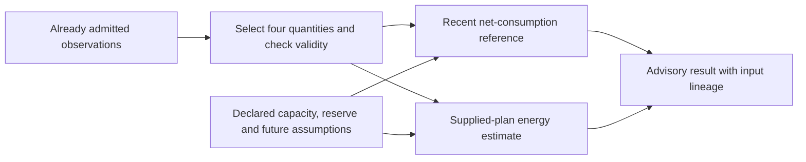

# Understand and reproduce the advisory forecasts

Historical known-route energy procedure. Its original model, workload and evaluation identities remain scoped to the frozen study; pending statements below describe that checkpoint. Use the [route-aware operating guide](route-aware-energy.md) for current geographic forecasting and the [final advisory closeout](../verification/energy-advisory-acceptance.md) for the completed legacy product scope. Inspection of retained results does not authorize rerunning a consumed evaluation.

The commands reproduce the advisory calculation checks from Windows PowerShell in the project folder.

## Follow one example

Energy is an amount; power is how quickly it is used. One kilowatt-hour (kWh) is 3,600,000 joules. State of charge (SOC) is a fraction: 0.20 means 20%.

Suppose the recorded battery energy falls from 3 to 2 kWh while a test bus travels 1,000 meters in 100 seconds. The recent net rate is 1 kWh/km. This already includes any equipment use and recovered braking energy. For a declared 10-kWh capacity and latest 20% charge, the model estimates 2 kWh currently available. Another kilometer at the same pattern requires 1 kWh and leaves 10% charge.

An explicitly chosen 5% test reserve represents 0.5 kWh. The estimated 1.5 kWh above reserve would cover 1,500 meters or 150 seconds at that recent pattern. Those are conditional references, not guarantees. The 5% is an arithmetic fixture, not an operational recommendation.

A supplied-plan estimate instead takes an assumed future speed, slope and equipment schedule and applies the numerical energy equations. It can recognize a reserve breach before a later downhill recovery. It does not know what traffic will actually do.



Lineage means the recorded chain of inputs and versions behind an answer. Here it includes observation identities and fingerprints. A fingerprint is a content digest that changes when the selected input changes; it is not a copy of the input or an authentication credential.

## Objects used by the Python library

| Object | Role |
|---|---|
| `ObservationScope` | Keeps one asset, run, source, session, epoch, mode and clock together |
| `SignalBindings` | Names which sensor identifiers supply energy, distance, SOC and speed; units remain J, m, fraction and m/s |
| `ForecastClock` | Declares the analysis time in simulation seconds and recorded/live origin |
| `ForecastPolicy` | Supplies age, gap, history and work limits explicitly |
| `MissionRequest` | Supplies remaining distance, capacity assumption, reserve and external-charging declaration |
| `reference_forecast` | Computes the simple recent-pattern comparison |
| `planned_forecast` | Uses the numerical model with declared vehicle parameters and future motion |
| `AdvisoryForecast` | Frozen result with values or an unavailable reason; never a vehicle command |

The selector handles already admitted reviewed 3.0.0, 3.1.0 and 3.2.0 observation packets. It does not authenticate them or replace the full telemetry contract validator. Test fixtures may contain only its selected view. Unrelated sensors do not affect the answer. Four coincident good required readings are currently necessary; different sampling cadences need a reviewed alignment adapter later.

For recorded analysis, use `origin="recorded_analysis"` with `source_state="frozen"` and an explicit analysis time. This permits honest historical analysis without pretending it is live. For a future live snapshot, `running` is required, but trusted time, authorization and connection freshness must come from the later runtime integration. The library cannot establish those facts by itself.

Unavailable means there is no usable prediction. It differs from a valid zero charge or a predicted energy shortfall. Missing/stale/mixed-asset/bad-quality inputs return a reason and no prediction values. A valid but insufficient-energy plan returns values, a visible deficit and false feasibility. Zero/negative recent net consumption produces an unavailable extrapolation result.

## Step 1: run shared checks

```powershell
python scripts/dev.py check
```

The launcher runs locked Linux tools in Ubuntu while the desktop agent stays Windows native. This builds the development-check image and runs Python/dashboard tests, typing, formatting, build, contracts and privacy checks. Allow a few minutes, longer if image layers are not cached. Success ends with `Checks passed: True` and an ignored report path. A nonzero exit or `False` is a failure; inspect the saved log before proceeding.

## Step 2: run the public offline examples

Choose a new name after `evidence/p2/`; an existing directory is refused to preserve prior results.

```powershell
New-Item -ItemType Directory -Force evidence/p2 | Out-Null
python scripts/linux.py --timeout 120 -- docker run --rm --network none --read-only --memory 512m --cpus 2 --mount type=bind,src=<checkout>/evidence/p2,dst=/app/evidence/p2 evdt-development-checks:local python scripts/known_route_energy/qualify_energy_forecasts.py --evidence-dir evidence/p2/YOUR-NEW-ADVISORY-CHECK
```

Docker runs this packaged check in a temporary container, an isolated process environment. `--network none` disables its network; `--read-only` protects its packaged inputs. The mount shares only the private result folder for writing. The memory/CPU limits bound this small calculation. `--rm` removes the container afterward; no database or persistent volume is created. The 120-second launcher timeout is a stopping bound, not the expected calculation time.

Calculation normally takes seconds; startup adds a few seconds. Expected final text: `Advisory forecasts passed: True; synthetic: 12; recorded assets: 0`. Open its `qualification.json`: require `passed: true`, twelve distinct passing cases and no source/input-change error. The versioned public cases are `qualification/energy/forecast-cases.json`; they cover the hand-calculated reference, invalid inputs, a supplied plan and the intermediate reserve breach. These selected views are synthetic mathematical fixtures, not real-bus recordings.

## Step 3: optionally reuse the accepted local recording

This requires the ignored Phase 1 recording already present on this machine. It is unnecessary for repeating the public examples and must not be uploaded. The command starts no bus or application service and does not regenerate history.

```powershell
python scripts/linux.py --timeout 120 -- docker run --rm --network none --read-only --memory 512m --cpus 2 --mount type=bind,src=<checkout>/evidence/p2,dst=/app/evidence/p2 --mount type=bind,src=<checkout>/evidence/p1/2026-11-04-final-functional-01/services,dst=/app/evidence/p1/2026-11-04-final-functional-01/services,readonly evdt-development-checks:local python scripts/known_route_energy/qualify_energy_forecasts.py --evidence-dir evidence/p2/YOUR-NEW-RECORDED-CHECK --accepted-fixture evidence/p1/2026-11-04-final-functional-01/services
```

Expected: twelve synthetic cases and two recorded assets pass in seconds. Each asset supplies thirty packets; both forecast methods consume that history. The runner requires the existing accepted reconciliation and checks every packet's canonical digest against its stored original digest. It fingerprints the evidence and source files before and after use. Rejection is a failure, not permission to bypass that guard.

The future plan is independently declared in the public case file and begins at the latest observed speed. The runner does not use actual future motion or hidden plant parameters. Capacity, equipment, reserve and vehicle numbers are illustrative declared assumptions. This check proves accepted-format consumption; it does not measure forecast accuracy or reproduce a live authenticated runtime.

## Step 4: inspect and stop

Both commands exit automatically. No fleet, broker, browser or database needs stopping. If a command times out, preserve its incomplete/failed evidence and inspect the launcher receipt and Docker state; do not delete unrelated resources. Raw result files remain ignored. Only reviewed aggregate results enter Git.

The nine prior numerical profiles can also be rerun using the [numerical guide](energy-numerical-core.md) with a new directory. Numerical version 1.1.0 adds minimum trajectory energy; the original 1.0.0 evidence remains historical.

The scenario partition design and selected local runtime-isolation step now pass; see the [worker/partition guide](energy-worker-and-mission-partitions.md). Synthetic training/validation collection and calibration now pass their scoped checks; see the [calibration guide](energy-calibration-and-validation.md). Independent held-out errors, uncertainty review, forecast storage and dashboard integration remain pending. See the [model card](../models/energy-advisory-model-card.md) and [status](../advisory-status.md).
