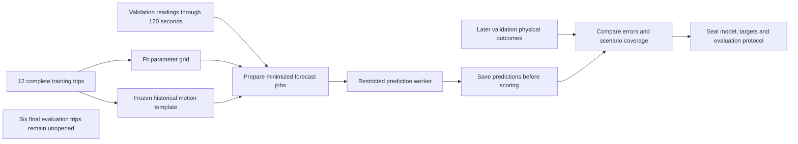

# Understand and reproduce energy calibration and validation

Historical known-route energy procedure. Its original model, workload and evaluation identities remain scoped to the frozen study; pending statements below describe that checkpoint. Use the [route-aware operating guide](route-aware-energy.md) for current geographic forecasting and the [final advisory closeout](../verification/energy-advisory-acceptance.md) for the completed legacy product scope. Inspection of retained results does not authorize rerunning a consumed evaluation.

The calibration uses the independent energy calculation and restricted worker. Run the commands from Windows PowerShell in the project folder using the documented Ubuntu and Docker setup.

## Follow the learning sequence

1. **Collect complete trips.** SUMO generates vehicle motion and battery behavior. The adapter turns that into the same 20 observed quantities used by monitoring. We collect 12 training and 6 validation trips sequentially; the 6 final evaluation trips remain ungenerated.
2. **Calibrate on training data.** Calibration adjusts the estimator's assumptions to better explain observed training data. A bounded grid search tries 36 combinations of rolling resistance and propulsion efficiency. It minimizes mean squared error: square each complete-trip energy miss, then average. Squaring penalizes large misses more strongly.
3. **Check stability.** Leave one complete training trip out, refit, and repeat for each trip. Different selected pairs warn that the fitted physical-looking numbers are not uniquely determined. They are effective model parameters, not measurements of the actual vehicle.
4. **Prepare a forward assumption.** Choose a historical motion template from training only. At 120 simulation seconds of another trip, use its last 60 seconds of readings and that historical template to estimate the remainder. Never use that trip's actual future movement as the assumed plan.
5. **Validate and freeze.** Compare predictions with later physical outcomes on the six validation trips. Choose the uncertainty method and freeze acceptable errors before opening final evaluation outcomes.

Rolling resistance represents the force opposing tire motion; higher resistance generally costs more energy. Propulsion efficiency describes how much electrical drive-path input becomes mechanical work; 0.90 means 90% in this simplified model, not 90% efficiency for the entire bus. Fitting can absorb missing effects into these numbers, so we call them effective parameters.

Sensor noise is random scatter, bias is a consistent offset, and quantization rounds readings to fixed increments. Standard deviation controls the typical scatter of the simulated noise; it is not a maximum-error bound. These chosen imperfections make the synthetic measurements less ideal, without establishing the behavior of real sensors.



The nominal bus capacity supplied to the estimator stays 350 kWh even when the simulator's actual capacity is lower. Its assumed loaded mass stays 18,000 kg. That evaluates the effect of parameter mismatch on the estimator. Current observed auxiliary power is a legitimate input; assuming it remains constant is explicitly a forward assumption. All vehicle/measurement values remain synthetic, uncalibrated real-world hypotheses.

## Understand the metrics and uncertainty

Mean absolute error (MAE) averages the size of each miss without its sign. An energy MAE of 0.28 kWh means the average miss over these complete validation missions was about 0.28 kWh. Charge errors use **percentage points**: 80% predicted versus 79% actual is a 1-point error.

The selected point parameters are rolling resistance 0.010 and propulsion efficiency 0.90. Other nearby paired values fit nearly as well. The uncertainty method keeps jointly plausible training pairs, including leave-one-trip-out choices, while varying explicit mass, capacity, equipment and recovery assumptions. A scenario envelope is the range of outcomes from those declared scenarios plus a stop-time allowance. It is **not a 95% confidence interval or a guaranteed physical bound**.

The first independent-parameter envelope covered the validation outcomes but was too wide. That result remains rejected. The joint-pair method was selected on validation, with the point predictions, original data and all error/width thresholds unchanged. All final evaluation outcomes remain unopened, so this choice can still receive an independent test.

| Frozen advisory criterion | Limit |
|---|---:|
| Available candidate/reference forecasts | All six complete missions |
| Energy MAE / maximum absolute error | 1 / 2 kWh |
| Final charge MAE / maximum absolute error | 0.5 / 1 percentage point |
| Candidate energy MAE versus simple reference | No worse |
| Joint energy/charge envelope coverage | At least five of six complete missions |
| Maximum energy / charge range width | 6 kWh / 4 points |
| Energy change under fixed-plan step refinement | At most 1% |

These limits apply to one prediction at 120 simulation seconds on the known synthetic route. They are not production safety or charging-dispatch limits. A 1-point charge error is 3.5 kWh at the declared capacity, one tenth of the illustrative 35-kWh reserve. Six covered cases are reported as six covered cases, without a population coverage guarantee. Thermal, real-bus and command-effect criteria remain separate.

## Step 1: shared checks

```powershell
python scripts/dev.py check
```

Allow a few minutes. Expected final text is `Checks passed: True`; the private report/log is under `.runtime/dev-checks/`. This builds the locked development image used for numerical analysis. A nonzero exit or `False` means inspect the saved log before proceeding.

## Step 2: collect development missions once

Use a new private directory name:

```powershell
python scripts/known_route_energy/qualify_energy_collection.py --evidence-dir evidence/p2/YOUR-DEVELOPMENT-COLLECTION
```

The command builds/reuses the locked simulator image, then runs one bus at a time with a 512-MiB limit. On the existing machine, allow a few minutes; a fresh image/dependency cache can take longer. The collection command has a separate 15-minute deadline after image preparation. Quiet periods are normal because the controller captures Docker output. Progress is visible in `collection/progress.json` under your chosen folder; it counts up to 18, followed by the repeated training mission check.

Expected final text: `Development missions passed: True`. Open its `qualification.json` and `collection/dataset.json`, both JSON text files of named values/lists. Require 12 training / 6 validation missions, complete missions, exact repeatability, distinct driving/content hashes, `held_out_collected: false`, no memory-kill flag and passing cleanup. Generated source copies, sensor noise/seed settings, original packets, truth traces and file inventories remain ignored.

The recorded duration is simulation time; hundreds of simulated seconds run much faster than wall time here. This is not a live rate, capacity or endurance test. Offline contract admission does not retest network/database delivery. Actual completion endpoints are the last sampled state before the vehicle exits the successfully completed route.

## Step 3: fit, validate, verify workers and seal

```powershell
python scripts/known_route_energy/qualify_energy_calibration.py --collection evidence/p2/YOUR-DEVELOPMENT-COLLECTION --evidence-dir evidence/p2/YOUR-CALIBRATION-CHECK
```

Normally allow a few minutes. This reads the accepted data with exact inventory/source checks, fits only training observations, prepares causal validation jobs, computes the selected sensitivity envelopes and writes the prediction batch before scoring physical truth. It then rebuilds the restricted worker from guarded pinned inputs and independently reproduces twelve forecasts: candidate and reference for each validation mission. The wrapper checks actual packaged bytes and restriction settings, not just a saved image name.

Expected final text: `Calibration release checks passed: True; worker cases: 12`. Inspect:

1. `analysis/qualification.json`: successful analysis and `validation.targets_met: true`; failed/unavailable counts remain visible.
2. `analysis/validation.json`: six per-regime rows, energy and charge errors, baseline comparison, scenario coverage/width and refinement.
3. `analysis/model.json`: training-only parameters, historical template, candidate scores and leave-one-trip-out choices; `model_qualified` remains false.
4. `analysis/targets.json` and `analysis/evaluation-protocol.json`: frozen targets and final evaluation rules.
5. Top-level `qualification.json` and `release.json`: twelve matching worker results, unchanged artifact digests, held-out outcomes unopened and cleanup passed.

Frozen means the exact bytes are sealed by recorded digests. It does not mean a Windows administrator cannot edit them. Changed model, job, prediction, target, source or protocol bytes must fail verification; do not edit a failed report into a pass.

If an exact compatible analysis already exists, the wrapper accepts `--analysis evidence/p2/YOUR-EXISTING-ANALYSIS/analysis` with a **new** verification directory. It verifies the actual source and artifact guards before reuse. Do not repeat successful mission collection because unrelated estimator code was added. An incompatible source needs review or the affected requalification, never a disabled guard.

## Stop and preserve

The commands exit and clean up only their owned containers. No broker, database, browser, fleet, host-memory change or global engine restart is required. A timeout/failure remains incomplete or failed in its own directory; inspect cleanup before another attempt. The original independent-envelope rejection and unavailable-image attempt are retained in the measured record.

Retain private model and evidence artifacts for reproducible inspection. Git protects source, protocols, reviewed summaries and the sealed release manifest, while raw data remains ignored. The reviewed [release manifest](../models/energy-validation-release.json) records exact artifact hashes for P2-C1. No remote publication or final evaluation is implied by this local checkpoint.

P2-C1 has now verified that frozen release and passed all unchanged criteria on the six reserved complete missions. See the [held-out guide](held-out-energy-evaluation.md) for read-only inspection; do not regenerate the final trial. Forecast persistence, the read API, dashboard, and final advisory review are recorded in the [advisory closeout](../verification/energy-advisory-acceptance.md). See the [decision](../adr/0042-energy-calibration-and-validation-freeze.md) and [status](../advisory-status.md).
