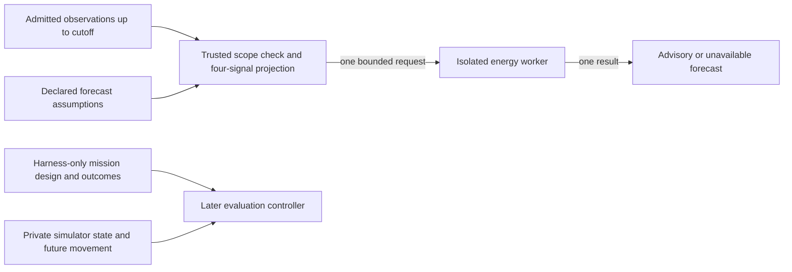

# Understand the energy worker and mission partitions

Historical known-route energy procedure. Its original model, workload and evaluation identities remain scoped to the frozen study; pending statements below describe that checkpoint. Use the [route-aware operating guide](route-aware-energy.md) for current geographic forecasting and the [final advisory closeout](../verification/energy-advisory-acceptance.md) for the completed legacy product scope. Inspection of retained results does not authorize rerunning a consumed evaluation.

This guide documents isolated Energy Worker execution and whole-mission dataset partitions. Run the reproduction commands from Windows PowerShell in the project folder through the Linux launcher.

## Why keep whole trips together?

Suppose we fit the model using the first half of one trip, then call the second half an independent final test. Both halves share the bus, route, initial state and driving realization. That can make the result look stronger than it is. Assign the complete trip and all of its windows and replays to one partition.

| Set | Purpose | Planned complete trips |
|---|---|---:|
| Training | Fit model parameters, such as rolling resistance | 12 |
| Validation | Choose settings, operating limits and acceptable errors | 6 |
| Held out | Final independent evaluation after those choices are frozen | 6 |

A partition is one of these data sets. A regime is a category of conditions, such as heavy load or cold/high equipment demand. A realization is one complete generated trip. Its family includes copies, derived windows and replays. A seed is an input that allows a random generator to repeat a realization; reserving different seeds alone does not prove the generated trips differ.

The versioned design covers six regimes, with all three sets represented in each. It lives in `qualification/energy/mission-design.json`, marked `planned_not_collected`. At the B1 checkpoint no mission results had been collected. P2-B2 now has twelve training and six validation missions; the six held-out outcomes remain ungenerated. See the [calibration guide](energy-calibration-and-validation.md). All trips currently refer to the known hypothetical Montreal core route; unseen-route performance is outside this design. B2 maps the existing ambient/equipment controls, driver variation and scheduled dwell to these recipes; this does not introduce interacting traffic or temperature-dependent battery chemistry.

The guards reject a family, identical recipe or seed crossing sets. Future inventory checks also reject copied trace/observation content assigned across sets. Collectors must compute those content fingerprints without filenames or run IDs, so renaming cannot change them. A fingerprint is a digest of content; it does not prove the collector was honest. Existing development recordings remain development material. The final evaluation gate requires references to frozen calibration, error targets and evaluation protocol; the later controller must verify those actual artifacts before use.

## Why a separate execution boundary?

A worker is a program that takes one prepared task, computes an answer and exits. Its image is the packaged code/environment used to start it. This worker contains the energy calculations and strict request reader, with no plant or dataset-design module. It receives a minimized copy of already admitted observations and declared assumptions.



The worker has no connection to the private-state branch. It has no project-folder mount, database credentials, simulator library, Docker socket or external network. The controller starts it as an ordinary user with a read-only filesystem and fixed resource limits. Administrator capabilities are individual privileged powers; all are removed. The default Linux syscall filter restricts operating-system actions, while no-new-privileges prevents gaining extra powers by starting another executable. The [decision record](../adr/0041-mission-partitions-and-energy-worker-isolation.md) explains the exact settings and official references.

An allowlist means only explicitly named fields may pass. Here the worker accepts scope, clock, mission, policy, bindings, four selected readings per observation and, for planned forecasts, declared parameters/assumed motion. Extra nested truth labels, URLs, commands and file paths are rejected. The projector removes unrelated sensors and annotations without changing the original stored telemetry. Adding an unrelated sensor therefore does not change this forecast interface.

The worker permits at most 1 MiB of input, 1,000 observation points, 1,000 motion intervals and 100,000 numerical steps. These are resource bounds, not an accuracy claim. It returns a stable rejection for an invalid task and an unavailable forecast for a valid task with unusable observations. A valid energy shortfall is still reported with values and false feasibility.

## Step 1: run shared checks

```powershell
python scripts/dev.py check
```

Allow a few minutes, longer on a fresh dependency/image cache. Success ends with `Checks passed: True`. The ignored `.runtime/dev-checks/` report/log records tests, contracts, types, build, source fingerprints and privacy results. A nonzero exit or `False` is a failure; inspect the report before continuing.

## Step 2: run the bounded isolation experiment

Choose a new result directory; an existing one is refused to preserve evidence:

```powershell
python scripts/known_route_energy/qualify_energy_boundary.py --evidence-dir evidence/p2/YOUR-NEW-BOUNDARY-CHECK
```

This builds the small worker image from the pinned Python base. It creates only temporary owned test containers and one internal network. It starts no bus, browser, broker or database. Normally allow about one to three minutes on the existing machine; first-time image preparation can take longer. Individual worker calculations have a 30-second deadline; image building has a separate three-minute bound. Quiet periods during Docker startup are normal.

The experiment first proves that four synthetic private files/endpoints exist and are readable from the harness. A canary is a deliberately placed test marker; these contain no real credentials or simulator truth. The predictor then attempts the reads under its actual restrictions. This is stronger evidence than merely checking that its Python function has no network import.

Reports use JSON, a text format containing named values and lists. Expected final line: `Energy boundary passed: True; cases: 5`, followed by the report path. In `qualification.json`, require:

1. `passed: true` and `data_collected: false`.
2. A 24-mission design with 12/6/6 assignments and the held-out gate still closed.
3. Positive controls for four files and four endpoints.
4. Seven blocked file-path attempts, four blocked endpoint reads, absent forbidden imports, ordinary user, no effective capabilities, active syscall filtering and blocked filesystem write.
5. Reference/planned outputs, stale/future unavailable outputs and hidden-field rejection passing.
6. `cleanup.passed: true`, preserved original inventories and no source-change error.

The seven attempted paths include four files in the separate truth container, the host canary, the Docker socket and a process-root path. The fixture verifies the private file/endpoint positives; it does not claim every attempted path exists in every namespace. No real private operational data is read.

The command exits automatically and removes its own test resources. A failure remains failed in that directory. Do not delete unrelated Docker storage or restart Ubuntu to recover a test. Read the private error/cleanup report first. The controller checks ownership before cleanup; it never runs a global prune.

## Step 3: reproduce one prepared job

The successful check saves a private `reference-job.json` and `planned-job.json`. Use the actual folder chosen above and a new output name:

```powershell
python scripts/known_route_energy/run_energy_job.py --job evidence/p2/YOUR-NEW-BOUNDARY-CHECK/reference-job.json --evidence-dir evidence/p2/YOUR-NEW-SINGLE-JOB
```

This command rebuilds/reuses the pinned worker image, checks its actual restrictions, sends the bounded request through standard input, captures the answer and removes the worker. Standard input/output are the program's request/response streams, so no project folder has to be mounted. Allow roughly 10–30 seconds with a cached image. Success prints `Isolated job passed: True`; its report contains the forecast under `result.stdout`, which is a JSON string. Open and parse that string to inspect the result. An unavailable forecast is an explicit usable response, not a claim the requested trip is feasible.

For a planned task, `make_job` takes the same observations/scope/clock/mission/policy as the advisory library, plus declared `EnergyParameters` and a tuple of `DrivingInterval` objects. The existing [advisory guide](energy-advisory-forecasts.md) introduces those inputs. Store prepared jobs only under ignored `.runtime/` or `evidence/p2/`; the controller rejects other locations. Do not edit private readings to manufacture a passing forecast.

## What this does and does not establish

The test establishes actual direct-access denial in the selected local worker configuration. It does not defend against a host/Docker administrator changing it, authenticate a caller's clock/asset/charging declaration, prove the forward plan was independently estimated or prevent inference from legitimate observations. For example, an ideal simulator's energy and charge may mathematically reveal capacity. The estimator must still use independently declared/calibrated assumptions, with capacity mismatch and measurement realism evaluated later.

Raw requests, stdout, diagnostics, canaries and generated identifiers remain ignored. Reviewed aggregate results alone belong in Git. No command or automatic charging authority is added. The [current status](../advisory-status.md) distinguishes this completed boundary from completed synthetic development collection/calibration and pending independent accuracy evaluation/product integration.
