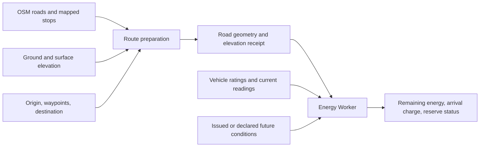

# Energy forecasts on a new map

The geographic workflow imports actual OpenStreetMap roads, finds a connected bus route, attaches elevation, and forecasts the remaining trip with the same physical model. A map supplies geometry and road rules. It does not supply fitted energy coefficients, and importing another map does not train the estimator.

## Inputs and outputs



| Input | Purpose |
|---|---|
| OSM XML | Real road coordinates, directions, bus access, connections, speed limits, structures, and mapped passenger stops |
| Journey JSON | Named origin/destination and optional waypoints, as longitude/latitude pairs |
| Elevation | Ground heights and, where required, road-surface heights; source, coordinate system, vertical datum, and file fingerprint |
| Vehicle profile | Capacity, mass, resistance, efficiencies, power limits, and optional measured response curves |
| Operating assumptions | Planned stop dwell, passenger/equipment demand, weather, and known restrictions over the forecast horizon |

The model cannot infer battery capacity, passenger mass, or current construction from an OSM map. Those inputs come from the configured vehicle and issued or declared operating information. A new map needs data preparation, not model fitting.

## Prepare a route

Run commands in PowerShell from the project root. The existing Ubuntu preprocessing environment and pinned SUMO image are required. Put downloaded inputs under ignored `data/downloads/energy-v2/`.

Create a journey JSON file in that directory. For example:

```json
{
  "id": "new-route-01",
  "title": "Origin to destination",
  "anchors_lon_lat": [[-75.70, 45.421], [-75.696, 45.385]],
  "capacity_kwh": 350,
  "mass_kg": 18000,
  "initial_soc": 0.8,
  "auxiliary_w": 8000,
  "surface_multiplier": 1,
  "speed_factor": 1,
  "stop_spacing_m": 450,
  "dwell_s": 20
}
```

Coordinates are ordered **longitude, latitude**. Choose anchors on roads accessible to a bus. The importer searches within 200 meters and records each selected offset. Review those offsets and the route before accepting the input. Stop spacing chooses among actual mapped stops; it does not create fictional stop locations. Dwell is an explicit operating assumption.

The example's bus and operating values define a demonstration profile. Replace them with the intended vehicle and supported equipment-demand assumptions. `surface_multiplier: 1` uses the vehicle's baseline rolling coefficient; a higher value is a declared sensitivity case. `speed_factor: 1` uses road limits, turn limits, and the vehicle's movement constraints. It does not imply uninterrupted travel through stops or signals.

```powershell
python scripts/linux.py -- .runtime/energy-v2/venv/bin/python scripts/geographic/prepare.py evidence/energy-v2/new-route-01 --osm data/downloads/energy-v2/new-map.osm.xml --journey data/downloads/energy-v2/new-journey.json
```

This performs static preparation and starts no bus. It imports and routes roads, downloads or reuses public elevation, and writes `mission.json`, `stops.json`, `geometry.json`, and `preparation.json`. Successful completion writes `completed: true` in the preparation receipt. Missing road access, disconnected routes, missing elevations, conflicting heights, or changed source files stop preparation. Preserve that folder and use a new folder for corrected inputs.

The OSM XML limit is 32 MiB. For a larger regional PBF extract, use `scripts/geographic/extract_osm.py` to select a geographic box or journey corridor first. A PBF is the compact OSM data format. Regional extracts and a complete planet file are data sources, not files to load unbounded into a worker. [Extraction and source records](route-aware-energy.md#check-a-new-openstreetmap-route)

The optional PBF extractor and atlas background reader use pyosmium, a library that reads OSM records incrementally. Install its pinned Windows tools separately:

```powershell
python -m pip install --target .runtime/energy-osm-visual -r environments/osm-preparation-requirements.txt
$env:PYTHONPATH = '.runtime/energy-osm-visual'
python scripts/geographic/extract_osm.py --help
```

This installation does not change the numerical worker or its dependencies. OSM XML preparation uses the Ubuntu environment shown above.

## Elevation coverage

Canadian preparation uses the NRCan high-resolution ground and surface mosaics. Ground describes terrain; the surface mosaic also contains bridge decks, trees, and buildings. The preparation checks roadway continuity and records layer selection and profile processing. It never substitutes zero height for a missing sample.

For other coverage, pass `--raster-manifest data/downloads/energy-v2/elevation-catalog.json`. The catalog selects supplied GeoTIFF tiles by geographic bounds and layer. GeoTIFF is an image-like grid whose cells contain geographically located heights. Each tile has a fingerprint and an attributable metadata record. All selected tiles must share a compatible vertical datum, the reference from which heights are measured.

The catalog has `vertical_datum` and a `tiles` array. Each entry contains `manifest` (a project-relative tile metadata path), `layer` (`dtm` or `dsm`), and `bounds_lon_lat` (`west, south, east, north`). Tile metadata contains `file`, `sha256`, `horizontal_crs`, `vertical_datum`, `downloaded_real_life_unix_s`, `license`, `dataset_id`, `source_url`, and `layer`. The existing raster loader checks these values against the actual file. Each tile is limited to one million cells and 256 MiB; the catalog accepts up to 256 tiles.

A bridge needs a defensible roadway surface. A tunnel needs separate roadway-height information; the current automatic raster preparer rejects tunnel routes. Ground or roof elevation does not establish tunnel-road elevation. Ambiguous surface returns require input review. The numerical model accepts valid three-dimensional road geometry independently of the provider, but automatic geographic coverage is not worldwide or guaranteed.

## Configure the numerical and connected paths

Use the prepared `geometry.json` bundle in the existing [service assignment procedure](route-aware-energy.md#configure-a-service-session). Keep its network and bundle fingerprints matched to the registered source. Set the approved assignment's vehicle maximum speed from the vehicle profile. Conditions and route context retain their separate authority boundaries.

The [geographic policy](../../qualification/energy/route-aware/geographic-policy.json) enables power-limited forward movement, imported turn limits, and optional declared fixed-cycle signal timing. Signal braking is explicitly configured for the SUMO source. Its 0.2-working-second Euler setting applies to the matching SUMO source. Other position integration methods require the appropriate source policy; this field must not be guessed. Older assignments omit the new optional fields and retain their original policy.

The live controller first runs when the required observations are valid. Periodic updates are due 120 working seconds after the preceding forecast's input cutoff; confirmed plan changes, material input changes, or recovery can request earlier updates. Working time is time inside SUMO and holds while the trip is paused. One calculation runs at a time, and the controller keeps the newest pending input, so completion times can vary. Route revisions and observed street and junction lanes rebuild the remaining path. The Energy Forecast chart connects successive estimates across trip plan changes and marks the first estimate made on each updated plan. Network names and city identities do not enter the numerical equations. Native SUMO signals remain in reference drives. The fixed-cycle option requires a known unchanged program.

## Verify a new journey

```powershell
python scripts/route_aware_energy/qualify.py --case map-journey --journey evidence/energy-v2/new-route-01
```

This starts one bounded SUMO reference drive, then isolated forecast workers at seven cutoffs. The reference collector uses SUMO's battery model; it does not import the estimator. Forecast requests contain the observations available at their cutoff and declared future plans. Scoring uses later outcomes only after prediction. The Windows 2 GiB reserve, container limits, source checks, and owned-resource cleanup remain active.

The reference loads the assigned roads, complete adjoining intersections, and linked signal groups. Original lane geometry, elevations, junction requests, and signal programs are copied into a bounded runtime network. Remote, unused approaches end at the extraction boundary. The full imported map remains intact. `reference-network.json` records both network fingerprints and the extraction counts; `reference.json` identifies the original input and actual runtime network. This keeps a one-bus reference within its 512 MiB container limit without changing the Energy Worker's 256 MiB limit.

Review `qualification.json`, `worker-result.json`, `study-result.json`, and the retained `reference.json`. A pass covers the declared trip and profile. It does not establish the accuracy of unknown future traffic, a different vehicle, or unverified terrain. The [geographic verification record](../verification/energy-geographic.md) separates numerical accuracy, input coverage, and deployment evidence.
