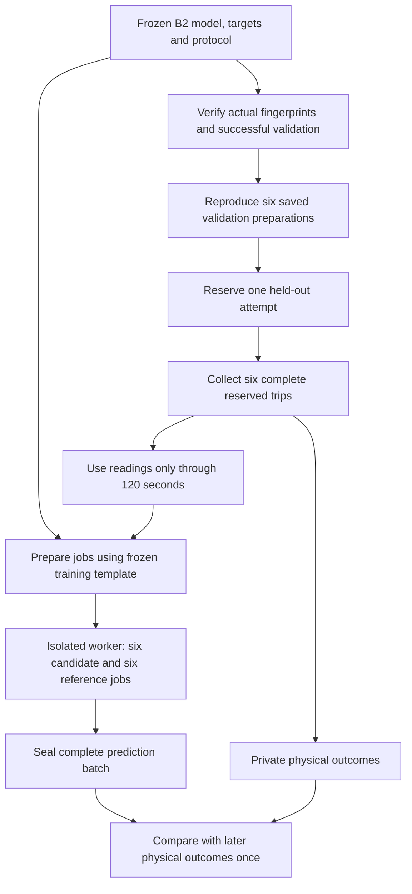

# Understand the independent final energy check

Historical known-route energy procedure. Its original model, workload and evaluation identities remain scoped to the frozen study; pending statements below describe that checkpoint. Use the [route-aware operating guide](route-aware-energy.md) for current geographic forecasting and the [final advisory closeout](../verification/energy-advisory-acceptance.md) for the completed legacy product scope. Inspection of retained results does not authorize rerunning a consumed evaluation.

P2-C1 evaluates the six complete trips reserved from fitting and validation. This guide explains how to inspect and reproduce the engineering checks without accidentally creating another final trial.

## What changes at this step?

Training adjusted parameters. Validation helped choose the uncertainty method and acceptable errors. The held-out set is the final independent check of those frozen choices. Its outcomes must not feed back into this candidate's fit or limits.

The same numerical functions, model parameters, historical template, uncertainty scenarios and quality limits are used. New code supplies the release gates, collection/execution order and report. Before opening the reserved outcomes, it reproduces all six saved validation preparations exactly in the locked Linux runtime. This separates a runner mistake from a model result.



A fingerprint changes if file contents change. A sealed release records the expected fingerprints of the actual model, targets, protocol, predictions and source. Windows and Linux use different line-ending bytes; Git preserves the exact qualified bytes of these release manifests so checkout cannot silently change their fingerprints. It detects changes; it is not permission for a host administrator to alter the study. A one-time claim records that this release has opened its final test, so repeating a command cannot silently create another trial.

## Inspect the existing attempt first

From Windows PowerShell in `<checkout>`:

```powershell
python scripts/known_route_energy/qualify_energy_holdout.py --inspect
```

This is read-only and starts no Docker workload. Before an attempt exists, it says no attempt is reserved. Afterward it shows the original report or current private attempt state. A completed test has `evaluation_completed: true`; its separate `held_out_criteria_met`/`passed` fields show whether the frozen limits passed. An incomplete run is not a model pass or a reason to regenerate the data.

## First-time execution on an eligible frozen release

Only when no attempt exists for that release, run shared checks and choose a new private result directory:

```powershell
python scripts/dev.py check
python scripts/known_route_energy/qualify_energy_holdout.py --evidence-dir evidence/p2/YOUR-NEW-HELDOUT-CHECK
```

The first command builds the locked development image and runs existing source/contract/privacy regressions. Expected: `Checks passed: True` after a few minutes.

The second command first checks the actual frozen files and reproduces the saved validation jobs/envelopes. It then reserves the one-time claim, collects six new complete trips sequentially, prepares forecasts from each 120-second prefix, runs twelve isolated worker jobs, seals the whole batch and scores it. No parameter search or model fitting occurs. Normally allow a few minutes on the existing machine; fresh image preparation can take longer. Individual collection/preparation/scoring stages have ten-minute controller deadlines, and each worker calculation has the existing 30-second deadline. Quiet Docker startup/collection periods are normal.

Expected progress includes:

1. `Verifying exact validation-job/envelope parity...`
2. `Collecting six reserved complete missions...` Progress is also written to `collection/progress.json`, counting 1–6.
3. `Preparing causal jobs...` The jobs contain no observations after 120 seconds; later movement is not a plan input.
4. `Sealed worker predictions 1/6...6/6...`
5. `Scoring the sealed batch once...`
6. A final line giving evaluation completion and criteria status separately.

A quality failure must remain visible with the original six cases and unchanged limits. A technical error preserves its partial files and cleanup report. Do not delete the claim, repeat the random seeds, widen a range or edit criteria to obtain a pass. Recovery requires reviewing the precise technical blocker and reusing compatible saved data; it must not become model tuning on final outcomes.

## Read the evidence

| File | What to check |
|---|---|
| `validation-parity.json` | Six exact comparisons passed before held-out collection |
| `collection/dataset.json` | Six correct held-out missions, complete combined 24-mission inventory, cross-partition copy guards |
| Each mission's `collection.json` | Original packet/trace file fingerprints and complete mission |
| `prepared/cases.json` | Cutoff/input lineage, frozen scenario envelopes and exact job digests |
| `worker-batch.json` | All twelve responses sealed before scoring |
| `evaluation.json` | Six independent cases, every failed/unavailable result, per-regime errors, reference comparison, coverage/width and unchanged criteria |
| `qualification.json` | Completed versus incomplete evaluation, quality status, source guards and cleanup |

An incomplete/changed worker batch cannot be scored. The same six-case denominator includes unavailable forecasts; missing results do not disappear or become zero. Refinement means recalculating the same assumed motion with a smaller numerical step, not replaying the actual trip until it looks better.

## Interpret the result

Energy error is predicted required kWh minus the physical change in pack energy. Charge error is predicted final fraction minus physical final fraction, expressed in percentage points. Negative energy error underestimates needed energy; positive charge error overestimates what remains. The endpoint is the last sampled state of a successfully completed mission, not an exact charging-station arrival.

The reference uses recent net consumption from the same input window. The candidate uses the frozen historical training plan and parameters. Neither receives the test trip's actual future motion, capacity recipe or seed. The restricted worker cannot import the plant or fitter and has no project-data mount or external network. The trusted harness separately verifies original bytes and later scores outcomes.

Six independent cases are a limited synthetic known-route test. Six covered cases would not be a 95% confidence guarantee or a proof of real-bus performance. Passing this check still leaves product authorization, persistent forecast records, calibrated/uncertainty API/UI presentation and final P2 review. No automatic vehicle command or charging authority is added.

All raw data and generated identifiers remain ignored. The commands remove only owned temporary containers and preserve original storage/network inventories. Use the saved results and read-only inspection command for subsequent review. See [ADR-0043](../adr/0043-frozen-held-out-energy-evaluation.md), the [candidate card](../models/energy-calibrated-candidate-card.md) and [P2 status](../advisory-status.md) for current measured scope.
