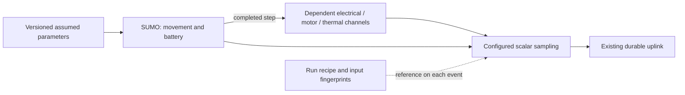

# Initial bus measurement plant

This guide explains P1-B1: an internally connected simulation that generates the initial 20 readings. A plant is the simulated vehicle producing observations. The twin is the separate software receiving observations and later estimating behavior or issuing authorized commands. They must not share hidden future truth.

## Start with one example

When the bus accelerates, SUMO updates movement and its battery. The adapter reads the completed step's speed and electrical power. A separate calculation derives equivalent motor speed/current and advances component temperatures. The sensor layer selects the readings due at this simulation tick, and the existing durable queue delivers them to the twin.



Only SUMO changes usable battery energy. Python checks that state and derives other measurements; it does not subtract energy again. Central storage handles supported scalars generically, without a separate database table or ingestion branch for each new sensor.

A parameter is a configured assumption, such as usable capacity or wheel radius. A state is a value that changes as the simulation runs, such as remaining energy or motor temperature. Keeping them separate lets you change a scenario's assumptions and reproduce how its states evolve.

## Energy, power and signs

Energy is the amount available; power is the rate at which it changes. A 350 kWh usable battery starting at 80% holds 280 kWh. A kilowatt-hour is an energy unit, not a power unit. One Wh equals 3,600 J; one kWh equals 3,600,000 J. A watt equals one joule per second.

For an interval with no charging and no capacity clipping:

`next energy [J] = previous energy [J] − power [W] × interval [s]`

The source reads the battery device's actual consumed energy in Wh per completed step, multiplies by 3,600 to get J, then divides by that step's duration to get W. Read charge level in Wh and multiply by 3,600 to get J. SOC, state of charge, is usable energy divided by usable capacity. This ratio has unit `1` and ranges from zero to one.

Positive pack power/current means discharge. Negative means net regenerated energy. Regenerative braking recovers some motion energy while slowing down; not all braking energy is recoverable. A stopped bus still uses auxiliary power. Here 3 kW of other equipment plus 5 kW of HVAC equals 8 kW total auxiliary load. HVAC means heating, ventilation, and air conditioning. `hvac.power` is a subset of `auxiliary.power`; do not add them again.

`EnergyLedger` compares the actual battery change with power times step length. It checks capacity clipping explicitly and stops the source on a mismatch. It is an audit calculation, not another battery integrator. Saturation, depletion and charging still need broader P2/P4 tests before operational services use them.

SUMO's first insertion tick initializes the battery; an emission-rate query already reports demand while the battery device reports zero step consumption. The source checks that specific initial state, then begins physical-interval accounting at the next tick. The separate emission-rate query can also differ slightly from battery-device accounting during motion in the tested version. The query remains diagnostic. Energy accounting uses the battery device's completed-step consumption. The strict state/energy check uses the battery device's completed-step value and keeps its original 0.01 J residual limit.

## Meaning of all 20 channels

All values have simulated provenance. A synthetic proxy is a declared simplified relationship, not a real sensor measurement or a claim of independent physical validation.

| Signals | Units | Origin and limitation |
|---|---|---|
| `location.latitude`, `location.longitude` | deg | SUMO map conversion; ideal simulated position, not measured GPS |
| `motion.speed`, `motion.distance` | m/s, m | Actual simulated motion and traveled odometer distance |
| `motion.heading`, `motion.acceleration` | deg, m/s2 | SUMO heading is north-zero/clockwise; acceleration is from the completed step |
| `battery.pack.energy`, `battery.pack.soc` | J, 1 | SUMO usable battery state and its fraction of capacity |
| `battery.pack.power` | W | Last completed 0.2-second step rate, not a one-second average |
| `battery.pack.voltage`, `battery.pack.current` | V, A | Assumed constant 650 V; current = power / voltage; no cell/electrochemical model |
| `battery.pack.temperature` | K | Assumed lumped pack temperature driven by an allocated loss budget |
| `traction.motor.speed`, `traction.motor.torque` | rad/s, N.m | Equivalent aggregate motor channels from road speed, wheel radius, gearing and drive power; low-speed torque approximation is explicit |
| `traction.motor.temperature` | K | Assumed lumped motor temperature from remaining drivetrain losses |
| `ambient.temperature` | K | Configured constant ambient condition |
| `auxiliary.power`, `hvac.power` | W | Total nontraction load and its HVAC subset |
| `location.horizontal_accuracy` | m | Zero for this ideal coordinate sensor; does not promise zero error for real GPS |
| `braking.pressure` | Pa | Deceleration-linked synthetic pressure proxy; no validated hydraulic brake subsystem |

Kelvin is an absolute temperature scale: degrees Celsius = kelvin − 273.15. A motor speed in radians per second is an angular speed, distinct from road speed. The final-drive ratio connects wheel rotation to equivalent motor rotation. Torque is turning effort; mechanical power equals torque times angular speed when rotation is above the declared small-speed threshold.

## Thermal behavior and numerical step

A lumped thermal model treats a component as having one uniform temperature. Heat generation raises it; heat transfer toward ambient can lower it. Thermal capacity says how much energy changes temperature by one kelvin. Conductance says how much heat flows per kelvin of temperature difference.

The model allocates the reconstructed drivetrain losses between pack and motor. It does not introduce another battery drain. It advances temperature after each completed SUMO step using the exact solution for inputs held constant over that step. Unit tests compare different subdivisions of the same interval and check cooling and equilibrium. These numerical checks establish equation behavior, not real vehicle accuracy.

Calibration means selecting parameters against suitable measured data. The current model has assumed parameters; it is not calibrated. Later P2/P5 work will assess model structure, sensitivity, convergence and independent prediction accuracy. Do not train a twin predictor against its own hidden plant state and present that as independent validation.

## Configuration and cadence

- [Bus assumptions](../../simulation/montreal/bus-parameters.json): initial energy/SOC, mass/load, geometry, ambient and motion settings.
- [Plant assumptions](../../simulation/montreal/plant.json): drive efficiencies, electrical/thermal parameters, auxiliary decomposition and sampling.
- [Current catalog](../../catalog/monitoring-signals.json): signal IDs, units, bounds, locations and freshness.
- [Architecture decision](../adr/0011-initial-simulated-plant.md): authority, equations, approximations and acceptance boundaries.

A cadence is how often a sensor samples. Simulation uses 0.2-second steps. The default one-second cadence samples every fifth tick. Per-signal overrides must be integral multiples of the fixed step and use registered IDs/units. The source publishes actual periods/freshness in its recipe; P1-B2 checks them against trusted run policy and the sampling configuration. Default integration uses all 20 at 1 Hz. Explicit sensor-failure/noise settings are described in the [registry/quality guide](run-registry-and-quality.md).

Pacing controls whether simulation waits for real elapsed time. The live transport test is paced; complete-mission model tests run faster. An accelerated test cannot establish real source-to-browser latency. Wall-clock UTC remains audit time, separate from modeled seconds.

## Reproducible run identity

A run manifest is the saved recipe for observations: input/config/catalog/code fingerprints, model version, actual simulator/package versions, step, cadence, pacing and initial conditions. A SHA-256 fingerprint changes when file contents change. The source saves `run-manifest.json` before sampling and places its fingerprint in every event's annotations. The delivery test verifies that reference and the original encoded observation bytes.

Full diagnostics remain in ignored source/evidence output. P1-B2 now registers the source recipe centrally, enforces identity/configuration binding and serves exact bytes through asset-scoped read queries. This does not implement a complete source-artifact archive or cryptographic author signature. A fingerprint alone is not permission or proof of who supplied a file. [Read the registration and clock rules](run-registry-and-quality.md).

Current source events use registered envelope 3.0.0/catalog 1.2.0 with explicit missing/invalid/null semantics. Historical simulation formats remain readable using their frozen catalog snapshots. Unsupported pairs are rejected; old events are not rewritten. The qualification family and frozen original reader remain separate.

## Run and check it

Run the plant checks in Windows PowerShell from `<checkout>`.

```powershell
python scripts/dev.py check
python scripts/linux.py --timeout 1200 -- python3 scripts/monitoring/qualify_uplink.py --evidence-dir evidence/p1/NEW-plant
```

Choose a new `NEW` label; prior evidence must not be overwritten. The first command builds locked tools and runs unit, type and shared message-format checks. The second builds the optional SUMO source and private broker/database fixture, reconciles 18 live updates across a short outage/restart, then runs the complete mission twice with the same fixed inputs. It checks all 20 channels, per-step energy balance, stopped auxiliary draw, regenerative intervals and repeatability. Temporary service credentials stay ignored.

Expected final output is `passed: True` with exit zero only after all assertions and owned-resource cleanup pass. Source output includes `source-report.json`, `run-manifest.json`, `plant-steps.json`, and the two complete plant runs. Raw logs and fingerprints remain under the chosen ignored evidence directory. A failed check is preserved and needs a fresh run after correction.

The measurement plant and local source/clock/quality registration gates are complete within documented scopes. Remaining P1 work includes product dashboard/history/map, replay/extension/restore and full workload/outage/capacity acceptance. Physical calibration, remote/distributed clock qualification and plant state restoration remain separate checks. No actuation or range/remaining-time decision service is enabled here.
