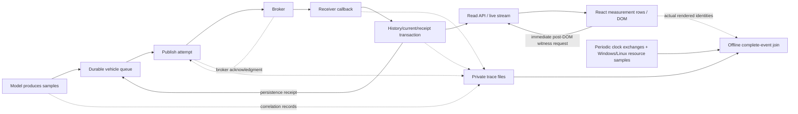

# Observation and resource measurements

The collector rehearsal passed within the scope recorded below. The [release evidence](../release/verification.md) records later one-bus latency, recovery, browser, and resource checks. Fleet endurance remains deferred.

## The problem this solves

A correctly displayed final reading does not tell us how long it took to arrive or whether intermediate readings appeared. E2-B follows each original event through the real system, measures its delay, checks complete coverage, and records the machine resources used. An event is one packet containing 20 scalar readings; a retry is another delivery attempt for the same original event.



## What is recorded

| Stage | Meaning | Important boundary |
|---|---|---|
| Sample ready | The source yields the model readings, before queue insertion | The same wall time becomes the packet's observed_at; it is not simulated time |
| Enqueue committed | The durable queue call returned | Conservative completion timestamp after SQLite commits |
| Publish attempt / return | The existing sender calls the broker client and receives its immediate result | A successful immediate return is not database storage |
| Broker acknowledgment | MQTT quality-of-service 1 confirms broker receipt | It does not authorize queue retirement |
| Receiver callback | The receiver begins handling the actual incoming packet | Repeated deliveries retain the same original event identity |
| Projection staged | Current readings have been updated inside the database transaction | A projection is a view derived from stored observations; these changes are not independently durable yet |
| Transaction committed | The database transaction context returned successfully | A conservative upper completion bound; an insert-time column is not relabeled as commit completion |
| Receipt applied | The existing sender applied the server's persistence acknowledgment | Only the existing queue checks can retire a matching pending original |
| DOM available | All 20 actual measurement rows carry the event identity and their text matches the original values/units | DOM means the rendered element tree; it does not measure a person noticing the screen |

The event ID, run, asset and source link stages. Attempt IDs separately identify retries. Every publish attempt must have a recorded immediate result and broker acknowledgment in the fault-free rehearsal. Receiver delivery counts include duplicates; generated/accepted unique-event counts do not. MQTT delivery IDs belong to each connection; do not pretend an incoming broker delivery ID is the sender's attempt ID.

## Collector tools

No extra monitoring server or runtime dependency is added. The Python standard library writes opt-in bounded JSON Lines files: each line is one complete structured JSON record. Process identity and increasing record numbers expose missing, duplicated or reordered lines. Each file is capped at 128 MiB; an enabled recorder that cannot write fails the qualification. Tracing is disabled unless the deployment provides EVDT_TRACE_FILE and a private writable volume. Raw values, packet payloads and credentials are not written to stage traces. Original packets remain separate private source evidence.

The existing Playwright browser tool drives Edge and Chromium. A MutationObserver is a browser API that reports changes to the element tree. It examines committed measurement rows, captures their event identity and actual displayed text, and records first availability once per event. The test then compares those values and units with the source originals. Downloading a snapshot is insufficient evidence of rendering. Background-tab DOM availability is included; this is not physical screen-paint or human-visible foreground latency.

The initial one-second loop missed observations because query time added to its sleep. ADR-0020 selects a 250 ms refresh budget (up to four replacement snapshots per second), subtracting query/serialization time from the wait. Source packets still arrive once per second. The interface can still coalesce intermediate states under overload; complete rendered-event coverage must be measured, and any missing observation fails. No latency threshold or event denominator is relaxed.

## Clocks explained

Wall time gives a calendar date/time. Monotonic time counts elapsed seconds without ordinary wall-clock adjustments. Simulation time belongs to the model. We use Linux monotonic timestamps for local stage intervals; the qualified containers share the same Linux kernel/boot clock domain. A future multi-host deployment requires per-domain synchronization checks.

The authenticated read-only /v1/time endpoint returns Linux receive/send wall and monotonic times. The browser records times immediately before and after the request, bounding the possible server-minus-browser clock difference. Before, periodic five-second, and after exchanges must cover the event window. Missing exchanges, inconsistent local elapsed clocks, wall-clock steps or a different Linux boot identity fail the result. The separate constant-offset calculation remains strict: inconsistent intervals or uncertainty above 50 ms make that cross-clock diagnostic inconclusive. Its failure is preserved and cannot be relabeled as synchronization. The browser uses a monotonic-backed epoch estimate and checks it against Date.now throughout. A 2 ms resolution allowance covers its initial millisecond wall-clock anchor.

For the selected primary timing method, the observer immediately sends an authenticated asset/event-bound request after verifying all 20 DOM rows. Its server receive time is later than verified display availability. Subtracting source-ready from this receive time uses one Linux monotonic clock and gives a conservative upper delay including the return-path overhead. The browser records the DOM-to-request-to-reply interval as a bound on confirmation overhead. That overhead can exceed 50 ms: it makes the conservative reported delay larger and cannot produce a false pass. The 50 ms limit applies to cross-domain clock uncertainty; that diagnostic stays inconclusive when unsuitable. The primary bound uses only one qualified Linux monotonic domain and records its resolution. Missing/invalid witnesses or timing above the ten-second deadline fail. Every event, including warmup, needs a matching witness. The server echoes identity and timestamps without storing a new observation. Do not subtract unrelated Windows/Linux origins or add uncertainty twice to an already conservative bound.

A percentile is an ordered cutoff: p95 is the value at rank ceil(0.95*n) after sorting all observations. No missing event is removed to improve p95/p99, and the 20 readings inside one event do not count as 20 independent transport delays.

## Resources explained

A cgroup is Linux's accounting boundary for a container. The Linux collector samples current memory charge, anonymous/cache breakdown, configured limit, CPU and out-of-memory counters for disjoint owned services, including sources and senders. It keeps whole-Linux memory and swap counters separately. Swap means moving pages between RAM and swap storage; calculate changes in counters, not allocated swap space. Rolling 60-second windows are evaluated at each one-second sample. Three consecutive windows above the frozen 64 MiB limit violate Q-12.

The Windows collector uses built-in Windows APIs for available physical RAM and browser process working sets, and Performance Data Helper (PDH) counters for paging rates and the protected vmmemWSL process working set. PDH exposes built-in Windows performance measurements without changing process permissions. [Windows memory API](https://learn.microsoft.com/en-us/windows/win32/api/psapi/nf-psapi-getprocessmemoryinfo), [English counter interface](https://learn.microsoft.com/en-us/windows/win32/api/pdh/nf-pdh-pdhaddenglishcounterw). A working set is physical memory currently attributed to a process. Browser and WSL process-name totals are separate labeled context and can include other sessions. Windows paging includes disk-backed file activity and is not automatically Linux swap. A cgroup charge, a process working set and host available RAM are different measurements; do not add them as though they were disjoint.

Record once per second, check sample continuity, reject counter resets and OOM, and retain clock/coverage failures. A short rehearsal records observed headroom/budget conditions; Q-12 at W1 still requires the full E2-C workload.

## Reproduce the checkpoint

In Windows PowerShell, in <checkout>:

```powershell
python scripts/dev.py check
python scripts/monitoring/qualify_measurement.py --evidence-dir evidence/p1/CHOOSE_NEW_MEASUREMENT_RUN
python scripts/monitoring/qualify_dashboard.py --evidence-dir evidence/p1/CHOOSE_NEW_REGRESSION_RUN
```

Use fresh evidence names. The controller invokes Ubuntu through the Linux launcher and native Docker Engine. Containers are started from locked images/dependencies and have private uniquely owned volumes. Qualification cleans up only its own resources.

The short rehearsal uses bus-001/002 for Edge and bus-003/004 for Chromium. Each browser observes two actual sources concurrently, with 60 warmup and 30 measured events per asset at one event/second. Expect 360 unique original events / 7,200 scalar readings across both rehearsals: 240 warmup and 120 measured events. Every original, including warmup, must appear in all required stages and in the DOM. Source and browser values/units, exact database bytes, recipes, scoped APIs, zero pending, clocks and resource coverage must agree.

Both controller and service qualification reports must pass, source fingerprints must still match, and owned cleanup must be empty. The private measurement.json contains stage distributions, attempt/delivery counts, clock bounds and resource summaries. Raw JSON Lines, policies, source packets, process/machine data, browser results, screenshots and controls remain ignored. Only reviewed aggregate results belong in public documentation.

E2-C later runs full warmup plus W0 (30 measured wall minutes) and W1 (ten simultaneous sources for one measured wall hour). Those runs retain their frozen targets and event counts; neither source acceleration nor this short rehearsal substitutes for them.

Trace headers identify `event-trace/1.1.0`; clock replies identify `clock-exchange/1.1.0`. Unknown trace formats fail. These are qualification formats, separate from the unchanged telemetry/catalog/recipe tuple. See [ADR-0020](../adr/0020-observation-stage-and-resource-measurement.md) for the failed constant-offset hypothesis, chosen local-clock upper bound and unchanged quality thresholds.


## Find the implementation

| File | Responsibility |
|---|---|
| src/evdt/monitoring/trace.py | Bounded opt-in local stage recorder |
| src/evdt/monitoring/adapter.py, transport.py, ingest.py, repository.py | Record source, queue, send/receive and database boundaries on the actual path |
| src/evdt/monitoring/api.py | Reader-authenticated clock/witness reply and elapsed-time-aware live refresh |
| qualification/browser/dashboard/measurement.spec.mjs | Verify actual rendered rows, original values/units and post-display confirmations |
| src/evdt/workload/correlation.py | Reject incomplete records and calculate conservative event/stage/resource results |
| scripts/monitoring/linux_resources.py, windows_resources.py | Read the separate operating-system/container measurements |
| scripts/monitoring/measurement_fixture.py | Coordinate owned services, source pairs and private evidence |
| scripts/monitoring/measurement_report.py | Join actual source, browser, trace and resource evidence |
| scripts/monitoring/qualify_measurement.py | Windows command entry point |

## Measured checkpoint

The final short run reconciled all 360 unique events / 7,200 scalar readings and every required rendered value/unit, with zero pending. The 120 measured event upper bounds had p95 <=1.284 s and p99 <=1.375 s. All four strict constant-offset diagnostics stayed inconclusive; the primary bound used one Linux monotonic clock and retained confirmation overhead. Application cgroups peaked near 610 MiB with zero Linux swap/OOM; Windows available RAM reached about 335 MiB and failed its observed host-headroom condition. Resource collection worked; full W1/Q-12 did not pass.

Shared checks passed 154 Python tests and 12 frontend tests, with strict types/build and 339+81 contract outcomes per language. The original monitoring/quality/history/export/map/role/old-byte/replay and complete plant regressions passed in both browsers. Current-source fingerprints and owned cleanup were checked. [Reviewed result](../verification/workload-measurement-collectors.json). E2-C first needs host-headroom preparation, then full warmup and wall-time workloads without weakening targets.

For the clock endpoint, use an Authorization header with the private reader credential. Expected negative outcomes are: no credential =>401; a witness for an asset outside reader scope =>403; only one of asset/event provided =>422; malformed event UUID =>422. These checks do not insert observations. The final owned fixture was checked against all four cases; raw request results and the API source fingerprint stay in private evidence.


## Memory ceiling versus host headroom

A memory ceiling is the maximum the Ubuntu virtual machine may use; it is not a fixed amount of physical RAM reserved in advance. Raising it lets Ubuntu compete for more of the same laptop RAM. Microsoft documents the default WSL2 ceiling as 50% of Windows physical memory. [Official WSL configuration reference](https://learn.microsoft.com/en-us/windows/wsl/wsl-config#main-wsl-settings).

A brief November 4, 2026 idle preflight found no user .wslconfig file. Linux reported about 7.62 GiB total and 6.97 GiB available, while the WSL process working set was about 1.34 GiB. Windows available physical RAM fell to about 0.48 GiB while Ubuntu was active. This was a short setup reading with no application workload, not W0/W1 or Q-12 acceptance.

The evidence supports keeping the current ceiling: Linux was not short of memory; Windows host headroom was constrained. For a later increase, verify measured guest demand and sufficient host margin first. Configuration changes can affect the WSL virtual machine beyond this project, so check their scope before applying them. Raw account/configuration/memory readings remain private. Keep the full-workload headroom target unchanged.

To reproduce the guest reading from Windows PowerShell in <checkout>, use `python scripts/linux.py -- free -h`. The `-h` option displays human-readable sizes. Read the `available` column, not just `free`: Linux can reuse some cached memory. For a meaningful Windows comparison, keep a lightweight Linux process active while sampling with the existing Windows resource collector, as the preflight did. An inactive-WSL Windows reading is not the active Linux baseline.
