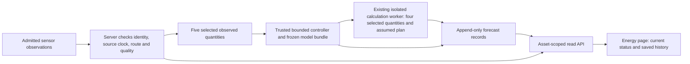

# Saved energy forecasts: learning and reproduction guide

Historical known-route energy procedure. Its original model, workload and evaluation identities remain scoped to the frozen study; pending statements below describe that checkpoint. Use the [route-aware operating guide](route-aware-energy.md) for current geographic forecasting and the [final advisory closeout](../verification/energy-advisory-acceptance.md) for the completed legacy product scope. Inspection of retained results does not authorize rerunning a consumed evaluation.

This guide explains the initial D1 design and reusable controller. For the current E1 Energy page, eight selected input quantities, station plans and complete acceptance command, use the [Energy and station guide](advisory-mission-assessments.md).

## What this adds

A measurement says what a sensor observed. A forecast says what a model expects under stated assumptions. We store them in separate tables so a later prediction can never replace a measurement. An immutable record is one whose saved content cannot be edited or deleted through the application's database permissions. A new result is another record.

An application programming interface (API) is a set of messages programs exchange. The existing monitoring API now supplies a restricted energy-input view and read-only forecast views. The dashboard's Energy page uses the read-only views. No vehicle command endpoint is added.



The fifth observed quantity is auxiliary equipment power, used to declare forward equipment demand. The calculation worker still receives only the original four observed quantities: battery energy, charge fraction, distance and speed. The assumed motion plan comes from the frozen training template, not the current trip's future movement. Scenario bounds come from the unchanged training-compatible uncertainty method. They are empirical ranges, not probability confidence intervals.

The host controller is trusted infrastructure. It can prepare inputs and invoke Docker; the isolated worker has no database credential, project mount, source recipe, Docker socket or external network. The controller's dedicated energy-input token cannot open ordinary monitoring/recipe endpoints. The writer container gets only its own database password. This preserves the worker's tested access boundary; it is not a defense against a malicious host administrator.

## Availability and the supported domain

An administrator assigns the reviewed route/release to an asset and source. An assignment is versioned by a content fingerprint and cannot be silently edited during a run. The versioned product profile fixes the initial supported route, independently declared 350-kWh capacity, illustrative 10% reserve, 60-second observation history, forecast at 120 simulation seconds and five-second latest-observation age limit. A new profile requires explicit compatibility and evaluation review.

The server obtains run/source/epoch/session identity and clock state from registered data. The source must be running, its heartbeat current and its observed quantities valid. A pause, stale observation, wrong route, missing required measurement, source restart or unsupported cutoff produces an unavailable current forecast. A heartbeat alone cannot make an old observation new. External charging exclusion is a declared operator/source-configuration assumption, not a measured charging detector.

Only the known-route simulated study is supported. Predictions at other times are outside the evaluated domain. Product records retain `model_qualified: false` and no automatic-dispatch authority after E1. The reference's conditional range/time are now visible if recent consumption continues; these are not separately calibrated driving-range guarantees. E1 also adds read-only assumed-plan station reachability.

## Storage, identity and read access

Database migration `007_energy_forecasts.sql` creates assignments, immutable forecast records and a restricted observation-reference view. A migration is a versioned change to database structure. Existing migration files are unchanged; applying an old migration with changed bytes still fails the existing guard.

The `evdt_forecast` role may read assignments and original identity/wire-digest references, and insert forecasts. It cannot read raw observation payloads, run recipes or quarantine, alter observation/clock/assignment tables, or update/delete forecasts. Ordinary API readers remain read-only; replay's database role cannot read operational forecast records. One connection slot is reserved for the writer, keeping total ordinary application admission at fifteen slots beneath the existing seventeen-slot ceiling.

Each record includes original observation event/wire fingerprints, source clock, assignment and model-release fingerprints, model/numerical versions, candidate/reference job digests and worker outputs, declared assumptions, result values or unavailability reasons, and uncertainty method/bounds. A matching duplicate is idempotent: repeating the save does not add another record. Different content claiming the same input is an error. SHA-256 fingerprints identify exact content; they do not prove physical accuracy.

With the usual Authorization header and asset scope:

| Read endpoint | Meaning |
|---|---|
| `GET /v1/energy-input?asset_id=...` | Bounded server-owned five-quantity input view; dedicated input-only credentials are accepted here |
| `GET /v1/energy-forecasts?asset_id=...&limit=20` | Latest records and independently rechecked current availability; at most fifty records/page |
| `GET /v1/energy-forecasts?asset_id=...&before=...&limit=20` | Earlier immutable records; explicitly historical, never a current prediction |
| `GET /v1/energy-forecasts/RECORD_ID?asset_id=...` | Original historical record within the authorized asset |

A stale current response hides prediction values without changing the historical record. The browser validates response identity/shape/numbers, aborts old requests on asset changes, polls at a bounded rate, and hides current values after connection loss or a response-age timeout. Credentials remain in request headers and page memory, never URL parameters or browser storage.

## Reproduce the small integration session

This is an automated temporary demonstration, consistent with Phase 1's supported local workflow. It is not a persistent deployment or a capacity/soak benchmark. Its controlled producer rebinds already-recorded **training** observations to a fresh test run, without changing the originals or claiming a new live simulator trip. Nothing regenerates or rescores the reserved held-out evaluation.

1. Open PowerShell in the repository root.
2. Once there is adequate memory for a small service/browser session, run:

   ```powershell
   python scripts/known_route_energy/qualify_energy_product.py --evidence-dir evidence/p2/YOUR-NEW-PRODUCT-CHECK
   ```

   Choose an unused evidence directory. Setup prints progress and may take several minutes while locked images build. It creates its own private credentials and uniquely named containers/storage. The browser is automated and hidden; no dashboard window is expected.
3. Expect six retained validation-preparation comparisons, one 61-packet controlled observation window, both real isolated point forecasts, an available Energy card followed by hidden stale current values, preserved history and asset switching. The session checks credential/database denial, identical-save behavior, conflicting-save refusal, pause/out-of-domain states, ordinary history/map reads and a fresh-cluster database restoration. Existing uncertainty/error limits and the five-second age limit are unchanged.
4. Normal completion prints `P2-D1 integration passed: True` or `False` and the private report path. A pass requires the report's `passed` and cleanup flags, not merely a visible card. Images of the actual available/stale page remain in the private `browser/` directory. An error or interrupted session is incomplete/failed; preserve its report and inspect it before considering a correction. Do not repeat model held-out qualification.
5. Let normal cleanup finish. The session removes only its own temporary services, volumes and networks and compares inventories with those from before the run. Do not stop Ubuntu or run a global Docker prune. If interrupted, inspect that run's private Compose environment and ownership labels before any manual cleanup.

## One forecast in an already prepared local session

The reusable controller is bounded: one input, candidate/reference calculation, optional station calculations and one saved result. Up to four isolated worker calls can run concurrently; each retains the original per-worker resource and access limits. It is not a scheduler. Run it through Linux to keep numerical execution in the qualified Python environment and avoid Windows/Linux process-launch overhead in the short freshness window:

```powershell
python scripts/linux.py -- python3 scripts/known_route_energy/run_monitoring_forecast.py --asset bus-001 --env-file .runtime/YOUR-SESSION/compose.env --project evdt-YOUR-SESSION --credential-file .runtime/YOUR-SESSION/secrets/energy_reader --evidence-dir evidence/p2/YOUR-NEW-FORECAST --wait-seconds 30
```

Use the actual existing session paths and project name; these placeholders do not create a deployment. The optional Compose overlay is `ops/compose/compose.energy.yaml`. Beforehand, an administrator must provision the exact route/release assignment and enable the writer with a fresh private password. The controller verifies frozen artifacts and unchanged worker sources, builds the guarded worker before fetching fresh input, then waits at most the requested time. A timeout with unusable input saves an unavailable outcome; authentication or integrity failure is an error, not a successful prediction.

The Energy page appears alongside Measurements, Map and History. Available values are explicitly advisory. Its saved-history table remains historical when current values disappear.

## Backup and restoration

The normal PostgreSQL archive includes the new tables, indexes, constraints, triggers, sequences, views and object permissions. Restore into an empty independent cluster using the existing recovery preflight/bootstrap. Bootstrap creates the forecast role without login; passwords are excluded from the data archive. An administrator must supply a fresh private writer credential and run `python -m evdt.monitoring.energy_views enable-writer` in the prepared admin tool environment, with `FORECAST_DB_PASSWORD_FILE` set. Do not insert a second assignment just to rotate a password. Same-disk test archives are private development evidence, not offsite or encrypted protection.

Sustained load, broader deployment/reboot/storage lifecycle and production hardening retain their Phase 6 gates. This integration does not repeat or supersede the Phase 1 capacity measurements.

The qualifier also accepts `--presentation-only` for a focused interface check after a presentation-only change. Its report explicitly excludes complete integration/backup qualification. Preserve the full report, compare exact source differences and reuse it only where behavior is unchanged; a passing focused view is never a replacement for backend evidence.
