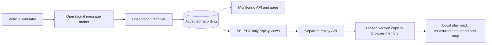

# Recording replay: understand, reproduce, and extend

P1-D1 lets a reader inspect an accepted recording using a separate viewing clock. It is a bounded local analysis feature. See [ADR-0015](../adr/0015-isolated-recording-replay.md) for decisions and [P1 status](../monitoring-status.md) for measured acceptance. A recording remains simulated evidence; replay does not make it real vehicle data. D2 additionally qualifies registered envelope 3.1.0/catalog 1.3.0/source-run 2.1.0 alongside the original 3.0.0/1.2.0/2.0.0 tuple; replay package format stays 1.0.0. See the [extension guide](sensor-and-asset-extension.md).

## What the parts do

An **API (application programming interface)** is the set of HTTP requests a program accepts. Replay runs its own API and browser entry, separate from monitoring. An **origin** is a browser address's scheme, host, and port; replay uses a different local port and different reader credentials. The monitoring link opens that independent workspace; it does not carry a credential in the link.

The arrows from the database are reads. There is no replay-to-broker arrow. A **database view** exposes a named query as if it were a table. Migration 006 adds replay views without rewriting existing observations. The `evdt_replay` database account can select these views and cannot update them, update operational tables, or create tables. Migration means a versioned database structure change; applied migrations 001–005 remain unchanged.

Docker networks decide which containers can reach each other. Replay belongs to the database and browser-access networks, not the operational network. It receives only a replay database password and replay reader list. It does not receive broker, producer, administrator, or monitoring-reader secrets. These process/credential/database/network boundaries provide isolation; a `mode` string alone would not.

## A concrete viewing example

Suppose the package covers simulation seconds 3–40. At playhead 3, show only packets at or before 3. A speed observation at 2 may initialize the display as a **seed**, meaning a before-window starting value. It retains its original timestamp and already has one second of age. A speed of zero at 4 is valid. An explicitly invalid reading at 5 replaces the previous value with unavailable; its raw diagnostic value remains inspectable. Do not silently keep showing the earlier good value.

Play at 2× advances two simulated seconds per second of elapsed computer time. Pause stops only the viewing clock. Seek pauses and recomputes from the same frozen packets. Previous/next observation moves between distinct recorded times. End clamps at the requested window end, which can include an empty/stale tail. Restart returns to the window start. The clock uses `performance.now()`, a browser clock for elapsed intervals that does not jump when wall-clock time changes. A hidden tab or scheduling gap over one second pauses playback; it does not silently jump forward after computer sleep.

“Recent in replay” compares a packet's age with its registered freshness deadline in simulation seconds. It does not assert that the original vehicle was connected. Original heartbeat health is not reconstructed. Playback pause and an original source pause are different states. No missing interval is interpolated. Trajectory coordinates must be a good latitude/longitude pair from the same packet; bad or absent pairs and source/time gaps break the path. Known route/station context can be shown immediately; observed future movement cannot.

## What freezes, and what is verified

`POST /v1/replay/sessions` requests a copy, not a database write. A **read-only repeatable-read transaction** gives all of its database queries one consistent view while it collects:

- The selected asset and configured source run's bounded observations plus needed before-window seeds.
- Original packet bytes, wire SHA-256, observation/receipt/persistence timestamps and source revisions.
- Referenced original source recipes, asset-scoped signal definitions/timings, catalog fingerprint and optional assigned map context.

**SHA-256** produces a content fingerprint. **Base64** represents binary bytes using text characters so the exact original packet bytes can travel inside JSON without rewriting them. The API checks stored bytes against their fingerprints and the source contract. The browser checks the complete response fingerprint and each included packet/recipe/context fingerprint, identities, supported versions, ownership, finite values, bounds and qualities before displaying anything. A recomputed outer fingerprint does not conceal a changed inner packet. Fingerprints prove consistency with the supplied fingerprints, not independent remote authenticity.

The browser then recursively freezes the decoded session in memory. Each session receives a new replay run ID and `replay/<id>` namespace while preserving its original source run/revision. Original source packets keep `mode=simulation`; the surrounding analysis package has `mode=replay`. Nothing is inserted into operational history. Later ingress does not alter an open session; creating a new session can include it. Close, reload or asset/window change clears playback. Tokens are memory-only; local/session browser storage is unused.

Playback uses retrospective simulation-time ordering. A late-arriving packet already in the frozen source revision appears at its original simulated time. This does not reproduce the order in which network deliveries originally reached the server. Original UTC arrival times remain in the provenance inspector. This distinction matters when investigating delivery outages.

## Supported boundaries

| Item | Initial support |
|---|---|
| Package / recipe / source envelope / catalog | 1.0.0 / source-run 2.0.0 / 3.0.0 / verified registered catalog, initially 1.2.0 |
| Source scope | One configured source run per replay deployment; authorized assets only |
| Copy limits | At most one simulated day, 10,000 selected/seed packets, 8 MiB original packet bytes, 16 MiB serialized response |
| Time / qualities | Recorded simulation time; good, missing, invalid; unknown before any signal observation |
| Historical artifacts | Require original registered recipe and catalog bytes matching policy; fail if unavailable or inconsistent |
| Maps | Optional original immutable context; no online tile dependency |
| Storage | Browser memory only; no import, saved replay session, or archival restore service |
| Control | No observation publishing, source configuration or command dispatch |

The caps bound individual work; they are not a measured large-workload throughput claim. Historical pre-registration envelopes remain readable in their original monitoring compatibility paths but are not automatically made replayable by inventing a missing recipe. Pre-C1 mislabeled heading recordings retain their existing limitation. No new runtime library was added; the frontend uses the existing React/TypeScript/Leaflet tools and the browser's built-in cryptography.

## Reproduce the checks

Run these in Windows PowerShell at `<checkout>`, keeping the desktop agent Windows native. Prerequisites are the qualified Ubuntu launcher/native Docker Engine, pinned images and existing Windows browser tooling described in the earlier setup guides.

1. Run `python scripts/dev.py check`. It builds the pinned checks image, scans candidate files for private data/secrets, then runs formatting, Python tests, strict TypeScript, frontend logic tests and historical/shared contract checks. Success prints `Checks passed: True` and an ignored report path.
2. Run `python scripts/monitoring/qualify_dashboard.py --evidence-dir evidence/p1/YOUR_NEW_D1_DIRECTORY`. Choose a new directory under `evidence/p1`; the script refuses an existing directory. The controller automatically starts a uniquely owned temporary service fixture through WSL, exercises the original monitoring and quality/clock suites, then replay in visible Windows Edge and automated Chromium.
3. The tests exercise real read APIs/database roles and broker denials, compare original bytes/times, check playback without network requests, send an additional real controlled observation to prove the loaded session stays frozen, and test a new session/tampering/scoped credentials. They also repeat source missions and verify owned cleanup. Expect a final `Dashboard passed: True`; inspect that directory's `qualification.json` and nested `services/qualification.json` for actual scope. Failed runs stay separate; do not relabel old evidence after source changes.
4. Review desktop/mobile replay screenshots in the new evidence directory's `replay` subfolder. These private artifacts are ignored by Git. Browser fixtures are removed after the run; these scripts do not leave a persistent demo running or back up private recordings.

The separate broker observer used for a negative publication test exists only in the test probe. Its password is never mounted into the replay service. The actual replay container is also tested for broker DNS/TCP isolation. Unchanged operational database fingerprints around read/negative tests and zero playback requests are separate checks. They do not establish safety of a future operational executor; that requires P3's command/effect tests when such a component exists.

## Extend without coupling replay to operations

Generic measurement display and history come from the scoped catalog. Adding a compatible scalar does not require a signal-specific playback control. Navigation is an optional capability requiring canonical coordinate signals; the map renderer accepts values and never fetches live data itself. Keep new playback analysis functions pure: input a frozen session and playhead, return display data. Keep live fetch/subscription hooks out of this entry. A new format requires explicit reader validation, compatibility tests and requalification; do not silently accept unknown versions. A future export/import or saved-session feature needs its own storage, rights, integrity and resource decisions.

Primary technical references: [browser elapsed-time clock](https://developer.mozilla.org/en-US/docs/Web/API/Performance/now), [browser SHA-256 operation](https://developer.mozilla.org/en-US/docs/Web/API/SubtleCrypto/digest), and [Vite multiple-page builds](https://vite.dev/guide/build.html#multi-page-app). These explain the underlying platform features; project-specific behavior is defined by the ADR, source and tests.
