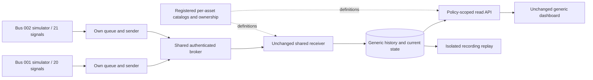

# Adding a scalar sensor and a second modeled asset

This guide explains P1-D2. Read [ADR-0016](../adr/0016-sensor-and-asset-extension.md) for design choices and [P1 status](../monitoring-status.md) for measured acceptance. Tests described here are requirements until their actual result is recorded.

## The engineering question

The **signal catalog** is the dictionary of measurement IDs, units, ranges, component locations and model evidence. A **schema** is the rulebook for a message's structure. The **adapter** is the source-side code that turns a device or simulator reading into that message. The shared receiver, database and browser use these definitions to handle supported signal types.

For example, `coolant.inlet.temperature` means the temperature of coolant supplied to the simulated vehicle. Its canonical unit is kelvin (`K`), an absolute temperature scale: subtract 273.15 to obtain degrees Celsius. 293.15 K equals 20 °C. Storing a consistent unit prevents accidental mixing; displaying a different unit requires an explicit conversion.

The earlier system already had generic scalar storage and UI, but operational catalog/version selection still assumed 1.2.0. Preparation commit `d2edc52` first made that selection explicit per registered asset. It added policy-bound catalog reads, supported format metadata, matching TypeScript reader schemas, registry/replay format selection and queue format binding. The preparation has its own checks. It is not honest to claim that this older boundary required no preparation.

After preparation, `qualification/extension/shared-core.json` freezes 54 existing shared files: the contract engines, monitoring modules excluding source/adapter/recipe bindings, all dashboard source, and database migrations. The extension qualifier checks every frozen fingerprint before and after the real run. **SHA-256** is the content fingerprint used here; changing a file changes its fingerprint. New adapter/model code, reviewed catalog/schema/profile data, scenarios and qualification code are outside this freeze. A future shared-code change needs a reviewed new baseline and requalification; do not silently refresh fingerprints to conceal a sensor-specific core edit.

The frozen content is taken from the preparation commit. The guard normalizes Windows CRLF line endings to Linux LF before hashing; every other content byte remains significant. This avoids treating the same source text as an implementation change when checking out on a different operating system. Raw packet, recipe, historical fixture and run-evidence hashes keep their existing exact-byte semantics.

## What changes where

| Layer | Extension | Shared behavior being exercised |
|---|---|---|
| Catalog/format metadata | Catalog 1.3.0, envelope 3.1.0 and source recipe 2.1.0; old artifacts preserved | Explicit version dispatch and rejection of unsupported pairs |
| Adapter model | `coolant_adapter.py`, selected through the source's optional boundary hook | Existing generic sampling and quality logic |
| Scenario | Independent bus-002 parameters and optional sensor configuration | Same scheduler/plant implementation with its own state |
| Source identity/queue | Own asset/session, 1.3.0 format, queue volume and publisher credential | Existing durable queue, immutable format binding and receipts |
| Receiver/database | No sensor-specific change after the freeze | Validation, registration, ownership, history/current/sample projections |
| HTTP API/browser | No code change after the freeze | Asset-specific definitions, all-measurements view, history, export and replay |

Migrations 001–006 remain unchanged. A scalar is stored as a value with a signal ID; adding this scalar needs no new database column. A genuinely different data type, such as a vibration waveform, would need its own design and compatibility work.



## The two modeled vehicles

Both sources step actual SUMO vehicle and battery states. They run in separate simulator processes on the reviewed Montreal network. Each owns its source clock, battery ledger, dependent thermal state, recipe, queue, sender and map assignment. The second bus uses the same qualified physics implementation with different parameters; it is not another adapter implementation or a traffic-interacting fleet simulation.

| Assumption | Bus 001 | Bus 002 |
|---|---:|---:|
| Loaded mass | 18,000 kg | 15,000 kg |
| Usable battery capacity | 350 kWh | 300 kWh |
| Initial charge fraction | 0.80 | 0.65 |
| Constant pack voltage | 650 V | 600 V |
| Maximum road speed | About 13.889 m/s | 10 m/s |
| Acceleration limit | 1 m/s² | 0.7 m/s² |
| Aggregate auxiliary demand | 8,000 W | 6,500 W |
| Ambient temperature | 293.15 K | 283.15 K |
| Scheduled stop duration | 10 s | 15 s |
| Scalar catalog | Original 20 signals, 1.2.0 | 21 signals including inlet temperature, 1.3.0 |

These are project assumptions, not vehicle manufacturer specifications. Independent motion/energy/session checks distinguish the two instances. Repeatability and energy balance show numerical consistency; they do not establish real-bus accuracy. The old controlled bus-002 producer remains a protocol/UI fixture in the regression suite and is not counted as this modeled asset.

## How the inlet boundary works

The new observation models an externally conditioned coolant supply. Its target is ambient temperature plus a configured offset. At each completed simulation step:

`new_temperature = target + (previous_temperature - target) × exp(-step_seconds / response_time_seconds)`

This is the exact response of a first-order lag while the target is constant: temperature approaches the target gradually without overshooting. Bus 002 starts at 300.15 K, targets 293.15 K and uses a 60-second response time. Unit and full-run checks compare every step with the analytic response.

This external boundary does not feed back into the existing pack/motor equations. It is not a closed coolant circuit, radiator/pump energy model or calibrated sensor. P5 physical coupling/calibration remains separate. SUMO still owns battery energy; the new observation never integrates a competing battery state.

The sensor publishes every two simulated seconds, while the original 20 channels publish every second. Its registered freshness deadline is six seconds. For controlled acceptance, the source marks the reading at 4 s missing and the reading at 8 s invalid. The invalid reading retains its finite diagnostic raw value. These schedules are adapter test configuration, not fault-diagnosis labels delivered as observations. The recipe contains fingerprints and declared timing, not hidden future schedules.

## Identity, formats and scope

Keep each source's schema/catalog pair explicit. Bus 001 retains 3.0.0/1.2.0 with source-run 2.0.0; bus 002 uses 3.1.0/1.3.0 with source-run 2.1.0. Envelope field meanings remain consistent, but the new dictionary requires explicit compatibility selection. Historical files are never edited to make the new version fit.

The default catalog endpoint reports `catalog_version=mixed` when authorized assets use different catalogs. Use `/v1/catalog?asset_id=bus-002` to retrieve that asset's registered definitions. Snapshot/history/export selection follows the trusted per-asset policy and verifies the original catalog fingerprint. The generic browser takes measurement definitions from its selected snapshot. It can show 20 readings for one asset and 21 for another without a coolant-specific widget.

Each asset has a separate broker publisher permission and producer/reader scope. A broker is the message-routing service. Its access rules prevent bus 001's publisher from writing bus 002's topic. API checks independently prevent a bus-only reader from querying the other asset. Asset-scoped query cursors cannot be reused across vehicles. Dedicated sender diagnostic mapping prevents one bus's queue being presented as another bus's health.

A used queue is bound to its run/asset/source and schema/catalog pair, even after it drains. Changing the catalog needs an explicit new-run/queue decision. A legacy used empty queue without stored format metadata cannot establish its old format and requires an explicit migration; the code does not guess or delete it.

## Reproduce the checks

### Bounded release check

From the project root in Windows PowerShell, run the following commands. Choose a new evidence folder for each attempt.

```powershell
python scripts/linux.py --timeout 1000 -- python3 scripts/release/prepare_simulation.py --dashboard
python scripts/release/qualify_restarts.py --case sensor-extension --output evidence/p6/extension-review
```

The first command builds the dashboard for the current source. The second runs the memory and disk checks, then sends 16 messages from each simulated bus through the ordinary broker and receiver. It compares all saved readings with the source, checks scoped monitoring and replay access, and removes its temporary services. Review `qualification.json` for the outcome. The reported startup time excludes image preparation. The source runs without wall-time pacing, so this check measures correctness and isolation.

The separate browser check opens the built dashboard in the pinned local Chromium browser. It uses the recorded final readings and the signal catalog to form offline snapshots. This keeps the browser separate from the two-bus services while exercising the actual measurement rows. Set up the [local browser tools](dashboard.md) first. The temporary container below copies only the built files from the exact image named in the service report.

```powershell
$out = 'evidence/p6/extension-review'
$image = (Get-Content "$out/qualification.json" -Raw | ConvertFrom-Json).worker.checks.dashboard_image_id
$target = "$out/dashboard"
New-Item -ItemType Directory -Path $target
python scripts/linux.py --timeout 60 -- python3 -c 'import subprocess,sys; from pathlib import Path; target=Path(sys.argv[1]).resolve(); subprocess.run(["docker","run","--rm","--network","none","--read-only","--memory","64m","--mount",f"type=bind,source={target},target=/export","--entrypoint","/bin/sh",sys.argv[2],"-c","cp -r /app/dashboard/. /export"],check=True)' $target $image
$env:PLAYWRIGHT_BROWSERS_PATH = (Resolve-Path .runtime/playwright-browsers).Path
node.exe scripts/release/check_extension_ui.mjs $out
```

Success creates `extension-browser.json` and a screenshot in the evidence directory. [Bounded service and browser results](../verification/signal-extension.json)

### Recorded-input adapter

The alternate adapter reads the exact recorded simulation values and submits a new experiment through the same registration, durable queue, broker, and receiver. A new run and new credentials keep the experiment separate. Each new message names the original event and its fingerprint. The adapter checks the recorded recipes and message bytes before publishing.

From the project root in Windows PowerShell, use a passing two-bus recording from the bounded check above. Keep its ignored runtime settings available for the negative credential test. Choose a new output directory.

```powershell
python scripts/release/qualify_restarts.py --case recorded-experiment --recording evidence/p6/extension-review --output evidence/p6/experiment-review
```

Expect a host precheck followed by two bounded producers. A successful report shows 16 messages per asset, exact sample and lineage matches, four refused registration writes, four refused broker writes, and empty queues after delivery. The controller removes its temporary services. [Recorded-input results](../verification/recorded-experiment.json)

### Original two-browser qualification

Run commands in Windows PowerShell at `<checkout>`, keeping the desktop agent Windows native. Linux execution uses the existing Ubuntu launcher and authorized native Docker Engine.

1. Run `python scripts/monitoring/extension_scope.py`. Success prints `passed: true` and the frozen file count. A mismatch identifies the changed shared file; review the design before making a new baseline.
2. Run `python scripts/dev.py check`. Expect `Checks passed: True`. It covers original/historical compatibility, cross-language new-message cases, the analytic inlet response, source quality/cadence, queue format binding, strict TypeScript, scoped Python typing, formatting/build and privacy/secret scans.
3. Run `python scripts/monitoring/qualify_extension.py --evidence-dir evidence/p1/YOUR_NEW_D2_DIRECTORY`. Use a new directory. It builds pinned images, creates a uniquely owned temporary fixture and separate private credentials, provisions both policies/maps, then starts two actual paced vehicle sources and their separate senders. Both Windows browsers inspect current/history/export/replay, metadata, asset switches and scope. Real probes reconcile original bytes, quality/counts and permission denials. Each parameter set then completes two accelerated missions with energy and repeatability checks.
4. Inspect `qualification.json` and `services/qualification.json` under the new evidence directory. Success requires both reports to pass, frozen shared files to match and owned cleanup to leave no containers or volumes. Review desktop/mobile and replay screenshots. Reports, recordings, private credentials and screenshots remain ignored.
5. Run the existing regression separately: `python scripts/monitoring/qualify_dashboard.py --evidence-dir evidence/p1/YOUR_NEW_D2_REGRESSION_DIRECTORY`. This rechecks the original 20-signal source, outage/restart, clock/quality/migration, monitoring and replay isolation behavior after the shared preparation. Keep its evidence separate from the second-asset fixture.

The qualifiers remove their own temporary services after the run. They are not a persistent demo or backup system. Do not relabel a failed or older report after changing its tested source; use a new evidence directory.

## Add another compatible scalar later

1. Define meaning, canonical unit, range, component location, evidence and timing before coding the source. Decide whether it belongs to an existing source or a separately authorized source.
2. Add the source-side mapping/model in the adapter layer. Reuse the generic sampler, quality and clock contracts. Validate finite values and initial/failure behavior.
3. Add a new catalog artifact and explicitly supported format metadata; preserve old artifacts. Bind the trusted policy to original input hashes and nonoverlapping ownership.
4. Exercise the actual queue, receiver, database, history/export and generic browser with positive and negative cases. Include scope, units, missing/invalid values, cadence and replay. Verify the shared-code fingerprints before and after the exercise.
5. Record measured scope and limitations, then save a scanned local commit. A new sensor does not automatically add a diagnostic or control algorithm; those services need their own models and evidence.

Current qualification commands select the reviewed later E2 baseline while retaining the original D2 freeze as historical proof. E2-A adds an explicit ten-asset tuple and a separately bounded trusted policy parser; it does not rewrite D2 hashes. Fresh reports state the exact guard/current source bytes. See [ADR-0019](../adr/0019-sustained-workload-sources-and-measurement.md) and [the current source guide](sustained-workload-sources.md).
