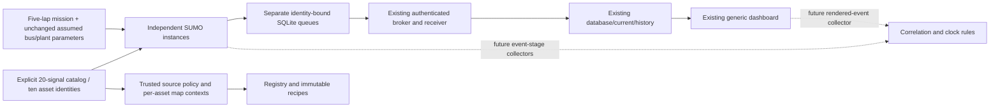

# Sustained workload sources and measurement preparation

## Source qualification sequence

The initial mission completes in about 14 simulated minutes. The sustained source joins five laps without resetting vehicle state. The later [release profiles](../../benchmarks/release-monitoring-capacity.json) define 30 measured wall minutes after 60 warmup seconds. The sequence below records source and identity qualification before live measurement.

| Checkpoint | Deliverable | What success establishes |
|---|---|---|
| E2-A | Five-lap scenario, ten explicit assets, trusted policy/maps, repeated long simulated prefixes, short paced delivery/browser rehearsal and tested measurement rules | Source and compatibility readiness |
| E2-B | Actual event/attempt/stage/browser/clock/resource collectors and short correlated rehearsals | Measurement readiness |
| E2-C | Complete W0 and W1 at frozen wall durations/rates with required metrics | Workload acceptance, subject to the other P1 gates |

These checkpoints keep failures attributable and learning manageable. An accelerated model run or a short rehearsal cannot pass a full-duration benchmark. E3 separately qualifies the W2-sized history/query/restore fixture.

## The source architecture



SUMO, Simulation of Urban MObility, continues to own movement and battery energy. The new scenario repeats connected route edges, not recorded observations. Each lap begins from the completed prior state: traveled distance, battery energy and dependent temperatures continue evolving. There is one initial scheduled stop. No source, queue, UI or SQL physics/state algorithm is changed for the longer route.

The ten preparation assets run in separate containers and separate SUMO processes using the same assumed parameter set. Each has its own source identity, session, queue, producer token, broker principal, recipe and context. The initial rehearsal runs two at a time for host headroom. It proves ten independent identities and compatibility; ten simultaneous models and interacting road traffic are separate claims.

## Terms introduced

| Term | Meaning and use here |
|---|---|
| Warmup | Initial time for connections/caches to settle; its event IDs and counters are separate from measured workload totals. Full runs require 60 wall seconds outside measurement. |
| Sustained mission | A driving scenario long enough for the requested run without resetting the vehicle at route boundaries. |
| Catalog | The agreed dictionary of signal names, units, locations and permitted assets/sources. |
| Format tuple | An explicitly supported envelope/catalog/recipe version combination. Here it is 3.2.0 / 1.4.0 / source-run 2.2.0. |
| Trace fingerprint | SHA-256 over a defined ordered sequence of numeric model results. Equal fingerprints check repeatability, not real-bus accuracy. |
| Event correlation | Linking a generated observation's identity to its later queue, delivery, storage and rendered stages. |
| Percentile | An ordered cutoff; p95 means at least 95% of observations are at or below it. Use the complete event set, not an average of window percentiles. |
| Clock offset | How far one clock's reported time is ahead of another. A bracketed request/reply exchange bounds it. |
| Clock uncertainty | The remaining range of possible offset. Add it to latency bounds; more than 50 ms makes cross-clock acceptance inconclusive. |
| Event conservation | Every unique generated event must have exactly one accepted/quarantined/dropped/pending disposition. Attempts and duplicates have separate counters. |

## Version and configuration decisions

Catalog 1.4.0 contains bus-001 through bus-010 and preserves the exact 20 initial signal definitions. New envelope 3.2.0 and source-run 2.2.0 schemas explicitly bind to it. Earlier artifacts and the original default tuple remain unchanged. All new artifacts are frozen by the monitoring integrity manifest.

The trusted ten-source startup configuration is larger than a telemetry packet. It has a separate 1 MiB portable-JSON bound; live telemetry, source registration and clock message limits stay unchanged. Duplicate keys, invalid UTF-8, excessive nesting, unsafe numbers and ownership conflicts still fail. This is a startup file provisioned by the administrator, not a new policy-upload API.

The historical D2 freeze is retained. E2's guard verifies 52 unchanged files, five exact profile additions and one exact reviewed policy-parser change recorded with old/new hashes in `qualification/workload/core-changes.json`. It does not overwrite old baseline hashes or accept arbitrary core changes. See [ADR-0019](../adr/0019-sustained-workload-sources-and-measurement.md).

The normal extension/restore/outage commands automatically select that reviewed current baseline. The original `extension_scope.py` remains an exact historical D2 comparison and intentionally differs after approved later changes; do not alter its hashes to make it pass. Fresh qualification evidence always records the current bytes and selected baseline.

## Reproduce E2-A from Windows PowerShell

In `<checkout>`:

```powershell
python scripts/dev.py check
python scripts/monitoring/qualify_workload_sources.py --evidence-dir evidence/p1/CHOOSE_NEW_SOURCE_RUN
python scripts/monitoring/qualify_dashboard.py --evidence-dir evidence/p1/CHOOSE_NEW_REGRESSION_RUN
```

Use fresh evidence names; earlier attempts are preserved. Keep Windows-native agent mode. The source controller invokes the existing Linux launcher and locked container toolchain, then uses the already qualified Windows browser tools. No second source checkout or global app setting change is involved.

The preparation command builds current images, derives the policy/map context, checks two 1,860-sample and two 3,660-sample accelerated model prefixes, and then runs 30 actual paced observations for each of ten assets in batches of two. It verifies every original packet/recipe, all 20 signal rows per asset, zero pending, scoped API/broker access and existing desktop/mobile rendering in Edge and Chromium. The independent model prefixes also check continuous multi-lap movement, energy/electrical/SOC/heading consistency and numeric repeatability.

Require both top-level and service `qualification.json` reports to pass, unchanged source fingerprints, reviewed-core guard success and empty owned container/volume cleanup. Browser screenshots and raw policies/coordinates/packet traces stay private under ignored evidence/runtime folders. The separate regression command verifies the earlier monitoring/replay path against the current compatible runtime. It uses the original short scenario; it is not the new fleet workload.

## What the measurement library does so far

`evdt.workload.measurement` implements strict nearest-rank percentiles, bounded clock exchange arithmetic, disjoint unique-event accounting and complete generated/rendered event-set checks. It rejects missing events, inconsistent/over-uncertain clocks and invalid bounds. Tests check that a negative or invalid clock uncertainty cannot create an artificially favorable latency.

These are pure functions: they calculate results from their inputs without contacting a service or changing stored state. That lets us check the mathematical rules before connecting real collectors. `OffsetBound` is a small Python data record holding the lower and upper possible clock offsets; its uncertainty is half the width of that interval.

At the E2-A checkpoint this was calculation code. E2-B still needed actual collectors, source/publication attempt and receiver/persistence/projection timestamps, authenticated periodic clock exchanges, rendered event identities, missing-event deadlines and host/container/swap sampling. Pre/post clock agreement alone does not rule out an intermediate clock step. Snapshot arrival alone does not prove that every event reached the rendered browser element tree, called the DOM. Screenshots of final values do not measure live availability.

Before full W0/W1, E2-B must prove complete event coverage in a short rehearsal. E2-C then uses full warmup and wall durations; model acceleration cannot replace them. Q-05's five-signal/one-hour historical query still needs E3's larger query/aggregation work, and Q-12 host headroom/resource limits remain unpassed until measured under the actual workload.

## Measured E2-A result

The final November 3, 2026 checkpoint passed. Each 1,860-sample prefix checked 9,299 physical intervals; each 3,660-sample prefix checked 18,299. Both repeated numeric hashes matched. The ten-asset short rehearsal reconciled 300 original events / 6,000 scalar readings, with zero pending, exact recipes/bytes, independent containers, scoped API/broker/context checks and both browsers' generic desktop/mobile display. Original monitoring/replay regression passed again. All owned test containers/volumes were removed.

The final shared suite passed 113 Python tests, 12 frontend tests, strict TypeScript/four scoped Python modules, formatting/build/privacy/secrets and 339+81 contract outcomes per language. All final source fingerprint sets matched. [Reviewed result](../verification/workload-source-readiness.json). The subsequent collector, short-run, and one-bus endurance results are recorded separately. [Measurement guide](observation-measurement.md) · [Release evidence](../release/verification.md)
