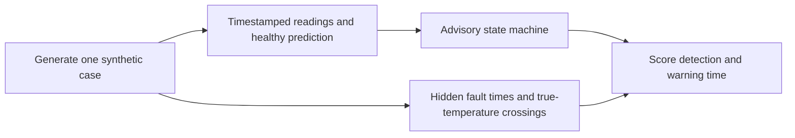

# Synthetic thermal fault qualification

A motor can read hotter than expected because cooling weakened or because the sensor is reading high. The monitor compares each new temperature with a healthy prediction. That difference is the **residual**. A large residual that persists warrants an advisory. A second simulated probe on the motor housing can corroborate the rise. A single probe supports an abnormal-temperature warning with the cause marked ambiguous.



## C1. Fault catalog and reference cases

The standalone bus fixture has a motor temperature and a housing temperature. Heat flows between them and leaves through the housing. Cooling loss reduces the housing's heat transfer to the environment. The independent housing probe has its own simulated noise. The existing bus monitor's aggregate motor channel supplies the single-probe design boundary. The two-probe study uses an additional fixture-only reading. Every case runs at one sample per second with independent variations in load, ambient temperature, heat, and the plant's thermal parameters. The healthy reference predicts temperatures from the initial readings and observed load and ambient inputs. A matched healthy run with the same simulated plant and load isolates whether a fault caused the true temperature to cross the reference limit.

| Case | Injection and expected handling |
|---|---|
| Healthy | Vary load and ambient conditions. Count alert episodes after warmup. |
| Cooling loss | Reduce housing heat-transfer conductance to 18–34% of nominal for the rest of the case. Seek a corroborated warning with two probes. |
| Step bias | Add or subtract 6.5 K from the primary reading. Flag an abrupt measurement change as sensor suspicion. |
| Slow bias | Ramp the primary reading up by 7.5 K over 135 seconds. Flag the temperature deviation with the cause ambiguous. |
| Dropout | Omit the primary reading for a bounded interval. Report unavailable and start persistence over on recovery. |
| Stale input | Repeat the last reading with its original observation time. Repeated values cannot advance timers, and their age eventually exceeds five seconds. |
| Cooling loss plus dropout | Interrupt the primary reading while cooling deteriorates. Requalify evidence after fresh readings return. |
| Cooling loss plus step bias | Compromise the primary probe after cooling starts. Preserve sensor suspicion and abstain from attributing cooling after the bias. |
| Single-probe cooling loss | Supply only the motor reading. Warn about the persistent deviation with an ambiguous cause. |

Development and reserved cases use disjoint seeds. A seed is a fixed starting number that lets the simulator reproduce a set of variations. Each partition has 48 cases. The reference limit of 354 K applies only to this synthetic experiment. [Scenario protocol](../../qualification/thermal/synthetic-fault-protocol-1.0.0.json)

## C2. Timing and decision rules

A **state machine** records the current decision and updates it when new evidence arrives. Persistence uses elapsed time across consecutive eligible samples. Hysteresis uses a lower threshold to clear an alert than to start it. This avoids switching states as a reading hovers near the trigger. Losing housing corroboration downgrades an active thermal advisory to ambiguous. A primary sensor step latches suspicion until the session resets. Time gaps or unavailable primary readings clear the timing evidence. The interface returns advisory states and reasons.

The RTAMT comparison uses a past-time rule. It checks whether the cooling evidence predicate stayed true throughout the preceding persistence window. The comparison waits for a complete window and checks that both implementations report corroborated cooling on the same ticks. The state machine tests also cover freshness, gap handling, sensor suspicion, ambiguity, and clearing. [RTAMT interface](https://github.com/nickovic/rtamt)

## C3. How the measurements work

Healthy false alerts count new alert episodes per simulated operating hour after warmup. Cooling detection delay starts at the known fault onset. Warning lead is the time from the first thermal advisory to the hidden motor temperature crossing 354 K. It applies where the matching healthy case stays below the limit. An ambiguous single-probe warning counts for lead time while remaining separate from a corroborated cooling attribution. The scoring also counts wrong cooling attributions, unavailable-window violations, and cases that fail to report sensor suspicion or ambiguity.

From Windows PowerShell in `<checkout>`, use the existing analysis environment with Python 3.13.7, NumPy 2.4.3, and SciPy 1.17.1. The monitor itself uses Python's standard library. Run the local tests and evaluate development cases with a fresh report path.

```powershell
$env:OPENBLAS_NUM_THREADS = '1'
python -m unittest discover -s tests/thermal -p 'test_thermal_advisory.py' -v
python scripts/thermal/qualify_thermal_faults.py develop --report evidence/p5/my-advisory-development.json
```

For the independent comparison, install RTAMT 0.4.10 in an ignored Python 3.12 environment. A virtual environment keeps this tool's packages separate from the project application and the scientific Python installation. RTAMT uses ANTLR to parse its rule language. The published ANTLR version requires the older Python environment. The project already uses its Windows-to-Ubuntu launcher for this step.

```powershell
python scripts/linux.py -- bash -c 'python3 -m venv --copies .runtime/p5-rtamt && .runtime/p5-rtamt/bin/python -m pip install rtamt==0.4.10'
python scripts/linux.py -- .runtime/p5-rtamt/bin/python scripts/thermal/check_rtamt_thermal_rule.py --development evidence/p5/my-advisory-development.json --output evidence/p5/my-rtamt-check.json
python scripts/thermal/qualify_thermal_faults.py inspect
```

Expect a selected development rule, five passing RTAMT comparison traces, and the location of the original reserved report. The `freeze` mode binds the passing development evidence and RTAMT comparison to a release. The `reserved` mode requires that release to be committed and records a claim before generating reserved scenarios. Preserve the original claim and results. Use `inspect` for subsequent review.

The development screen selected the 20-second rule with a 3.5 K motor residual and a 2.5 K housing residual. The minimum measured warning lead was 94 seconds across 12 fault-induced crossings. The longer persistence candidates also passed, with 76- and 58-second minimum leads. Seventeen Phase 5 checks passed, including nine advisory tests. The RTAMT comparison matched on all five traces. [Development evidence](../verification/synthetic-advisory-development.json)

## Reserved results

The frozen monitor passed all eight checks in its single run across 48 reserved scenarios. The result covers the declared load and noise ranges and the tested cooling losses, which left 18–34% of the housing's nominal heat transfer. The limited healthy exposure gives an observed false alert rate for these scenarios.

| Metric | Frozen limit | Reserved result |
|---|---:|---:|
| Healthy alert rate | ≤0.2 per hour | 0 alerts in 8.27 hours |
| Alerts before injected faults | 0 | 0 |
| Missed cooling cases eligible for two-probe corroboration | 0 | 0 of 8 |
| Longest time from cooling loss to corroborated advisory | ≤390 seconds | 306 seconds |
| Fault-induced reference crossings with earlier warning | At least four crossings, all warned | 12 of 12 |
| Shortest warning lead before the reference crossing | ≥45 seconds | 78 seconds |
| Unexpected cooling attributions | 0 | 0 |
| Missing sensor suspicion or ambiguity reports | 0 | 0 |
| Unavailable-window violations | 0 | 0 |

The eight cases with ambiguous advice consisted of four slow biases and four cooling losses with only the motor probe. The abrupt bias cases remained sensor-suspect, including all four combined cooling and step-bias cases. The monitor suppressed its thermal advice during missing or stale windows and rebuilt the evidence window after fresh samples returned. [Frozen release](../../qualification/thermal/synthetic-advisory-release-1.0.0.json) · [Measured results](../verification/synthetic-advisory.json)

The next stage of the experiment uses the frozen advisory to qualify a scoped, expiring simulated cooling boost. [Intervention guide](synthetic-thermal-intervention.md)
