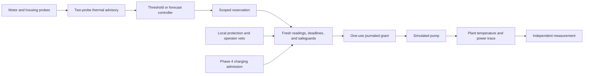

# Test a bounded cooling intervention in simulation

P5-D asks whether the digital twin can request cooling, whether that action changes the motor temperature, and how the request interacts with a charging diversion. The fixture is a small simulated mission with a motor temperature, a housing temperature, and a virtual pump. A simulated asset gives us repeatable tests for faults and race conditions without connecting a vehicle.

## Follow one cooling request



The advisory asks whether two independent readings agree that cooling may have degraded. The **threshold controller** asks whether the measured motor temperature has reached 351.5 K. The **predictive controller** fits a straight line to the recent measured temperatures and estimates how hot the motor could get 60 seconds later. It uses 26 readings spanning 25 seconds and limits the fitted rise. The prediction is an early trigger. The same corroboration, freshness, and interlock rules still apply.

The reservation is permission to ask for a grant for one specific run and bus. It gives the actuator no permission by itself. A **lease** expires at a fixed deadline. The grant window closes at two simulated seconds or three elapsed real seconds. A separate freshness check requires both readings for the current simulation tick and a frame received less than two real seconds ago. The simulator checks the lease again just before first use. This prevents a grant that finished late from starting the pump. During the boost, losing a current probe, detecting bad evidence, an operator veto, or local protection stops it. [Command boundary](../../scripts/thermal/thermal_intervention.py)

**SQLite** is a database built into Python that can keep a local ledger in a file. Here it records a one-use grant before the actuator can consume it. Restart tests reopen an actual file and verify that spent grants and vetoes persist. The offline mission sweeps use an in-memory database for each simulated mission. The active boost state is intentionally short lived and is discarded on restart.

## Read the experiment

| Measurement | How it is obtained |
|---|---|
| Isolated motor cooling | At 120 seconds after grant, subtract the measured motor temperature from a no-boost replay with the same weather, heat inputs, and recorded local load reductions. |
| Thermal exposure | Add the temperature above 350 K each second. Convert the result to kelvin-minutes. For example, one minute at 352 K contributes 2 K·min. |
| Energy | Integrate modeled base and pump power over the mission. Report total energy and pump energy separately in kilowatt-hours. |
| Delay | Compare time to finish with the 1,320-second full-speed mission. The local safeguard slows mission progress when the motor overheats. |
| Failures and incomplete missions | A rejected requested handoff or inconsistent trace fails the case. A mission reaching the time limit without finishing is incomplete. Delay is reported only for completed missions. |

The isolated measurement holds the load response equal to identify the pump effect. The whole-mission comparison lets each run's local protection react to its own temperature. An earlier boost can consume more pump energy while reducing the time the motor runs hot or the time the vehicle spends at reduced power.

The three strategies start with the same simulated weather, loading, fault, and noise for each seed. A seed is the number that reproduces the same randomized scenario. The development and reserved groups use different seeds. Bias, dropout, stale readings, and single-probe cooling cases check whether degraded evidence could produce a grant. The forecast error and coverage are measured against future temperatures in the local-protection-only arm before enabling predictive action. Coverage is the measured fraction of forecasts within ±3.5 K. Forecasts overlap in time, and the resulting coverage applies to these trajectories.

## Reproduce development and coordination checks

In Windows PowerShell, open the project folder and use the same scientific runtime as P5-C with Python 3.13.7, NumPy 2.4.3, and SciPy 1.17.1. The production charging check imports the project's JSON Schema library, which validates structured data. Put its pinned dependencies and Ruff, a Python code and formatting checker, in an ignored folder using the `uv` package installer. Run the first line once if the folder has not already been prepared.

```powershell
uv --no-cache pip install --python 3.13 --target .runtime/p5-control-win313 jsonschema==4.26.0 attrs==26.1.0 jsonschema-specifications==2025.9.1 referencing==0.37.0 rpds-py==2026.9.1 ruff==0.17.3 typing-extensions==4.16.0
$env:PYTHONPATH = 'src;scripts/thermal;.runtime/p5-control-win313'
$env:OPENBLAS_NUM_THREADS = '1'
python -m unittest discover -s tests/thermal -v
python -m unittest discover -s tests/charging -p 'test_charging_dispatch.py' -v
python scripts/thermal/qualify_thermal_intervention.py develop --output evidence/p5/my-intervention-development
```

`PYTHONPATH` tells Python where to find the project modules and local dependencies. `OPENBLAS_NUM_THREADS` keeps the numerical library on one computation thread for these small calculations. The first test command checks thermal behavior and the second exercises the unchanged Phase 4 diversion admission rules. The development command creates a new folder with a forecast-gate record, per-mission numerical traces, and a result summary. Use a fresh output name for another development run.

The `freeze` action requires a passing report and saves its fingerprints in a release. The `reserved` action requires the committed release and matching sources and runtime. It records an exclusive attempt marker before evaluating the reserved cases. Preserve the original marker and report. For review, use the measured results linked from the project plan.

## Reserved results

The forecast passed before predictive cooling was enabled. Across 1,590 scored predictions, mean absolute error was 1.30 K, and 99.31% fell within ±3.5 K. The frozen limits were 1.75 K and 95% coverage. The minimum isolated cooling effect at 120 seconds was 1.46 K for threshold control and 2.05 K for predictive control. Each strategy met the 1 K target in all eight eligible cases.

| Mean across eight cooling-loss scenarios | Local protection only | Threshold boost | Predictive boost |
|---|---:|---:|---:|
| Peak motor temperature | 359.48 K | 356.94 K | 354.60 K |
| Heat exposure | 62.57 K·min | 39.20 K·min | 19.28 K·min |
| Total mission energy | 25.904 kWh | 25.928 kWh | 25.737 kWh |
| Energy for the boost | 0 kWh | 0.034 kWh | 0.079 kWh |
| Mission delay | 184.1 s | 152.8 s | 54.8 s |

All 72 runs completed. Each cooling policy produced eight grants across 24 scenarios, all in the cooling-loss group with intact sensors. Predictive grants came 40 to 123 seconds earlier than threshold grants and lowered exposure in all eight matched cooling-loss cases. Delay fell in seven of the eight. The simulated power and delay results depend on the selected load model and local protection settings. [Verification record](../verification/thermal-intervention.json)

The coordination tests covered operator veto, local protection, probe freshness, exact deadlines, exclusive cooling and diversion, and opening the grant journal again. The qualified boundary exercises the existing Phase 4 charging checks with synthetic departure and station inputs. Vehicle actuation, networked charging and cooling coordination, and real bus energy savings require separate evidence.
